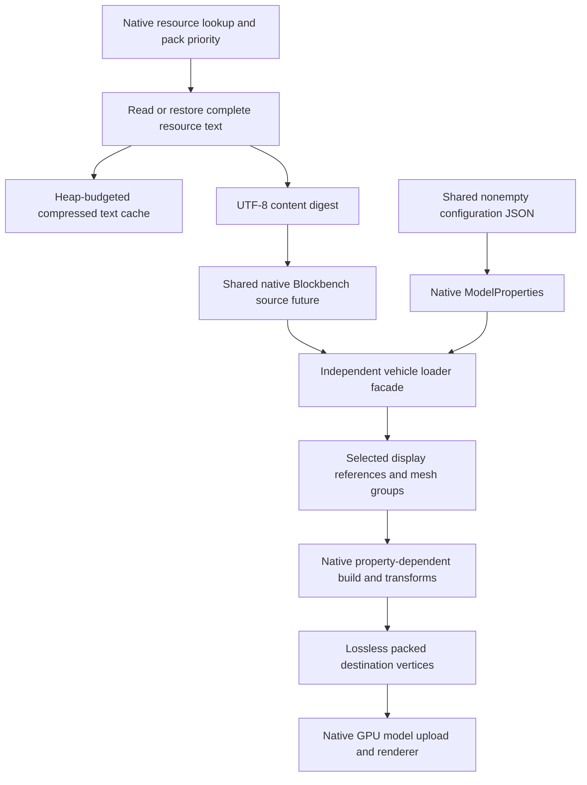

# MTR Memory Saver: implementation, runtime evidence and compatibility

Reviewed on **2026-11-13, UTC+08:00**. Implementation reference:
`fdaa0033961393229621230740e94e7d19a88aab`, before this documentation change.
This report consolidates source inspection, historical session outcomes, preserved
audits, runtime logs and artifact fingerprints. It records no new game trial.

The strongest result is configuration capacity: the historical official-MTR
**v0.3.0** companion completes startup and foreground F3+T in two fresh processes
with the frozen sixteen-pack fixture at **3072 MiB of Java heap**. Historical
v0.2.9 fails startup at that same cap and otherwise identical recorded context.
The separately adapted **v0.3.1-v6** also passes two fresh 3 GiB trials against one
exact custom MTR binary. These results do not establish a universal percentage
reduction in RAM, an uncapped FPS improvement or support for every MTR release.

## 1. Scope and evidence rules

| Evidence | What it establishes | Practical boundary |
| --- | --- | --- |
| Current Java source and builder | Algorithms, selected source trees, hooks and build guards | Source inspection alone does not prove a loader applies the hooks successfully |
| Exact-release offline comparisons | Tested text/vertex/reader equivalence and allocation or ownership properties | Synthetic and model-level results do not measure whole-client RAM or gameplay |
| Native logs, fresh snapshots, images and verified normal shutdown | The recorded binary/configuration passes the stated runtime phase | Applies to its pack hashes, mod set, world, settings and observation window |
| Jstat, Windows counters and JFR | Sampled memory, GC activity, frame intervals and allocation hotspots | Sampling gaps and observer overhead limit peak and speed claims |
| Historical session narrative | Explains sequence, failures, corrections and why a trial was repeated | Plans or an unfinished investigation are not acceptance evidence |
| Namespace/build equivalence | The compared classes match after the specified package normalization | Does not replace a new game run with the renamed binary |

Historical runtime companions use `dev.abenli.mtrmemory` and the display name
**MTR Memory Sharing**. Current sources use `site.benli06`,
`site.benli06.mixin` and **MTR Memory Saver**. The mod ID remains
`mtr_memory_sharing`. The November 11 namespace checks and November 13 branding
rebuilds are packaging checks; they are not additional gameplay acceptance.
See [namespace evidence](evidence/namespace-branding-20261111.json) and
[the dated change record](walkthrough.md).

The accepted fixture contains the **older sixteen repaired archives and 2,541
registered vehicles**. The newer [669-entry native catalogue](../vehicle-catalog/README.md)
changes registration metadata and has static/release-schema validation. It has
not received a new in-game acceptance with this companion. Matching archive count
does not make those two package sets interchangeable evidence.

## 2. Technical approach and source selection

The companion reduces redundant parsed inputs and retained CPU-side staging data
while preserving independent vehicle builds. It works at three different layers:

1. Share content-equivalent Blockbench parses and vehicle configuration trees.
2. Store parsed vertex streams in lossless compressed blocks and retain only
   display transforms that each vehicle's native properties can consume.
3. Reduce text allocation traffic and bound reusable resource-text retention
   during registration.

It continues to use the target release's Blockbench parser, model properties,
position definitions, native model objects and renderer. It does not reduce
texture resolution or remove vertices. `.bbmodel` requests are intercepted at
`VehicleModel.getModelLoaderBase`; other model formats retain their native factory
path. Resource-text interception can still affect other text read through the
targeted native resource helper.

The [builder](tools/build_vehicle_memory_mod.py) first selects common sources,
applies platform overrides, then replaces or adds explicitly requested feature
sources. Later selections can replace an earlier class with the same filename.
Reading only `src/main/java/` therefore does not describe v0.3.0.

| Final v0.3.0 responsibility | Selected source |
| --- | --- |
| Shared parse keys, futures, completion and counters | [streamed-digest SharedBlockbenchCache](src/experiments/streamed-digest/java/site/benli06/SharedBlockbenchCache.java) |
| Independent facade and property-selected display references | [display-retention SharedBlockbenchLoader](src/experiments/display-retention/java/site/benli06/SharedBlockbenchLoader.java), [DisplayRetention](src/experiments/display-retention/java/site/benli06/DisplayRetention.java) |
| Compressed vertex blocks and stage/texture stores | [PackedVertices](src/experiments/packed-mesh/java/site/benli06/PackedVertices.java), [PackedModelGroupStore](src/experiments/packed-mesh/java/site/benli06/PackedModelGroupStore.java) |
| Native add/merge/build interception and GPU emission | [NeoForge packed-mesh sources](src/experiments/packed-mesh/platform/neoforge/java/site/benli06/mixin/PackedModelGroupMixin.java) |
| Vehicle constructor JSON sharing | [streamed-digest VehicleJsonCache](src/experiments/streamed-digest/java/site/benli06/VehicleJsonCache.java) and JSON-sharing Mixins |
| Exact compressed text, admission budget and LRU | [bounded-text-cache implementation](src/experiments/bounded-text-cache/java/site/benli06/CompressedResourceTextCache.java) and [read/reload Mixin](src/experiments/bounded-text-cache/java/site/benli06/mixin/CompressedResourceTextMixin.java) |
| Segmented native text reads | [SegmentedResourceText](src/experiments/segmented-reader/java/site/benli06/SegmentedResourceText.java) |
| Bounded UTF-8 hashing buffers | [ResourceTextDigest](src/experiments/streamed-digest/java/site/benli06/ResourceTextDigest.java) |
| Additional v6 ABI and lifecycle changes | [v6 compatibility sources](src/compatibility/performance-v6/java/site/benli06/mixin/PackedModelGroupMixin.java) |

Without feature flags the builder still produces **v0.1.1**, for Fabric or
NeoForge. The advanced packed/text feature chain is NeoForge-only in this
implementation. A Fabric baseline build does not provide Fabric v0.3.0 support.
Variant flags and source hashes in `.build.json` identify a build more precisely
than its version string; unrelated experimental flags can alter its contents.

### Version development and rejected alternatives

The following summarizes historical trials, rather than a universal minimum-heap
table. Unless stated otherwise, these use official MTR beta.2 on NeoForge 21.1.265.
Early contexts can include a passenger companion; the final v0.2.9/v0.3.0
memory-only acceptance is a separate context.

Some earlier trials also used an additive observer that replaced MTR's native
end-client-tick callback. Their loading/measurement results retain that
instrumented scope and cannot establish native movement/audio behavior. The
corrected observer and native v0.2.8 repetitions are recorded separately in
[the unpacking guide](experiments/segmented-unpack/README.md) and
[native acceptance](evidence/neoforge-v028-native-acceptance.json). The final
v0.2.9/v0.3.0/v6 trials explicitly check preservation of the native callback.

| Companion | Implementation change | Recorded outcome and interpretation |
| --- | --- | --- |
| v0.1.1 | Shared Blockbench source, independent facades, white `Color` reuse, native text-cache release after registration | Baseline retained; its parsed vertex objects still dominate retained data |
| v0.1.2 experiment | Reuse unchanged vertex records | 1,002,880 raw-bit comparisons pass, but both post-acceptance histograms still count 79,359,867 vertices; no population benefit |
| v0.2.0 | Lossless packed vertex storage | 6 GiB and 5 GiB startup/reload pass; 4 GiB fails. Diagnostic live heap differs from ordinary process peaks |
| v0.2.1 | Retain facade displays selected by native properties; release source-cache ownership | 5 GiB startup/reload pass. Post-GC shallow live bytes decrease; process peaks change little |
| v0.2.2 | Share nonempty property/position JSON trees | 5 GiB startup/reload pass; 4 GiB fails. Reader-local state remains independent |
| v0.2.3 experiment | Immutable transformed views share packed source bytes | Geometry/physical-sharing checks pass; 5 GiB runtime passes, 4 GiB fails; post-GC total is about 1.3 MiB higher than v0.2.2 |
| v0.2.4 experiment | Content-interned packed blocks with epoch-scoped pool | Offline geometry and collision controls pass; 4 GiB runtime fails. No useful runtime RAM improvement established |
| v0.2.5 experiment | Select raw displays before source parsing | 5 GiB startup passes, but 5 GiB reload and 4 GiB startup fail while reading text; not selected for the final chain |
| v0.2.6 | Exact compressed resource-text cache | One 4 GiB startup/reload acceptance passes; a later 4 GiB run fails in native StringBuilder growth, motivating v0.2.7 |
| v0.2.7 | Segmented native text reader | Two fresh instrumented 4 GiB startup/reload trials pass; reader allocation controls pass |
| v0.2.8 | Segmented text unpacking | Corrected native 4 GiB repetitions pass. One 3.5 GiB pass is followed by reload failure; 3 GiB fails |
| v0.2.9 | Stream large UTF-8 digests through bounded arrays | Two fresh memory-only 3.5 GiB trials pass; one 3 GiB startup fails |
| v0.3.0 | Heap-scaled LRU admission for resource text | Two fresh memory-only 3 GiB startup/reload trials pass |
| v0.3.1-v6 | Integer-color ABI, cached GPU build semantics and facade closure | Two fresh v6/NF265 3 GiB trials pass; one additional v6/NF248 trial passes |

Detailed records: [vertex identity](experiments/vertex-identity/README.md),
[packed meshes](experiments/packed-mesh/README.md),
[display retention](experiments/display-retention/README.md),
[JSON sharing](experiments/json-sharing/README.md),
[mesh views](experiments/shared-mesh/README.md),
[block interning](experiments/block-sharing/README.md),
[early display selection](experiments/source-displays/README.md),
[text compression](experiments/compressed-text/README.md),
[reader](experiments/segmented-reader/README.md),
[unpacking and lower-heap repeats](experiments/segmented-unpack/README.md),
[digests](experiments/streamed-digest/README.md) and
[bounded cache](experiments/bounded-text-cache/README.md).

The final recommended flag chain excludes `--share-meshes`, `--intern-blocks`
and `--source-displays`. Correctness of an experiment's storage representation
does not establish an end-to-end memory advantage.

## 3. Runtime implementation and ownership



### 3.1 Shared Blockbench parsing

The key comprises SHA-256 of the complete source text, the **resolved texture
identifier** and `flipV`. A path alias with identical content can share its parsed
source if texture and UV orientation also match. Different textures or flip-V
settings remain separate keys. Equality relies on the digest key; this cache does
not additionally compare the complete text when digests match.

`ConcurrentHashMap.computeIfAbsent` creates one source entry per retained key.
The entry owns a `CompletableFuture<ModelLoaderBase>` and an epoch number. The
native `BlockbenchModelLoader` is recorded in an identity-based pending map before
its parse begins. A Mixin at `ModelLoaderBase.setModelLoaded` publishes the completed
source to its waiting facades. Each request returns a distinct facade, keeping
property-dependent destination builds and vehicle state independent.

The observed **4,608 requests / 651 unique completed source parses per epoch**
demonstrate reuse in this fixture. They do not mean only 651 text reads or hashes:
resource text is retrieved/restored and digested **before** the shared source-cache
lookup. A text-cache miss can therefore cause a reread even when a parsed source
entry is already available.

At reload entry the shared map is cleared, its epoch advances and counters reset.
Old pending sources keep their completion entries and can satisfy their existing
consumers. An epoch check separates their intended completion accounting from
the current epoch. At registration return, cache-owned source entries are released; facades
and pending completions retain the references they still need. Clearing the map
does not close every source, force GC or promise that every retained byte disappears
immediately. Later requests can parse again after ownership is released.

The source/JSON caches clear existing maps; they do not implement the text cache's
whole-map epoch-swap protocol. The source epoch primarily separates completion
accounting. No general proof of arbitrary concurrent reload/request races or failed
parser recovery is claimed for the standard shared-source path. Failure cleanup
tested for the early-display experiment is not automatically a property of v0.3.0.

### 3.2 Display retention and JSON reader isolation

On source completion, a facade references the parsed mesh groups and the display
groups selected by its properties, then publishes loaded state. Selection and
publication synchronize on the facade, allowing properties or completion to arrive
first. `DisplayRetention` derives names from actual `PartType.DISPLAY` properties.
Unconfigured factory uses retain all display data. Normal geometry remains
available even when raw display metadata is dropped.

This reduces metadata ownership; it does not simplify visible geometry or invent
floor/doorway boxes. The independent display audit compares the released consumer
across **10 part cases and 16 display instances**, including original object
identities, mirrored positions and native interaction lists.

The JSON Mixin intercepts property/position parsing in `VehicleModel` constructors,
not the worker's Blockbench parse. Nonempty Gson trees are keyed by the text digest;
null/empty/malformed inputs preserve native parsing and diagnostics. The target
release's `JsonReader` copies top-level entries into its own map, and consumers
read shared children without modifying them. Its merge operation changes that
reader-local map. Each vehicle still creates its own properties and positions.

Publication uses `putIfAbsent` after parsing. Concurrent misses may parse the same
JSON more than once before one tree wins; this is not a strict one-parse-per-key
guarantee. A future MTR reader that mutates shared children would invalidate the
sharing assumption. Cache references are cleared at reload entry and registration
return; that does not dispose of children already owned by readers.

### 3.3 Lossless packed vertices

Each record stores **eight raw 32-bit float patterns plus one 32-bit ARGB value**:
position XYZ, UV, normal XYZ and color, totaling **36 uncompressed bytes**.
Deflate `BEST_SPEED` compresses each appended block. Encode/decode staging holds
at most **1,024 records (36,864 bytes)**, rather than a complete decoded model.
Compressed output arrays, native zlib state and temporary native vertex lists are
additional allocations; this is not a cap on total mesh-build memory.

`PackedModelGroupStore` preserves the native stage/texture map implementation and
iteration behavior. `add` still invokes the native vertex-producing callback into
a temporary list, records packed data, and preserves supplied bounds or computes
the same bounds from those vertices. `merge` decodes source blocks, applies the
released arithmetic and packs the destination. Offset values are cast to float
before addition; mirrors retain operation order, signed-zero behavior and normal
handling. The final v0.3.0 chain does **not** use the v0.2.3 transformed-view shortcut.

`build` uses native `NewOptimizedModel` and emits the same bulk vertex arguments,
including default lighting and overlay. There is no vertex deduplication,
quantization, texture downscaling or per-frame geometry decompression in the
unchanged native renderer. Packing primarily changes CPU-side storage and upload
preparation; independent destinations still own their GPU models.

Raw storage preserves float bits. Java does not specify the payload selected when
arithmetic operates on NaNs. Synthetic audits explicitly allow equivalent NaNs
only in arithmetic-modified fields and record those differences; actual-model
comparisons do not use that exception. The early official audit passes all
**391 Shanghai models / 47,373,240 source vertices / 35,688 generated bounds**.
Its compressed-byte total excludes overhead and is not whole-client RAM savings.

The official ABI also permits `VertexColorMixin` to reuse `Color.WHITE` only for
fully opaque white; all other colors use the original constructor. It does not
change color values or fix the retained vertex population by itself.

### 3.4 Resource text: retained data versus transient allocations

The native reader function remains responsible for resolution, pack priority,
missing-resource behavior and failures. The cache redirects the selected native
`ConcurrentMap.computeIfAbsent` operation. On a miss it reads the original String,
packs a cache representation and returns the **original reader String**. It does
not immediately decompress that new value. A hit can return retained raw text or
restore the full String from compressed bytes.

Compression serializes Java **UTF-16 code units in big-endian order** with an
8,192-byte buffer. This preserves isolated surrogates, supplementary characters,
BOM, NUL and line endings. A packed result is retained only when its byte length
is less than `value.length()`; otherwise the original String is retained. This
conservative threshold is different from comparing against a two-byte-per-character
upper estimate of a String's payload.

The segmented reader fills 8,192-character chunks through `InputStreamReader`
with the native charset, then joins them. The native outer helper owns stream
closure. Segmented unpacking uses at most a 4,096-character buffer and an 8,192-byte
read buffer, preserves code-unit boundaries and joins output segments. Both paths
still allocate a **complete final String**, and output segments can coexist with
that final payload. The native JSON parser also still consumes complete text.
These are allocation-shape improvements, not a streaming JSON parser or a bound
on the largest input's required memory.

The streamed digest uses the original UTF-8 `getBytes` path for inputs up to
4,096 code units. Larger inputs use array-backed 4,096-character and 8,192-byte
buffers; the encoder replaces malformed UTF-16 exactly as `String.getBytes` does
and carries an unfinished surrogate across chunks. Buffers are allocated per hash
invocation and reused within it. It avoids the large complete UTF-8 byte array,
but does not remove the source String or all temporary allocations.

The digest audit compares **8,534 real inputs, 85 synthetic cases, 64 concurrent
reads and four actual cache digest methods**. Eight isolated large hashes reduce
thread allocation by approximately **99.898% / 99.974% / 99.981%** for the tested
ASCII/mixed/Unicode cases. Small-input allocation is unchanged; the single Unicode
timing is slower. Those results describe hashing allocation traffic, not retained
heap, total RAM or loading speed. The original array-allocation path fails the
[negative control](experiments/streamed-digest/array-digest-audit-negative-control.json).

### 3.5 Bounded cache admission, concurrency and reload

The default budget is `Runtime.getRuntime().maxMemory() / 32`, so at
`-Xmx3072M` it is **100,663,296 bytes (96 MiB)**. The JVM property
`mtr.memory.resourceTextCacheBytes` overrides that value; it is clamped at zero.
Zero prevents retained admission but the current miss path still creates its
compression candidate before rejecting it. Configure it at JVM startup; the
budget is a static final value, not a live setting.

The conservative entry accounting is:

```text
weight = 192 + 2 * resourceKey.length()
         + (compressedByteLength OR 2 * rawText.length())
```

A concurrent value map holds read-through results, and a synchronized,
access-ordered `LinkedHashMap` tracks admitted recent entries. Admission evicts
least-recently-used entries until the candidate fits. Keys and empty values consume
budget. Oversized values are returned and removed from retention **after** packing;
oversize bypass does not prevent compression allocations. Concurrent temporary
entries/in-flight references can exist outside the admitted-weight total.

Therefore the budget bounds **admitted accounting weight**, not a precise JVM
object census, complete text/model/parser allocations, process working set, native
zlib allocations or GPU memory. Values evicted while other consumers hold them
remain live until those consumers release them.

Each read captures an `Epoch` object. `clear()` swaps the whole epoch at reload
entry and registration return. An old in-flight read finishes in its old map and
cannot insert into the new text epoch. Concurrent retained-key misses use the
map's atomic computation; eviction permits subsequent native reads. Text decoding
runs outside LRU bookkeeping.

The synthetic bounded-cache audit uses **64 KiB**, covering exact real text,
LRU behavior, 64 concurrent reads, 500 churn inputs, 20,000 empties, null/errors,
oversize bypass and overlapping reloads. A separate generous budget isolates codec
roundtrips. Actual v0.2.9 correctly fails the unbounded-retention control.
The real 3 GiB trials record **3,010 evictions per registration** and admitted
peaks below 96 MiB. This does not establish hit ratio, reread count, physical disk
I/O or the loading-time penalty of eviction.

Earlier registration retained **592,010,155 compressed payload bytes (about
565 MiB)**. Bounding reusable text removes that obligation; the difference from
96 MiB is not an exact measured process-RAM saving. In-flight text, caches at
other layers and live native models remain outside that comparison.

## 4. Performance v6 requires a different ABI and lifecycle

The audited custom release is
`4.1.0-beta.2-mc1.21.1-performance-v6`, SHA-256
`8bd419bd798c2ab2fa03e08850409387804fdeb2e4f2987c66b9984236263585`.
“Performance v6” alone is not a sufficient binary identity.

| Interface or behavior | Official beta.2 path | Exact v6 adaptation |
| --- | --- | --- |
| `StoredVertexData.color()` | Returns `java.awt.Color`; packing uses `.getRGB()` | Returns integer ARGB; packing reads the integer directly |
| White color redirect | `VertexColorMixin` targets `Color` construction | Obsolete Mixin removed |
| Native group mutation | Official packed hook follows the original add/merge behavior | Calls v6 `ensureMutable()` before add/merge |
| Repeated GPU build | Official packed hook builds its native model map | Reuses v6 `builtModels`; later calls return the same map |
| Built destination staging | Official path retains its packed store | Clears the built destination's packed groups; shared source staging remains available |
| Close versus late source completion | Official facade has publication/selection synchronization | Adds a closed flag and native close hook; late publication cannot repopulate a closed facade |
| GPU ownership | Per-destination native model objects | Retains independent model objects and native disposal; closing one leaves another usable |

The old `.color().getRGB()` source fails compilation against v6 with
`int cannot be dereferenced`. Relaxing loader dependency metadata would not adapt
the methods or lifecycle. No dependency-bypass workaround is part of the accepted
implementation.

Historical binary comparison finds **30 classes unchanged**, three classes
changed, one obsolete Mixin removed and one lifecycle Mixin added relative to
official v0.3.0. This comparison uses the original namespace. It is distinct from
the later constant-pool-normalized namespace comparison.

The [offline ABI/geometry audit](compatibility/performance-v6/offline/audit.json)
passes **1,400,028 synthetic checked vertices** and **nine actual models /
1,267,536 source vertices**, with zero mismatches under the documented NaN rule.
Runtime probes pass **12/12 lifecycle checks** in each NF265 trial: repeated-build
identity, native cache field, staging retention/release, mutation rejection,
close-before-publication and independent GPU ownership/disposal. These specific
checks do not prove every GPU resource is leak-free over a long session.

## 5. Version restrictions and artifact identity

### 5.1 Target and loader matrix

All advanced runtime results here use **Minecraft 1.21.1 and Java 21**.

| MTR / loader / companion | Recorded validation | Restriction |
| --- | --- | --- |
| Official NeoForge beta.2 / NF21.1.265 / v0.3.0 | Two fresh 3 GiB startup/reload processes; additional profiling run | Exact official MTR fingerprint and old sixteen-pack fixture |
| Exact custom v6 / NF21.1.265 / v0.3.1-v6 | Two fresh 3 GiB startup/reload processes, ABI/model and GPU controls | Requires the v6-specific source and exact custom hash |
| Official NeoForge beta.2 / NF21.1.248 / v0.3.0-nf248 | One fresh 3 GiB startup/reload process, real lower-loader build | NF248/FML4.0.43 trial; not two fresh repetitions on this loader |
| Exact custom v6 / NF21.1.248 / v0.3.1-v6-nf248 | One fresh 3 GiB startup/reload process and 12 GPU checks | Same exact custom hash; lower-loader build |
| Official Fabric beta.2 / baseline v0.1.1 | Preserved baseline and namespace/build checks | No Fabric advanced v0.3.0 or v6 acceptance in this report |
| Current `site.benli06` binaries | Namespace equivalence; selected branding rebuilds | No new game run after namespace/branding changes |
| Other MC/MTR/custom v6/loader/JDK combinations | Not covered by these trials | Require renewed ABI, hook, dependency and runtime verification |

The builder verifies the **whole target MTR JAR SHA-256 at build time**, the marker's
Minecraft/MTR targets and the active loader classpath. Generated loader metadata
checks dependency versions at runtime; it does **not** perform that whole-JAR
fingerprint check in the running game. A substituted JAR with the same version
label can pass metadata while remaining incompatible.

NeoForge metadata uses a lower-bound range such as `[21.1.248,)`. That is a loader
declaration, not proof that every later 21.1 release works. Minecraft and MTR
dependencies are exact-version declarations. The required Mixin configuration
uses Java 21, minimum Mixin 0.8 and `defaultRequire: 1`; release-specific method
signatures, fields and even the resource-reader lambda are compatibility points.
Upstream changes can require source adaptation despite a similar version label.

The NF248 build audit compares **all 34 classes** and all other members with the
corresponding NF265 binaries. Only the minimum NeoForge dependency changes. The
actual build still uses NF248 patched client libraries; editing TOML without
checking the classpath would not supply that evidence.

Current resources declare `pack_format: 34`, include a 512 × 512 RGBA `pack.png`
and localized description keys. These package resources are for the supported
1.21.1 target. Pack metadata or a correct icon does not extend Java/MTR/loader
compatibility.

### 5.2 Exact target and historical delivery hashes

| Target MTR JAR | SHA-256 |
| --- | --- |
| Official Fabric beta.2, MC1.21.1 | `5da075f7d63daea89da17348ace0959a0c216cbaf14a322d063a64bec44aae94` |
| Official NeoForge beta.2, MC1.21.1 | `ff2b753d03f2bcc000d053a9014e4250c8ba720daa9b69b6899fe7dc26be1efa` |
| Exact custom NeoForge Performance v6 | `8bd419bd798c2ab2fa03e08850409387804fdeb2e4f2987c66b9984236263585` |

| Historical companion | SHA-256 |
| --- | --- |
| [v0.3.0, NF265](dist/releases/mtr-memory-sharing-neoforge-v030.build.json) | `eb21c0062f7944a7d2c015cb2eee5a1d24c11be4af2286bbbbfa4625d6cd2d54` |
| [v0.3.1-v6, NF265](dist/compatibility/performance-v6/mtr-memory-sharing-neoforge-v031-v6.build.json) | `ab6d372f458299bf1ce116a5a05101de3cc110b731149d668f13324adfb23dcb` |
| [v0.3.0, NF248](dist/compatibility/neoforge-21.1.248/mtr-memory-sharing-neoforge-v030-nf248.build.json) | `b9c95bbe79c6c76fe6a0c9af6bdb4f9ed7ce6b007fecdb1c9f543544ce562f02` |
| [v0.3.1-v6, NF248](dist/compatibility/neoforge-21.1.248/mtr-memory-sharing-neoforge-v031-v6-nf248.build.json) | `43da91dce144cc0a1a1e65307ba385cc9d89eb3a5057f07e7eab7529dca39174` |
| [v0.2.9 lower-heap control](dist/releases/mtr-memory-sharing-neoforge-v029.build.json) | `b8e903a3292cca032d6b1038d58f5f0b18be4823148e633ca4114263e2a83b6d` |

The four v0.3.x historical delivery JARs were rehashed against their original
manifests during this documentation review; all match. Those hashes do not
identify a newly branded build. Historical JARs are ignored by Git; tracked
manifests preserve identity, while a fresh clone needs a rebuild or separately
supplied binaries.

## 6. Actual runtime results and controlled interpretation

### 6.1 Fixture and acceptance criteria

The November profiling environment records Windows 10 Pro for Workstations 22H2,
Xeon E3-1275 v5 (4 cores / 8 threads), approximately 32 GiB RAM and **Intel HD P530
as the active renderer**. An installed NVIDIA adapter was not rendering these
trials. Scene settings: 1280 × 720, VSync, 60 FPS cap, render distance 8 and
simulation distance 5. The profiling report records Temurin 21.0.11+10; individual
launch records remain authoritative for each trial's JDK executable and options.

The final 3 GiB tests use:

```text
-Xms1G -Xmx3072M
-Djdk.virtualThreadScheduler.parallelism=2
-Djdk.virtualThreadScheduler.maxPoolSize=2
```

The accepted v0.2.9 lower-heap repetition uses `-Xmx3584M`. These scheduler
properties affect the JVM's global default virtual-thread scheduler, including
other mods using it. They do not cap ordinary thread pools or GC workers. Their
speed, blocking and other-mod effects have not been isolated.

Acceptance requires all sixteen selected archives, **2,541 registrations and
651 completed source parses**, then fresh in-world observations. Foreground F3+T
must produce completion in the **new resource epoch**. A snapshot that still
reports the previous complete state immediately after requesting reload is
insufficient. Each successful phase has a nominal 60-second fresh stability
monitor; actual first-to-last spans can be about 59.73–60 seconds.

Representative native DC01 images show both car bodies before/after reload.
Independent caches preserve **front: 5 floors / 10 doorways; rear: 6 floors /
10 doorways**. Native movement/audio callback preservation is checked separately
from audible sound coverage. Trials restore copied player/input state, save and
close normally, and verify saved transport fields plus pack/mod fingerprints.
Final memory-only acceptance has no passenger companion. Diagnostic GC and clock
mutation are excluded from those ordinary acceptance phases.

### 6.2 Capacity control: v0.2.9 versus v0.3.0

| Variant and heap | Fresh processes | Startup | Foreground reload | Supported conclusion |
| --- | ---: | --- | --- | --- |
| v0.2.9, 3.5 GiB | 2 | Pass | Pass | Lowest repeatably verified cap for this variant and final fixture |
| v0.2.9, 3 GiB | 1 | OOM; recovery to 423 built-ins/title screen | Full-pack reload not accepted | Full fixture did not complete at this cap |
| v0.3.0, 3 GiB | 2 | Pass | Pass | Full fixture repeatedly completes at the lower cap |

Comparison of the preserved v0.2.9 failure and v0.3.0 acceptance verifies identical
Minecraft/MTR targets, loader version, JVM argument array, all pack bytes and
order, and non-companion mod filenames/hashes. The companion changes. The
bounded-cache audit also verifies 31 unchanged class entries, including the text
codec, and scoped cache/Mixin changes plus the new epoch class.

This is strong evidence that the changed retention policy makes this frozen
configuration viable at 3 GiB. It is one failing baseline versus two successful
candidate repetitions, not a completed-load timing benchmark. The failed
baseline's original jstat observer timed out; no accepted complete heap-peak
report exists for that comparison.

| v0.3.0 / NF265 phase | Highest sampled heap used | Highest sampled working set | Highest sampled private commitment |
| --- | ---: | ---: | ---: |
| First startup, post-registration sampling only | 2.812 GiB | 3.863 GiB | 4.015 GiB |
| First reload | 2.890 GiB | 4.767 GiB | 5.619 GiB |
| Repeat startup | 2.815 GiB | 3.982 GiB | 4.137 GiB |
| Repeat reload | 2.896 GiB | 4.541 GiB | 4.737 GiB |

First-startup sampling misses parsing peaks. Repeat-startup jstat covers parsing,
and both reload jstat samplers start before F3+T. Process-lifetime working-set
watermarks reach **5.239 / 5.363 GiB** by the two reload observations; they include
unsampled intervals and cannot be assigned solely to reload. A 3 GiB Java heap
does not mean a 3 GiB Windows process.

Primary records: [v0.2.9 repetitions](evidence/neoforge-v029-acceptance.json),
[3 GiB failure](evidence/neoforge-v029-3gb-baseline-startup.json),
[v0.3.0 repetitions](evidence/neoforge-v030-acceptance.json).

### 6.3 Exact v6 with its adapted companion

| v0.3.1-v6 / NF265 measurement | First fresh process | Second fresh process |
| --- | ---: | ---: |
| Java heap cap | 3 GiB | 3 GiB |
| Startup to fresh in-world completed evidence | 155.16 s | 156.92 s |
| F3+T to fresh completed evidence | 136.88 s | 133.99 s |
| GPU/cache/lifecycle checks | 12/12 | 12/12 |
| Startup Full GCs / cumulative GC pause time | 2 / 7.530 s | 2 / 7.744 s |
| Reload Full GCs / cumulative GC pause time | 11 / 13.512 s | 10 / 13.635 s |
| Post-reload effective capped FPS | 58.91 | 58.87 |
| Post-reload maximum observed frame interval | 55.31 ms | 102.51 ms |
| Post-reload stable-window Full GCs | 0 | 0 |

| Highest sampled v6 memory | First startup | First reload | Repeat startup | Repeat reload |
| --- | ---: | ---: | ---: | ---: |
| Java heap used | 2.829 GiB | 2.992 GiB | 2.800 GiB | 2.936 GiB |
| Windows working set | 4.644 GiB | 5.159 GiB | 4.422 GiB | 4.907 GiB |
| Private commitment | 4.838 GiB | 5.397 GiB | 4.592 GiB | 5.396 GiB |

Startup jstat begins approximately 60 / 43 seconds after launch and misses early
behavior; JFR/GC logging starts with the JVM. Offline model work overlaps part
of the first reload, and brief regression/export work overlaps second startup.
The second reload and post-reload analysis windows exclude those tasks. These
are acceptance repetitions, not controlled speed benchmarks.

Frame intervals come from render hooks, include pacing and are not GPU
presentation timestamps. A capped near-60 FPS result does not quantify uncapped
throughput, and the repeat's interval above 100 ms remains part of the evidence.
Loading/reloading still has substantial GC pressure. Cumulative GC pauses are
not one continuous freeze; concurrent G1 old cycles are not Full GCs.

In the [earlier profiling study](performance/20261105/README.md), **exact v6 alone**
fails this full sixteen-pack stack at **8 GiB**: 165 Full GCs and 339.621 seconds
of cumulative GC pauses during an approximately 476.3-second startup, then OOM
without world entry. It separately passes a **425-registration DC01 subset** at
3 GiB. The subset and full-stack loads differ, and the successful adapted v6
adds memory features. These trials establish configuration capacity and failure
behavior, not a code-only RAM percentage or v6 rendering-speed advantage.

Primary records: [v6 acceptance](compatibility/performance-v6/acceptance.json),
[first profile](compatibility/performance-v6/runtime-first/profile.json),
[repeat profile](compatibility/performance-v6/runtime-repeat/profile.json).

### 6.4 NeoForge 21.1.248 differences

The lower-loader trial uses **NF21.1.248 / FML4.0.43** and one fresh 3 GiB process
per variant, tested in order v6 then official. Both pass startup, new-epoch F3+T,
fresh stability, representative rendering, exact independent caches, preserved
native callback and normal restored shutdown.

| NF248 variant | Startup to fresh evidence | Reload to fresh evidence | Additional checks |
| --- | ---: | ---: | --- |
| Exact v6 + v0.3.1-v6-nf248 | 165.81 s | 136.72 s | 12/12 GPU/lifecycle checks |
| Official beta.2 + v0.3.0-nf248 | 166.74 s | 143.54 s | Native callback/cache/save verification |

Single sequential trials do not establish that one version is faster, or that
NF248 performs differently from NF265. Differences in observation timing and
system activity remain. See [lower-loader acceptance](compatibility/neoforge-21.1.248/acceptance.json)
and [class/dependency comparison](compatibility/neoforge-21.1.248/build-audit.json).

### 6.5 Measurement and gameplay boundaries

Heap used, Windows working set, private commitment and GPU accounting overlap;
**do not add them together**. Jstat/process peaks are highest sampled values,
not continuous maxima. Process-lifetime watermarks are not phase-only peaks.
JFR allocation weights describe allocation traffic, not surviving objects or
retained heap. Post-acceptance histograms explicitly requesting GC are separate
diagnostics and must not be presented as ordinary gameplay memory observations.
Read-only observers still add memory and CPU overhead.

Native floor/doorway equality is meaningful interaction-data evidence, but it does
not establish physical boarding, station arrival, every window, cab/gangway
traversal or audible sound for every vehicle. Memory-only trials do not inherit
the separate passenger-companion gameplay acceptance. Known transparent-model,
missing-sound and authentication warnings remain in verbatim logs; a passing
trial is not a claim that all warnings disappear.

The [focused v6 door diagnosis](../vehicle-door-repair/v6-door-diagnosis/README.md)
finds completed legacy DC01 caches with **0 floors / 0 doorways**, versus native
replacement caches with **5/6 floors and 10/10 doorways**, in the same client.
That focused train is parked in its siding: it is a cache comparison, not a new
physical boarding or station-arrival test. It supports an explanation for those
confirmed saved legacy IDs and does not explain every reported failure of newly
placed native trains. A memory companion is not a general saved-ID migration or
door-animation repair.

Production networks, all vehicle families, shader packs, alternative renderers,
lower heaps and long-session leak behavior remain unaccepted. The short stable
windows cannot establish absence of all stutter or cumulative GPU/native leaks.

## 7. Reproducible build and acceptance method

Use [BUILDING.md](BUILDING.md) for setup: Python 3.11+, Java 21 JDK and an external
prepared/marked client with the exact target MTR and loader libraries.
`minecraft-launcher-lib==8.0` resolves launcher dependencies. The builder does not
download or launch the game. NF inputs include the active patched client, matching
NeoForm SRG game JAR, universal loader and launch-module libraries; checks reject
missing active patches, marker/launch mismatch and missing expected game classes.
Fabric baseline requires its existing intermediary-remapped client.

After defining `$instance` and `$javac` as in the build guide, the explicit
official bounded-cache build from this repository root is:

```powershell
.venv/Scripts/python.exe -X utf8 tools/build_vehicle_memory_mod.py `
  --instance $instance --javac $javac `
  --packed-meshes --prune-displays --share-json --compress-texts `
  --segment-text-reads --segment-text-unpacks --stream-text-digests --bound-text-cache `
  --output dist/local/mtr-memory-sharing-neoforge-v030.jar
```

For exact v6 use its prepared instance, add
`--performance-v6 --mtr-jar '<exact custom MTR JAR>'` to the full flag chain and
select a distinct output. The builder requires an explicit output/custom JAR and
the bounded-cache chain, and rejects the mesh-sharing/source-display experiments
for v6. A different hash or official-MTR instance is not an interchangeable input.

Builds use `javac --release 21`, isolated intermediates in ignored `build/` and
new outputs in ignored `dist/local/`. All `src/main/resources` files enter the JAR.
Generated loader/Mixin metadata and an adjacent `.build.json` record targets,
loader, feature flags, source/resource hashes, package and output fingerprint.
JAR container timestamps can differ; compare member payloads for equivalence.
An ordinary build does not install anything. The explicit `--install-test` path
checks the recorded client PID and targets the specified marked fixture.

Historical offline/integration tools referenced in older guides belong to the
parent resource-pack repository. Their recording-time commands use that parent
root and old Java namespace. The standalone repository owns its builder and build
tests; it does not implicitly relocate every external observer or audit harness.
Use fresh output paths rather than overwrite historical results.

For new acceptance, preserve this sequence and evidence:

1. Fingerprint the exact MTR/companion/observer JARs, selected pack bytes and order,
   JDK executable/options, loader and frozen world/settings. Check manifests
   against actual binaries, rather than filenames alone.
2. Compare codec/reader/transform output with the actual target release, including
   malformed/boundary text, bounds, stage/texture grouping and lifecycle controls.
   Negative controls should reject the old behavior the optimization addresses.
3. Launch a fresh copied fixture. Start external heap/process sampling early and
   JFR/GC logging at launch if profiling. Record sampling start and gaps.
4. Require the full registration set, new-epoch completed parses and fresh world
   state. Record nominal stability, images and independent native caches.
5. Request actual foreground F3+T, exclude stale complete snapshots, and repeat
   completion/stability/visual/cache checks for the new epoch.
6. Restore the copied player/input state, save and exit normally. Verify saved
   transport fields and unchanged source inputs; preserve failures and raw logs.
7. Repeat in another fresh process with the same context. For a speed or process
   RAM comparison, additionally control heaps, observer payloads, scene/load,
   system activity and sampling coverage; the historical capacity trials alone
   do not supply that benchmark.

## 8. Evidence index and historical provenance

| Question | Primary record |
| --- | --- |
| Which v0.2.9 lower-heap repetitions passed? | [neoforge-v029-acceptance.json](evidence/neoforge-v029-acceptance.json) |
| What actually failed at 3 GiB? | [v0.2.9 baseline startup](evidence/neoforge-v029-3gb-baseline-startup.json) |
| Which v0.3.0 trials and inputs passed? | [neoforge-v030-acceptance.json](evidence/neoforge-v030-acceptance.json), including 30 evidence-file hashes |
| Is text retention bounded and content exact? | [bounded-cache audit](experiments/bounded-text-cache/audit.json), including the old-cache negative control |
| Does streamed hashing preserve keys and reduce allocation? | [array digest result](experiments/streamed-digest/array-digest-audit-result.json) and [negative control](experiments/streamed-digest/array-digest-audit-negative-control.json) |
| What supports exact v6 ABI/lifetime adaptation? | [offline audit](compatibility/performance-v6/offline/audit.json), [runtime acceptance](compatibility/performance-v6/acceptance.json) and [evidence index](compatibility/performance-v6/evidence-index.json) |
| Was NF248 actually built and run? | [build audit](compatibility/neoforge-21.1.248/build-audit.json), [acceptance](compatibility/neoforge-21.1.248/acceptance.json) and [index](compatibility/neoforge-21.1.248/evidence-index.json) |
| What do GC/frame/Windows measurements mean? | [November 5 report](performance/20261105/README.md), [optimization review](optimization-review.md), [cache/GC/scheduler analysis](cache-gc-scheduler-analysis.md) |
| What changed after gameplay acceptance? | [namespace evidence](evidence/namespace-branding-20261111.json), [repository verification](repository-verification.json) and [walkthrough](walkthrough.md) |
| How are original paths/history recovered? | [repository-origin.json](repository-origin.json) and extracted Git history |

The historical parent session is `01a1c8a5-d326-71d2-a726-55c1ce865d65`.
The completed lower-loader session, **“用21.1.248 neoforge适配”**, is
`01a1afc4-18f0-74c3-bebc-927ffdded6e5`. Their completed outcomes were cross-checked
with the records above. Unfinished November 6 door work and later static catalogue
validation are not promoted to new runtime acceptance.

Extraction maps 109 relocated paths in `repository-origin.json`. That map records
the extraction snapshot; later namespace changes have their own record. Original
JSON, logs, manifests and indexes retain recording-time paths/hashes rather than
being rewritten to suggest newly produced evidence.

Hash review resolves all three evidence-file entries in the v0.2.9 acceptance and
all 30 in the v0.3.0 acceptance. The v6 index has 80 matching current entries,
including its raw JFR references; NF248 has 63. Six moved/edited entries require
historical recovery: four v6 Java sources, the v6 README and the NF248 README.
Their original bytes match the recorded hashes at these extracted revisions:

- Four v6 Java sources: `37f3bb7`, under
  `src/compatibility/performance-v6/java/dev/abenli/mtrmemory/`, including its
  `mixin/` subdirectory.
- v6 guide: `71a7a93:compatibility/performance-v6/README.md`.
- NF248 guide: `609199f:compatibility/neoforge-21.1.248/README.md`.

Current guides are useful navigation but need not match an earlier evidence
index's document hash. Use the primary JSON/raw records or recover the exact Git
blob when reviewing a historical fingerprint. Raw JFR references point to local
cache files and may not be available in a fresh clone.

The November 11 check proves all 51 Java files changed only in package references,
and compares **9 / 9 / 34 / 34** class files for Fabric baseline, NeoForge baseline,
official NF248 v0.3.0 and v6 NF248 v0.3.1-v6 after constant-pool normalization.
November 13 separately records branded Fabric-baseline and official-NF248 builds
with **9 / 34** class checks plus resources/metadata. Neither round launches the
game. Current-source equivalence is useful supporting evidence, while the exact
historical runtime binary remains the accepted measurement subject.
