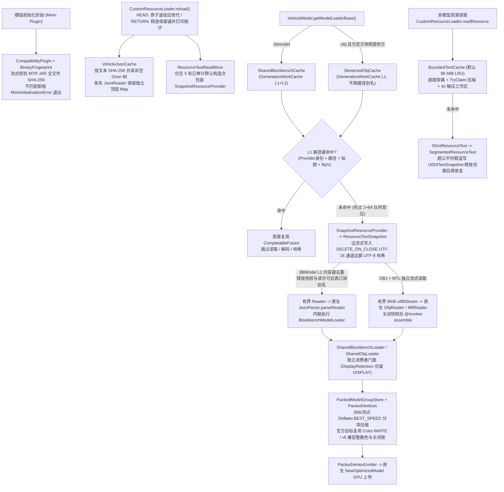
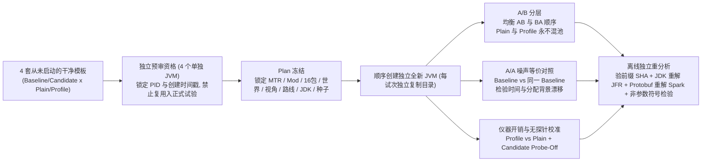

# MTR Memory Saver 技术原理、对照试验设计与全阶段实测结果

本文档系统阐述 **MTR Memory Saver**（Mod ID：`mtr_memory_sharing`，当前主实现包名 `site.benli06` / `site.benli06.mixin`，历史 0.3.x 为 `dev.abenli.mtrmemory` / `MTR Memory Sharing`）的运行时技术原理、受控对照试验方法论，以及自 `v0.1.1` 至 `0.4.8` 候选版本全阶段对照试验、负对照与耐久测试的实测结果。

> [!NOTE]
> 本文档汇总当前 Java 源码、构建矩阵、冻结实验协议及既有封存证据，不创造新的游戏验收结论。截至 `2026-11-24 +08:00`，最新 **0.4.8** 仅面向 `official-nf265` 提供限定范围的开发预发布候选（已通过组件检查与 20 次连续全包重载耐久，但**尚未通过整客户端受控性能验收**）；`Performance v6` 新测试仍处于暂停状态；历史 `0.3.x` 英文技术归档保留在 [TECHNICAL.md](../TECHNICAL.md)。

---

## 1. 目标边界、构件身份与证据分级准则

### 1.1 目标矩阵与核心二进制指纹

权威构建矩阵与依赖指纹定义于 [config/targets.json](../config/targets.json)，有效版本权威为 [gradle.properties](../gradle.properties)（当前 `0.4.8`）。所有 `0.4.x` 实测与构建均基于 **Minecraft 1.21.1** 与 **Java 21** 客户端环境。

| 目标预设 (`-Ptarget=...`) | 绑定 MTR 版本与校验 SHA-256 | NeoForge 精确版本 | 当前状态 |
| --- | --- | --- | --- |
| `official-nf265`（默认与发布目标） | 官方 `4.1.0-beta.2` (`ff2b753d03f2bcc000d053a9014e4250c8ba720daa9b69b6899fe7dc26be1efa`) | `21.1.265` | **0.4.8 预发布选定目标**：产物 SHA-256 `920c1f833b6f173c7443ff5956493b779acfeceb293fa640817a459985db3f5b`；已通过 106 项 Java 回归、69 项打包实机检查、错包拒绝与 20 次连续全包重载 |
| `official-nf248` | 同官方 `4.1.0-beta.2` | `21.1.248` | 历史构建/对比目标（2026-11-23 起新测试仅针对 `21.1.265`）；0.4.8 修订版 `943b3d45...` 曾在此目标完成 20 次重载与 12-JVM 配对 Spark 验证（性能未达标） |
| `v6-nf248` | 定制 `4.1.0-beta.2-mc1.21.1-performance-v6` (`8bd419bd798c2ab2fa03e08850409387804fdeb2e4f2987c66b9984236263585`) | `21.1.248` | 历史 `0.4.2` 冒烟与 100 次合成 GPU 所有权循环通过；新验证暂停 |
| `v6-nf265` | 同定制 Performance v6 | `21.1.265` | 历史开发候选；新验证暂停；历史 `v0.3.1-v6` (`ab6d372f...`) 曾完成两次 3 GiB 启动/重载 |

### 1.2 两套 16 包测试夹具的严格区分

在跨阶段对比历史结果时，必须严格区分两套不同的“全 16 包”夹具——相同压缩包数量并不代表相同的注册元数据或内存载荷：

| 夹具代际 | 适用版本范围 | 注册规模 | 每世代解析请求与独特输入 | 最大实际引用资源与说明 |
| --- | --- | --- | --- | --- |
| **旧 16 包修复夹具** | `v0.1.1` – `v0.3.1-v6` | `2,541` 辆车（290 物件 / 23 轨道） | `4,608` 次 Blockbench 请求 / `651` 次独特源解析 | 包含旧 `02a05_arknight.bbmodel`（`65,255,687` UTF-8 字节）等历史注册条目；[0.3.0 验收记录](../evidence/neoforge-v030-acceptance.json) |
| **MTR 4.1 原生目录 16 包夹具** | `0.4.x` 官方验证（含 `0.4.5`–`0.4.8`） | `1,092` 条车辆声明 / `1,091` 个去重 ID | 每世代 `651` 次独特 Blockbench 解析 + `974` 次 OBJ 解析 | 最大实际引用 BBModel 为 `13,141,932` 字节；最大实际引用 OBJ 为 `mtr:hxd3d/25t__doors_b351ad1ecabb.obj`（`102,035,449` 字节/码元，UTF-8 SHA-256 `e43f1b6b...`）；旧 65 MB BBModel 未被原生目录引用，但继续作为单输入微基准高压样本 |

### 1.3 证据分级边界

| 证据类别 | 它能证明什么 | 它**不能**证明什么 |
| --- | --- | --- |
| 静态源码与字节码审查 | 数据结构、锁顺序、Mixin 签名目标、编译期 ABI 适配 | 运行时 Mixin 是否真正注入成功、实际显存回收与帧率 |
| 离线原生参考等价审计 | 无修改 MTR 算法对比（原始浮点位、AABB 包围盒、变换精度、UTF-16/UTF-8 编码、JSON 树合并语义） | 整客户端进程 RAM 峰值的降低比例或游玩体验 |
| 隔离微基准与 64 MiB 负对照 | 特定路径（如路径命中跳过哈希、边写边哈希、流式读取 vs `String.join`）的分配流量、线程 CPU 与边界崩溃机制 | 整游戏冷/热加载总耗时、Full GC 停顿或稳态私有内存收益 |
| 容量基线与 20 次重载耐久 | 特定堆上限下能否反复完成全部包启动、原生 F3+T 重载、句柄释放与正常退出 | 在相同堆上限下优于未改动基线的百分比速度或内存增益 |
| 受控配对对照试验（48-JVM / 12-JVM） | 严格控制外部变量与仪器开销后的配对中位数变化及非参数置信区间 | 脱离当前硬件、资源包目录、场景或未经无探针校准前的普适性能结论 |
| 局部实景与观察记录 | 特定站点/列车模型可见性、地板/车门碰撞缓存相等性 | 全车系外观、所有车窗透视、物理上下车或两小时不间断路线稳定 |

---

## 2. 原生 MTR 内存与加载瓶颈成因分析

通过对未修改/早期基线客户端的堆直方图（GC Class Histogram）、JFR 采样、Windows 进程计数器及 OOM 堆栈进行联合诊断（见 [2026-11-05 性能报告](../performance/20261105/README.md) 与 [工程审查](../docs/ENGINEERING_REVIEW.md)），原生加载链路存在六类叠加瓶颈：

1. **同源模型重复解析**：多涂装或编组车辆反复引用相同的 `.bbmodel` 与 `.obj` 源文件。在旧 16 包夹具中，`651` 个独特 `.bbmodel` 触发了 `4,608` 次加载请求；在 `2026-11-05` 的 JFR 样本中，`BlockbenchModelLoader.lambda$loadModel$5` 在启动栈中占 `4,091 / 6,457` 样本、重载栈中占 `4,187 / 6,064` 样本。
2. **CPU 侧未压缩顶点对象图常驻**：原生 `NewOptimizedModelGroup` 在 CPU 侧为每个顶点保留独立的 `StoredVertexData` 对象及嵌套 `java.awt.Color` 实例。基线 `v0.1.1` 堆直方图记录到 **`79,359,867` 个活跃 `StoredVertexData` 实例**，单顶点记录开销远超原生原始浮点字节尺寸。
3. **非展示部位的原始矩阵变换滞留**：原生加载器为所有模型部位保留原始 `StoredMatrixTransformations` 元数据；实际上车辆渲染器仅对属性类型为 `PartType.DISPLAY` 的部位消费原始展示变换。`v0.2.0` 直方图显示此类实例高达 **`2,494,194` 个**，占据约 `753 MiB` 浅堆。
4. **重复车辆配置 JSON DOM 膨胀**：每辆车在 `VehicleModel.<init>` 中独立解析相同属性与位置 JSON。`v0.2.1` 诊断直方图测得核心 MTR Gson 对象浅堆达 **`385,752,224` 字节**。
5. **资源文本缓存无界滞留与全量 `String` 瞬时分配峰值**：
   - 原生 `CustomResourceLoader.RESOURCE_CACHE` 在注册期间不断累积完整资源文本；早期全包测试单轮注册文本总量达 **`2,000,187,675` 码元**，即便全部压缩也仍占用 **`592,010,155` 字节（约 565 MiB）**；
   - 原生 `ResourceManagerHelper` 调用 `IOUtils.toString` 导致内部 `StringBuilder` 倍增扩容；`String.getBytes(UTF_8)` 整块复制大文本用于计算哈希；`String.join` 在读取或解压结束后在堆上一次性拼装超大连续 `char[]`/`byte[]`。在 `3 GiB` 堆上限下，连续重载期间的新老对象叠加直接触发 `OutOfMemoryError: Java heap space`（实测于 `0.4.7` 第 4 次重载及 `0.4.8` 初版第 7 次重载）。
6. **`0.3.x` 架构级并发与寿命缺陷**：
   - **解析异常静默挂死**：原生 `BlockbenchModelLoader` 捕获异常后仅打日志并递减原生计数，不调用 `setModelLoaded()`，导致 `0.3.x` 的共享 `CompletableFuture` 与待处理映射永不完结；
   - **缓存命中前仍做重计算**：`0.3.x` 先经文本缓存读取/解压完整字符串并计算 SHA-256，再查 Blockbench 源缓存，导致路径已命中时仍承受 I/O 与哈希分配；
   - **非原子重载与无背压队列**：重载时分别清理地图并递增 epoch 存在竞态；未受限的解析队列持有原始准备回调易积压大文本；
   - **弱身份校验**：仅依赖模组版本号无法拦截“同版本号但字节被替换”的 MTR JAR（例如定制 `Performance v6` 或篡改包），会导致运行期 `NoSuchMethodError` 或语义破坏。

---

## 3. 0.4.8 核心技术原理与五层架构

针对上述瓶颈，`0.4.x` 系列（至当前 `0.4.8`）构建了一套以**“精确二进制门禁 + 有界描述符两级调度 + 流式文件快照与单遍哈希 + 有界压缩文本 LRU + 无损顶点压缩与轻量元数据共享”**为核心的五层运行时架构，且**全程保留原生 MTR 的模型解析、坐标变换、碰撞盒/地板/车门计算与渲染算法**。

### 3.1 第一层：精确二进制身份门禁与 Mixin 注入矩阵

#### 运行时指纹强校验（`CompatibilityPlugin` & `BinaryFingerprint`）
- 实现源码：[CompatibilityPlugin.java](../src/main/java/site/benli06/CompatibilityPlugin.java)、[BinaryFingerprint.java](../src/main/java/site/benli06/BinaryFingerprint.java)。
- 在 Mixin 配置加载期（`onLoad`），插件读取构建时嵌入 JAR 根目录的 `/mtr-memory-target.json`，通过 `LoadingModList.get().getModFileById("mtr")` 定位正在加载的 MTR JAR 文件，以 `65,536` 字节缓冲流式计算其全文件 SHA-256 并与目标指纹严格比对。
- **关键工程纠偏（`0.4.4 -> 0.4.5`）**：实机负对照暴露出 Mixin 运行时会捕获插件 `onLoad` 抛出的普通 `Exception`，仅打一条警告日志便跳过整个 Mixin 配置继续启动游戏。因此自 `0.4.5` 起，校验失败统一封装并抛出 Mixin 标准致命错误 **`MixinInitialisationError`**，确保任意同版本号替换/篡改的 MTR 二进制在资源注册开始前即以进程退出码 `1` 强制终止。

#### Mixin 注入点完整清单（对照 [config/targets.json](../config/targets.json)）

| 范围 | Mixin / Accessor 类 | 目标 MTR 类与方法/字段 | 注入职责与语义 |
| --- | --- | --- | --- |
| **公共** | [VehicleModelFactoryMixin](../src/main/java/site/benli06/mixin/VehicleModelFactoryMixin.java) | `VehicleModel.getModelLoaderBase` (`HEAD`) | 拦截 `.bbmodel` 请求并转交 `SharedBlockbenchCache.get` 返回独立门面 |
| **公共** | [BlockbenchParseExecutorMixin](../src/main/java/site/benli06/mixin/BlockbenchParseExecutorMixin.java) | `BlockbenchModelLoader.loadModel` 中 `ExecutorService.submit` | 仅当线程持有模块 `OWNED_PARSE` 作用域时内联同步执行解析 `Runnable`，外来 MTR 任务沿用原执行器 |
| **公共** | [ModelLoaderCompletionMixin](../src/main/java/site/benli06/mixin/ModelLoaderCompletionMixin.java) | `ModelLoaderBase.setModelLoaded` (`RETURN`) | 向当前线程 `OWNED_PARSE` 报告原生发布完成，用于区分“真正完成”与“异常被原生捕获未发布” |
| **公共** | [ModelLoaderAccess](../src/main/java/site/benli06/mixin/ModelLoaderAccess.java) | `ModelLoaderBase` 字段访问器 | 访问 `nameToNewOptimizedModelGroup` 与 `nameToRawModelDisplayParts` |
| **公共** | [DisplaySelectionMixin](../src/main/java/site/benli06/mixin/DisplaySelectionMixin.java) & [DisplayPartAccess](../src/main/java/site/benli06/mixin/DisplayPartAccess.java) | `VehicleModel.createModelSupplier` / `ModelPropertiesPartSchema` | 在构建 `ModelProperties` 后提取 `PartType.DISPLAY` 部件名并配置门面剪枝 |
| **公共** | [PackedModelGroupMixin](../src/targets/official/java/site/benli06/mixin/PackedModelGroupMixin.java) (分目标实现) | `NewOptimizedModelGroup` (`add` / `merge` / `build`) | 将 CPU 侧顶点列表存储替换为 `PackedModelGroupStore` 压缩块，上传 GPU 时解压发射 |
| **公共** | [VehicleJsonCacheMixin](../src/main/java/site/benli06/mixin/VehicleJsonCacheMixin.java) & [VehicleJsonEpochMixin](../src/main/java/site/benli06/mixin/VehicleJsonEpochMixin.java) | `VehicleModel.<init>` (`Utilities.parseJson`) 与 `CustomResourceLoader.reload` | 按文本哈希共享非空车辆配置 Gson 树，并在重载头/注册尾原子退役清空 |
| **公共** | [CompressedResourceTextMixin](../src/main/java/site/benli06/mixin/CompressedResourceTextMixin.java) | `CustomResourceLoader.readResource` (`ConcurrentMap.computeIfAbsent`) 与 `reload` | 将无界 `RESOURCE_CACHE` 重定向到有界 `CompressedResourceTextCache`，并在重载首尾清空并输出预算/活动日志 |
| **公共** | [SegmentedResourceTextMixin](../src/main/java/site/benli06/mixin/SegmentedResourceTextMixin.java) | `ResourceManagerHelper.lambda$readResource$1` (`IOUtils.toString`) | 用分段工作区读取器替换 `IOUtils.toString` 的整块扩容缓冲 |
| **公共** | [ResourceReloadMixin](../src/main/java/site/benli06/mixin/ResourceReloadMixin.java) & [SourceLifetimeMixin](../src/main/java/site/benli06/mixin/SourceLifetimeMixin.java) | `CustomResourceLoader.reload` (`HEAD` / `RETURN`) | 开启新资源世代、打印缓存统计、调用 `finishRegistration()` 并清理原生 `RESOURCE_CACHE` |
| **Official** | [ResourceTextReadMixin](../src/targets/official/java/site/benli06/mixin/ResourceTextReadMixin.java) | `CustomResourceLoader.reload`（5 处 `ResourceProvider` 参数）及 `lambda$readResource$22` | 仅在 5 处已审计原生默认提供方构造处包装 `NativeResourceSnapshots.wrap`；用 `StrictResourceText` 传播存在资源的 I/O 错误 |
| **Official** | [ObjVehicleFactoryMixin](../src/targets/official/java/site/benli06/mixin/ObjVehicleFactoryMixin.java)、[ObjModelInputMixin](../src/targets/official/java/site/benli06/mixin/ObjModelInputMixin.java) & [ObjSourceLifetimeMixin](../src/targets/official/java/site/benli06/mixin/ObjSourceLifetimeMixin.java) | `VehicleModel.getModelLoaderBase` / `ObjModelLoader` / `CustomResourceLoader.reload` | `.obj` 在非 `DEBUG` 且为 `SnapshotResourceProvider` 时走 `StreamedObjCache`；通过 `@Invoker("loadModel")` 复用原生 `ObjSplitting.splitByGroups` |
| **Official** | [VertexColorMixin](../src/targets/official/java/site/benli06/mixin/VertexColorMixin.java) | `StoredVertexData.write` (`NEW java/awt/Color`) | 将 `(255, 255, 255, 255)` 纯白复用为 `Color.WHITE` |
| **V6** | [V6LoaderLifecycleMixin](../src/targets/v6/java/site/benli06/mixin/V6LoaderLifecycleMixin.java) | `ModelLoaderBase.close` (`HEAD`) | 同步标记门面 `closed = true`，防止延迟完成的异步源发布重新填充已释放模型 |

### 3.2 第二层：有界描述符调度与两级单飞世代缓存

核心调度器为 [GenerationWorkCache.java](../src/main/java/site/benli06/GenerationWorkCache.java)，分别支撑 [SharedBlockbenchCache.java](../src/main/java/site/benli06/SharedBlockbenchCache.java) 与 [StreamedObjCache.java](../src/targets/official/java/site/benli06/StreamedObjCache.java)。

1. **两级单飞查找与“先路径、后内容”反转**：
   - **L1（快速路径键）**：使用 `ResourceSourceKey(providerIdentity, modelId, textureId, flipV)`（其中 `provider` 采用 `System.identityHashCode` 与引用的 `==` 比较，防止不同资源包或不同 `ResourceProvider` 实例在同路径下串读不同字节）。命中 L1 时**立即返回既有 `CompletableFuture`**，完全不进行文件打开、UTF-16 解码或 SHA-256 计算。
   - **L2（内容别名去重，仅 Blockbench）**：L1 未命中且进入工作线程后，才执行 `prepare.get()` 捕获快照并计算 `Content(sha256Utf8Digest, textureId, flipV)`。若与本世代已存在内容键相同，则通过 `try (var owner = prepared.owner())` **先关闭自身的快照文件与通道并退出 `ReadAdmission` 作用域，再订阅既有主任务的 Future**，消除“持许可等待另一任务”造成的死锁风险。
   - **OBJ 不做跨路径内容别名**：`StreamedObjCache` 将 L2 键同样设为 `ResourceSourceKey`。原因在于 OBJ 模型内部按相对路径引用 `.mtl` 材质库和贴图，两个位于不同路径但文本完全一致的 `.obj` 可能绑定截然不同的材质文件，内容去重会破坏材质隔离。
2. **有界背压与轻量描述符排队**：
   - 使用公平信号量 `Semaphore(workerCount + queueCapacity, true)`（默认 `2 + 64 = 66` 槽位）与固定容量 `ArrayBlockingQueue` 驱动 `MTR-memory-parse` 守护线程池及 `MTR-memory-timeout` 超时调度器（默认 `300` 秒）。
   - 排队提交给工作队列的是轻量的 `Supplier<Prepared<C, V>>` 描述符，**绝对不捕获或驻留原始资源文本**，避免大量未调度任务在堆中堆积模型字符串。工作线程内部禁止阻塞式获取新槽位（仅允许 `slots.tryAcquire()`），防止递归解析自锁。
3. **原生票据诚实性与终止态发布语义**：
   - 每次创建任务在锁内调用 `ModelLoaderBase::parseStarted`，直到 `Work.release()` 才调用 `ModelLoaderBase::parseFinished` 并释放槽位与递增/递减 `outstanding`。即便 Future 因超时或世代退役被取消，只要不可中断的原生解析/I/O 代码尚未退出，其读许可与原生票据就会持续保留直至真实返回——diagnostics 中因此可观测到 `pending == 0` 而 `outstanding > 0`。
   - 原生 `BlockbenchModelLoader` 解析时，`SharedBlockbenchCache` 改用 `JsonParser.parseString` / `JsonParser.parseReader(...).getAsJsonObject()`，拒绝非法或非对象 JSON（不再沿用 `Utilities.parseJson` 静默返回空对象的回退），且必须观测到 `ModelLoaderCompletionMixin` 对同一 `source` 的 `setModelLoaded` 回调才算发布成功；否则强制转为终端异常。
   - `preserveLateFailure` 使用带身份去重集合的 BFS 遍历异常链，仅将不与主异常构成 `cause/suppressed` 环路的独立清理或解析异常通过 `addSuppressed` 保留。
4. **原子世代退役与注册后释放**：
   - `beginReload()` 在单把锁内把当前 `Epoch` 标记 `retired = true`，原子切换为新 `Epoch`、清空索引并取消所有待处理 Future；排队中的任务未执行则直接触发 `Work.done()` 释放票据。
   - `finishRegistration()` 将当前 `Epoch.retain` 置为 `false` 并清理已完成键；晚完成的条目也会因 `!epoch.retain` 在 `terminal()` 回调中自动退场，同时各车辆门面已独立持有自身所需的网格/展示引用。

### 3.3 第三层：流式资源快照、单遍边写边哈希、加权工作区与有界文本 LRU

该层解决了全量 `String` 瞬时峰值问题，由三条协同机制组成：

1. **受限的原生快照能力包装（`SnapshotResourceProvider` & `NativeResourceSnapshots`）**：
   - [ResourceTextReadMixin.java](../src/targets/official/java/site/benli06/mixin/ResourceTextReadMixin.java) 使用 `@ModifyArg` 仅精确作用于官网 MTR 字节码中 **5 个经 ASM 契约审计的默认 `ResourceProvider` 传入点**（`RailResource.<init>`、`CustomResourcesConverter.convertRails`、`convertObjects`、`lambda$reload$8`、`lambda$reload$10`）。
   - 遇到未知外部模组/脚本传入的自定义 `ResourceProvider` 或启用 `Keys.DEBUG` 本地文件调试模式时，自动沿用原 `provider.get(id)` 字符串契约。
2. **原子删除即关闭 UTF-16 通道与“单遍边写边算哈希”（`0.4.7 -> 0.4.8`）**：
   - [Utf16TextSnapshot.java](../src/main/java/site/benli06/Utf16TextSnapshot.java) 在临时目录以 `CREATE_NEW | READ | WRITE | DELETE_ON_CLOSE`（POSIX 下附加 `rw-------`）原子创建随机 `.utf16` 文件；遇到文件名冲突直接重新生成（视为他方拥有文件，永不覆盖或跨进程清扫）。整个“写入 → 等待配额 → `rewind()` → 读取”全程共用同一个 `SeekableByteChannel`，一旦宿主 JVM 遭遇异常退出或 `Runtime.halt`，Windows 内核在关闭进程最终文件句柄时即自动删除该文件。
   - **单遍捕获优化（[ResourceTextSnapshot.java](../src/main/java/site/benli06/ResourceTextSnapshot.java)）**：`0.4.8` 修订版先将字符写完盘后再重读一遍算 SHA-256；`engineering-055` 优化引入匿名 `FilterReader` 包装 `InputStreamReader`，在 [ResourceTextDigest.sha256(Reader)](../src/main/java/site/benli06/ResourceTextDigest.java) 拉取字符流算哈希的同时，逐块校验长度上限 `admission.checkLength(length)` 并将大端 UTF-16 字节写入快照通道——**彻底移除解析前的整盘重读遍**。
   - **精确等价摘要编码**：`ResourceTextDigest` 对大于 `4,096` 码元的输入采用固定 `4,096`-char / `8,192`-byte 数组缓冲与 `CodingErrorAction.REPLACE`，利用 `CharBuffer.compact()` 精确跨块携带未配对的高代理项，保证与原生 `String.getBytes(StandardCharsets.UTF_8)` 在任意畸形 UTF-16/代理对/BOM/NUL 边界上逐字节相等。
   - **流式解析消费**：Blockbench 模型由 `JsonParser.parseReader(snapshot.reader())` 通过 `8 KiB` 通道读取器消费；OBJ 与每个关联 `.mtl` 由 `snapshot.utf8Stream()`（`8 KiB` `ReaderInputStream`）分别送入原生 `ObjReader.read(InputStream)` 与 `MtlReader.read(InputStream)`（保留原生 US-ASCII 与默认字符集替换语义），且在调用 `assemble` 前先关闭 `.obj` 快照。**全程不产生模块拥有的完整输入 `String`**。
3. **非流式路径的共享加权工作区防死锁溢写（`TextWorkspace` & `SegmentedResourceText` & `StrictResourceText`）**：
   - 对于仍须返回完整 `String` 的原生读资源接口（`CustomResourceLoader.readResource` 等），每次读取先申请 [ReadAdmission](../src/main/java/site/benli06/ReadAdmission.java) 许可（默认 2 并发，允许同线程嵌套作用域）。
   - [SegmentedResourceText](../src/main/java/site/benli06/SegmentedResourceText.java) 每次先向 [TextWorkspace](../src/main/java/site/benli06/TextWorkspace.java) 申请公平份额 `share = budget / readers`；当解码码元累计满足 `4 * length > share` 时，将已有 `8,192`-char 内存分段刷入 `Utf16TextSnapshot`、清空内存列表并**立刻释放 `share`**，直到输入读完获知精确总长后，再在 FIFO 队列中原子申请 `4 * length` 字节完整配额一次性恢复。这从根本上消除了两个并发读取大文件的线程各占一半工作区又互等对方释放的死锁。
   - [StrictResourceText](../src/main/java/site/benli06/StrictResourceText.java) 确保已存在资源的打开、读取、关闭、超限或退役异常显式向上抛出，而缺失资源仍保留原生 `Optional.empty() -> ""` 语义。
4. **有界压缩文本 LRU（[BoundedTextCache.java](../src/main/java/site/benli06/BoundedTextCache.java)）**：
   - 默认预算 `96 MiB`（`100,663,296` 字节，由 `CompressedResourceTextCache` 配置；注：历史 `0.3.0` 为 `maxMemory / 32`）。采用单世代同步访问序 `LinkedHashMap` + 单飞 `pending` 表。
   - 保守准入权重：`weight = 192 + 2 * key.length() + (packed != null ? packed.length : 2 * length)`。
   - **先判再压与无效止损**：未压缩权重超过总预算时直接旁路不压缩；可准入条目在工作区非阻塞尝试 `tryClaim(5 * length)`，以 `Deflater(Deflater.BEST_SPEED)` 压缩大端 UTF-16 字节。一旦压缩输出达到或超过 `value.length()`（即已无法胜过 JVM CompactStrings 压缩表示），立刻抛出内部 `NoGain` 退回保留原 `String`。插入前按 LRU 驱逐旧条目，首个读取者保留原 `String` 对象身份，后续命中或跟随者按 `4 * length` 申请工作区并分段解压恢复。

### 3.4 第四层：无损顶点压缩、展示变换剪枝与配置 JSON 共享

1. **无损分块顶点压缩（[PackedVertices.java](../src/targets/official/java/site/benli06/PackedVertices.java) & [PackedModelGroupStore.java](../src/main/java/site/benli06/PackedModelGroupStore.java)）**：
   - 每个顶点固定编码为 **36 字节**（9 个 32 位整型：`Float.floatToRawIntBits` 保存 `x, y, z`、`argb`、`u, v, nx, ny, nz`），按追加批次使用 `Deflater.BEST_SPEED` 压缩；编解码暂存上限固定为 `1,024` 顶点（`36,864` 字节）。
   - `appendTransformed` 解码源块并严格按原生精度与顺序做平移和镜像：`vx * factor + (float) x`、`vy + (float) y`、`vz * factor + (float) z`（保留 `(float)` 截断、`-0.0f` 与法线乘 `factor` 语义），结合 [PackedModelGroupOperations](../src/main/java/site/benli06/PackedModelGroupOperations.java) 维持原 `boxes` 包围盒计算。
   - `build` 通过 [PackedVertexEmitter](../src/main/java/site/benli06/PackedVertexEmitter.java) 向原生 `NewOptimizedModel` 批量输送顶点（附带 `OverlayTexture.NO_OVERLAY` 与 `IGui.DEFAULT_LIGHT`）。不量化坐标、不合并顶点、不降低贴图分辨率，且 GPU 渲染阶段维持原版零解压开销。
2. **展示变换按需留存（[DisplayRetention.java](../src/main/java/site/benli06/DisplayRetention.java) & [SharedBlockbenchLoader.java](../src/targets/official/java/site/benli06/SharedBlockbenchLoader.java)）**：
   - `VehicleModel.createModelSupplier` 在构造 `ModelProperties` 时扫描并提取 `PartType.DISPLAY` 部件名集合；由于源模型异步完成与属性构造存在任意先后顺序，[SharedBlockbenchLoader](../src/targets/official/java/site/benli06/SharedBlockbenchLoader.java) 在门面对象锁上同步 `whenComplete` 发布与 `selectDisplays` 剪枝：若属性先到则发布时过滤，若发布先到则 `selectDisplays` 立即剔除多余展示条目。普通几何网格组（包括被展示部位复用的网格）保持完整不动。
3. **车辆配置 JSON 树共享（[VehicleJsonCache.java](../src/main/java/site/benli06/VehicleJsonCache.java)）**：
   - 在受 `ReadAdmission` 与当前世代约束下，按 UTF-8 SHA-256 共享非空 `JsonObject` DOM 树（`null`/空对象/异常交还原生行为不缓存）。利用原生 `JsonReader` 构造时将顶层键复制进读取器局部 `Map` 且仅只读访问共享子节点的特点，确保各车 `merge` 与属性实例化相互隔离。

### 3.5 第五层：Performance v6 专属 ABI 与生命周期适配

定制 **MTR Performance v6**（`8bd419bd...`）修改了核心渲染与模型存储签名，因此 `official` 与 `v6` 编译各自独立的 `src/targets/` 目录：

| 对比维度 | Official `4.1.0-beta.2` (`src/targets/official/`) | Performance v6 (`src/targets/v6/`) |
| --- | --- | --- |
| `StoredVertexData.color()` 返回类型 | `java.awt.Color`（打包读取 `v.color().getRGB()`） | 原始 `int` ARGB（打包直接读 `v.color()`，不兼容构建会报 `int cannot be dereferenced`） |
| `VertexColorMixin` | 启用（纯白复用 `Color.WHITE`） | 移除（已无 `Color` 对象构造） |
| 模型组可变性守卫 | 无 | `add` 与 `merge` 头部必须先调用原生 `ensureMutable()` |
| `NewOptimizedModelGroup.build()` | 每次构造并保留暂存块 | 检查若 `builtModels != null` 直接复用既有缓存；首次构建后赋值 `builtModels = models` 并仅清空**当前目标组**的 `mtrMemory$meshes` 暂存 |
| `ModelLoaderBase.close()` 竞态保护 | 标准门面同步锁 | 新增 [V6LoaderLifecycleMixin](../src/targets/v6/java/site/benli06/mixin/V6LoaderLifecycleMixin.java) 在 `close()` HEAD 调用 `beforeNativeClose()` 置 `closed = true`，阻断迟到的异步源发布重填已释放门面 |
| OBJ 流式输入 | `0.4.8` 实装 `StreamedObjCache` 等 | 当前未向暂停中的 `v6` 目标移植 `0.4.8` OBJ 流式扩展 |

### 3.6 可配置参数与内存会计边界

所有参数均通过 JVM `-D` 系统属性在子系统初始化时读取一次。**任何畸形、非正或不一致的配置都会立即抛出 `IllegalArgumentException` 使初始化失败，绝不静默降级或回退默认值**（见 [ReadAdmission.java](../src/main/java/site/benli06/ReadAdmission.java) 与 [RUNTIME_DESIGN.md](RUNTIME_DESIGN.md)）：

| JVM 系统属性 | 默认值（3 GiB `-Xmx3072M` 下参考值） | 约束与作用 |
| --- | --- | --- |
| `mtr.memory.readers` | `2` | 并发资源读取 / 解压 / 模块解析作用域最大并发数（同线程允许嵌套） |
| `mtr.memory.parsers` | `2` | `GenerationWorkCache` 模型解析工作线程数（`>= 1`） |
| `mtr.memory.parseQueue` | `64` | 工作线程之外额外允许排队的轻量描述符容量（总槽位 = `parsers + parseQueue`） |
| `mtr.memory.parseTimeoutSeconds` | `300` | 队列入队等待与已提交任务执行超时秒数 |
| `mtr.memory.maxTextCodeUnits` | `min(Integer.MAX_VALUE - 8, maxHeap / 16)`（`201,326,592` 码元） | 单资源严格 UTF-16 解码长度上限（旧 `0.4.5` 为 `100,663,296` 导致 102M OBJ 被拒） |
| `mtr.memory.textWorkspaceBytes` | `max(maxHeap / 4, 4 * maxTextCodeUnits)`（`805,306,368` B） | 瞬时解码与恢复加权共享工作区预算；必须满足 `>= 4 * maxTextCodeUnits` |
| `mtr.memory.textCacheBytes` | `100,663,296`（`96 MiB`；`0.3.0` 曾名为 `mtr.memory.resourceTextCacheBytes`） | `BoundedTextCache` 已准入条目保守权重上限 |

> [!IMPORTANT]
> **必须明确的内存边界**：上述预算仅约束**已准入缓存权重、瞬时文本工作区配额与并发解析槽位**。调用方持续持有的返回值、原生 Gson DOM 树与 OBJ 对象图、等待 GC 的不可达垃圾、外来原生解析器、OpenGL/显卡驱动 VRAM 分配，以及 Windows 进程工作集与私有提交内存（Private Commit）均不在 LRU 预算之内。**严禁将 Java Heap Used、Windows Working Set、Private Commit 与 GPU 内存简单相加**；外部 `jstat` 与 OS 采样峰值仅为采样时刻观测下界，而非连续真实极大值。

---

## 4. 对照试验设计与方法论

为了避免“仅凭单次启动截图、无基线对比、或仅测出堆配置下限就宣称性能/内存改善”，项目确立了九步闭环验证框架（见 [OPTIMIZATION.md](OPTIMIZATION.md) 与 [CLIENT_EXPERIMENT.md](CLIENT_EXPERIMENT.md)），并用代码化的计划/执行/重分析管线强制执行。

### 4.1 独立实验单元与严苛隔离原则

- **唯一独立样本单位**：**全新创建的独立 JVM 进程**。同一 JVM 内的多次查询、多次采样点或上千帧数据均存在强序列自相关，严禁充当独立样本自由度。
- **零污染模板复制**：每次试验开始前，由 `packaged_client.py` 从**从未启动过、不含历史日志**的模板复制出一份全新临时实例目录运行；绝不在原目录重置、不复用可变存档。
- **全要素指纹与环境锁定**：
  - 拒绝任何预先注入 JVM 参数的环境变量（如 `JAVA_TOOL_OPTIONS` 等）；所有组显式锁定 `-Xms512M -Xmx3072M -XX:+UseG1GC` 与 `-Dspark.backgroundProfiler=false`；
  - 锁定精确 MTR、NeoForge、JDK、`16` 个资源包字节与加载顺序、原生目录、世界快照、摄像机坐标误差（`<= 0.1`）及朝向误差（`<= 0.1`）、固定路线 ID 与稳态位移门限（`>= 1`）；
  - **热文件缓存边界声明**：因每次开跑前需做哈希完整性校验且存在预热阶段，试验衡量的是 `fresh_jvm_warm_os_cache`（新 JVM + 暖 OS 文件缓存），不宣称冷磁盘 I/O 收益。

### 4.2 三套正式配对试验协议对比

项目针对不同抽象层次沉淀了三套可执行的受控协议配置：

| 协议维度 | 协议一：源码查找 48-JVM 协议 ([source-experiment.json](../config/source-experiment.json)) | 协议二：整客户端 48-JVM 冻结协议 ([client-experiment.json](../config/client-experiment.json)) | 协议三：实用 12-JVM 配对 Spark 验证 ([client-practical-verification.json](../config/client-practical-verification.json)) |
| --- | --- | --- | --- |
| **设计目的** | 隔离对比“L1 路径优先 vs 先解码哈希”在源码查找层的分配与耗时 | 正式统计检验整客户端私有内存、加载耗时、稳态堆、帧间隔与 GC | 针对 NF248 `0.4.8` 快速执行全门禁配对验证并结合 Spark 定位热点 |
| **总进程与排班结构** | **48 JVM**：6 对块 × 8 JVM（A/B Plain、A/B Profile、A/A Plain、A/A Profile），种子 `20261114` | **4 资格 + 48 试次**：6 对块 × 8 JVM（均衡 AB/BA 与仪器顺序），种子 `20261115` | **12 JVM**：2 对 Plain AB/BA + 2 对 Profile+Spark AB/BA + 1 对 Plain AA + 2 次 Candidate Probe-Off |
| **窗口与采样设置** | 默认每进程 2 预热世代 + 2 实测世代（11-14 实跑显式声明减为 1+1×2），10 ms 堆采样 | 进程启动至原生 RETURN 后首个静默快照为加载；随后 60 s 预热 + 180 s 稳态（2 s 采样，最大间隔 5 s，新鲜度 5 s） | 与协议二相同 60 s 预热 + 180 s 稳态；Profile 组叠加 Spark `1.10.124`（100 ms 全线程采样 300 s）；Probe-Off 300 s 预热 + 180 s 稳态 |
| **主终点与达标阈值** | 存活线程分配字节：中位变化 `<= -10%` | Plain 稳态私有内存 (`steady_private_bytes`)：`<= -10%` | Plain 稳态私有内存：`<= -10%` |
| **回归护栏预算** | 耗时：`<= +5%` | Plain 加载 `<= +5%`；Plain 稳态堆 `<= +5%`；Profile 帧 p99 `<= +5%`；Profile GC 总停顿 `<= +50 ms`；Full GC 次数/最大停顿 `<= 0` | 继承协议二全部 6 项护栏预算 |
| **A/A 等价与仪器控制** | A/A 耗时 `±15%`、分配 `±5%`；Profile 与 Plain 永不混池 | A/A 私有/堆 `±5%`、加载 `±15%`、帧 p99 `±10%`、GC `±50 ms`/Full GC `0`；JFR 开销私有/堆 `±10%`、加载 `±15%`；**强制 `neutral_probe_off_calibration`** | AA 私有/堆 `±5%`、加载 `±15%`；JFR+Spark 开销私有/堆 `±10%`、加载 `±15%`；观察器+空闲 Spark vs Probe-Off 私有内存 `±10%` |

### 4.3 中立观察器、原生诊断逐条归因与防篡改日志校验

1. **中立观察器 1.0.3 与进程身份一致性**：
   - 两个对比组安装**逐字节完全一致**的中立观察器 JAR，其 SHA-256 纳入预审资格键。针对早期 `1.0.1` / `1.0.2` 在并发读取下使用 `ReplaceFileW` 暴露的缺失路径/共享冲突（见 [publisher-race/README.md](../evidence/engineering-049/publisher-race/README.md)），`1.0.3` 改用 Windows `FileRenameInfoEx`（`REPLACE_IF_EXISTS | POSIX_SEMANTICS`）单次原子替换。
   - 独立分析器重新核验每个试用进程的真实 Windows PID、可执行路径、命令行、Windows 创建时间、前后不重叠的执行顺序，以及完整 `latest.log` 的逐前缀字节长度与 SHA-256 链（防日志截断或轮转伪造）。
2. **拒绝日志白名单：实时全链条归因（[native-diagnostic-review.json](../config/native-diagnostic-review.json)）**：
   - 官方 MTR `4.1.0-beta.2` 默认生成的空轨道构造 `RailResource` 会触发一次 `transparent.png` 的 `Invalid model!` 日志。协议**严禁通过字符串白名单屏蔽报错**，而是要求观察器在每次运行捕获完整的 `native-invalid-model.jsonl`：
   - 校验渲染线程身份、调用深度、空模型/贴图参数、MTR 字节码调用者索引与返回的 `BlockbenchModelLoader`，要求每个完整原生世代恰好匹配 1 次此调用且日志行严格逐次对齐。任何未归因的 `Invalid model`、`OutOfMemoryError`、资源/解析错误或 `FATAL` 均标记为 `unreviewed_native` 并直接否决资格。
3. **离线二进制独立重解析**：
   - 源码试验的期望答案由 Python 直接从压缩包原始字节独立算出，不采信被测 Java 返回的基准；
   - JFR 二进制由独立冻结 JDK `jfr.exe` 重新导出解析并比对输入/输出 SHA-256；Spark `.sparkprofile` 由 [SparkProfileExport.java](../tools/SparkProfileExport.java) 调用固定 Spark JAR 公开生成的 Protobuf `getter` 离线解码（见 [SPARK_PROFILING.md](SPARK_PROFILING.md)）。

### 4.4 非参数统计推断、失败保留与事后异常值敏感性准则

- **配对差与精确二项符号检验置信区间**：按配对计算相对变化 `100 * (B / A - 1)`（零基线指标如 Full GC 采用绝对差值，不伪造百分比），中位数置信区间通过**精确二项分布符号检验反演**（无正态分布假设、不使用自助法制造虚高置信度）。在 6 对样本与 95% 置信度下，保守双侧区间恰好等于观测到的最小至最大配对差；3 对样本无有限双侧边界，依规必判为 `inconclusive`。
- **等价性严苛标准**：“未能检测出显著差异”绝不等于“证明等价”。A/A 检验要求**整个置信区间完全落入容差带上下界以内**，跨越边界即判 `inconclusive`。
- **绝不静默丢弃异常或失败样本**：所有 OOM、超时、场景未就绪、采样间隙超标与偏慢试次全部保留在分母中。面对外部并发负载干扰疑虑，单独通过 [client_outlier_analysis.py](../tools/client_outlier_analysis.py)（配置 [client-outlier-analysis.json](../config/client-outlier-analysis.json)）执行**配对 Tukey Inclusive `1.5 × IQR` 筛查**（每组至少 6 个样本，任一侧标出即成对剥离）以及**留一对（Leave-One-Pair-Out）敏感性重算**，全量与筛选视图并行汇报，绝不通过事后剔除数据来换取发布通过。

---

## 5. 历次对照试验与验证结果全景记录

以下按时间演化与版本代际完整记录历次对照、消融、负对照与耐久试验的结果——**包括所有被否决方案、失败试次与 `inconclusive` 裁决**。

### 5.1 第一阶段：`v0.1.1` → `v0.3.1-v6` 迭代消融、容量对比与 `2026-11-05` 性能剖析

#### 5.1.1 十二轮算法演进与否决对照总表（旧 16 包 2,541 车夹具，Official NF265）

| 版本 | 引入机制 / 消融变更 | 离线等价 / 隔离审计结果 | 实机堆上限与诊断结果 | 工程裁决 |
| --- | --- | --- | --- | --- |
| `v0.1.1` | 共享 Blockbench 源、独立门面、`Color.WHITE` 复用、注册后清 `RESOURCE_CACHE` | — | `8 GiB` 通过；直方图保留 `79,359,867` 个 `StoredVertexData` | 原始基线 |
| `v0.1.2` | 尝试复用未变更 `StoredVertexData` 记录 | `1,002,880` 原始浮点位比对通过 | `8 GiB` 通过，**`6 GiB` 失败**；活跃顶点数仍为 **`79,359,867`**（无种群缩减） | **否决并归档** |
| `v0.2.0` | `PackedVertices` 36B 压缩块存储网格 | `1,200,028` 合成顶点 + 391 上海模型（`47,373,240` 顶点）通过；压缩载荷 `367,774,154` B | **`6 GiB` 与 `5 GiB` 通过**（`4 GiB` OOM 回退 423 内置）；消除 `StoredVertexData` 行，6 GiB 浅堆 `3.04 GiB` | **采纳**（最低 `5 GiB`） |
| `v0.2.1` | `DisplayRetention` 仅留 `PartType.DISPLAY` 变换 + 注册后释放源索引 | 10 类部位 / 16 展示实例审计全通过；20 类中的 10 类网格字节一致 | **`5 GiB` 通过**（`4 GiB` OOM）；5 GiB 浅堆由 `3.04 -> 2.31 GiB`（**−24.17%**），`StoredMatrixTransformations` 由 `2,494,194 -> 2,234` | **采纳**（进程峰值近似未变） |
| `v0.2.2` | 共享车辆构造非空属性/位置 JSON 树 | 1,397 真实输入 + 2,818 读取器对比通过（118.25 MB 文本去重至 32.22 MB） | **`5 GiB` 通过**（`4 GiB` OOM）；5 GiB 浅堆由 `2.48 -> 1.87 GiB`（`−579 MiB / −24.50%`），Gson 行 `385.75 -> 99.87 MB` | **采纳** |
| `v0.2.3` | 不可变变换网格视图共享源压缩块字节 | 1,400,028 合成 + 391 上海模型通过；128 视图共享 1 个 741 B 数组 | **`5 GiB` 通过**，`4 GiB` OOM；浅堆 `1,872,474,744` B 反比 `v0.2.2` (`1,871,160,520` B) **高约 `1.3 MiB`** | **否决**（不进主链） |
| `v0.2.4` | 世代级内容驻留压缩顶点块池 | 物理数组去重与碰撞控制通过；391 模型通过 | **`4 GiB` 注册期 OOM**；无可见运行时内存收益 | **否决**（不进主链） |
| `v0.2.5` | 构造前按车辆属性提前筛选源模型展示组 | 10 部位 / 16 实例与清理测试通过；日志跳过 `2,505,577` 个展示部件 | `5 GiB` 启动通过，但 **`5 GiB` 重载与 `4 GiB` 启动均在读文本时 OOM** | **否决**（不进主链） |
| `v0.2.6` | UTF-16 `Deflater` 压缩资源文本缓存 | 8,534 真实输入（`2,902,944,597` 码元压至 `1,026,235,694` B）通过 | 首轮 **`4 GiB` 通过**（Working Set 启动 `4.97` / 重载 `5.57 GiB` vs `v0.2.2` `6.00 / 6.57 GiB`）；后续搭乘客运模组在 **`4 GiB` 读取时 OOM** | **过渡采纳**（暴露 `IOUtils` 扩充） |
| `v0.2.7` | 分段原生资源文本读取（`SegmentedResourceText`） | 8,534 真实 + 51 合成通过；8.8M ASCII 分配 **−58.1%** (`127.27 -> 53.28 MB`)，4.8M Unicode **−44.2%** | **2 次独立 `4 GiB` 启动+重载全通过**（采样堆 `3.73–3.87 GiB`，Working Set `5.37–5.60 GiB`） | **采纳**（`4 GiB` 可重复） |
| `v0.2.8` | 4,096 码元分段解压压缩缓存命中 | 8,534 真实 + 44 合成通过；8 次 16M 命中分配 ASCII **−32.75%**、混合 **−39.61%**、全 Unicode `+0.46%` | 修正观察器后 **2 次独立 `4 GiB` 全通过**；`3.5 GiB` 首轮通过但**复测重载 OOM**，`3 GiB` OOM | **采纳**（仍需 `4 GiB`） |
| `v0.2.9` | 4K/8K 有界数组流式计算大文本 UTF-8 SHA-256 | 8,534 真实（`2,902,870,923` 码元）+ 85 合成通过；16M 哈希线程分配 ASCII **−99.898%**、混合 **−99.974%**、Unicode **−99.981%** | **2 次独立 `3.5 GiB` (`-Xmx3584M`) 启动+重载全通过**；**`3 GiB` (`-Xmx3072M`) 启动 OOM 回退至 423 内置** | **采纳**（最低 `3.5 GiB`） |
| `v0.3.0` | `maxHeap / 32` 预算（3 GiB 下 `96 MiB`）压缩文本 LRU | 8,534 真实 + 64 并发 + 500 抖动 + 20,000 空值通过；`v0.2.9` 负对照超出 64 KiB 预算 | **2 次独立 `3 GiB` (`-Xmx3072M`) 启动+F3+T 重载全通过**（每注册周期驱逐 `3,010` 次） | **0.3.x 官方交付基线** |
| `v0.3.1-v6` | `int` ARGB、v6 `builtModels` 缓存语义与关闭竞态锁 | 1,400,028 合成 + 9 真实模型（`1,267,536` 顶点）通过 | NF265 **2 次 `3 GiB` 全通过**（12/12 GPU 检查）；NF248 1 次 `3 GiB` 通过 | **0.3.x v6 交付基线** |

#### 5.1.2 容量对照与 `2026-11-05` 全夹具 Profiling 实测数据

在完全一致的官方 MTR `4.1.0-beta.2` + NF265 + 旧 16 包（`2,541` 车 / `651` 独特源解析）与 Java 21 虚拟线程调度参数（`-Djdk.virtualThreadScheduler.parallelism=2 -Djdk.virtualThreadScheduler.maxPoolSize=2`）下，容量分界与性能剖析实测如下（详见 [performance/20261105/README.md](../performance/20261105/README.md)、[neoforge-v029-3gb-baseline-startup.json](../evidence/neoforge-v029-3gb-baseline-startup.json)、[neoforge-v030-acceptance.json](../evidence/neoforge-v030-acceptance.json) 与 [v6 验收记录](../compatibility/performance-v6/acceptance.json)）：

| 试验配置 | Java 堆设置 | 注册结果 | 启动与世界进入 | F3+T 重载 | GC 统计（启动 / 重载 / 稳态） | 稳态帧指标与进程峰值水位 |
| --- | --- | --- | --- | --- | --- | --- |
| **v0.2.9 对照（失败）** | `-Xmx3072M` (3 GiB) | 仅回退 `423` 内置 | **OOM 失败**（未进世界，回退标题页） | 未达 | 启动期即堆枯竭，外部 `jstat` 超时 | 采样峰值 Working Set `4.02 GiB` (`4,317,102,080` B) |
| **Official + v0.3.0（首轮 / 复测）** | `-Xmx3072M` (3 GiB) | `2,541` 车 / `651` 源 | **通过**（两轮均通过） | **通过**（每轮 60 s 稳定） | 另有独立 `2026-11-05` 剖面跑测得启动 4 Full GC (`10.904 s`)、重载 10 Full GC (`13.750 s`)、稳态 0 Full GC (`0.075 s`) | 采样堆 `2.812 / 2.815 GiB`（启动）、`2.890 / 2.896 GiB`（重载）；WS 峰值 `3.863–4.767 GiB`；**生命周期 WS 最高水位 `5.239 / 5.363 GiB`**；剖面稳态 `58.85 FPS` (`p99 = 29.22 ms`) |
| **Performance v6 单独（全 16 包）** | **8 GiB** | 宣布 `2,541`；模型未完成 | **OOM 失败，退出码 1** | 未达 | 476.3 s 内 **`165` 次 Full GC**，累计停顿 **`339.621 s`（占 71%）**，最终 `8182M->8175M(8192M)` | 采样 Working Set `9.015 GiB`，Private Commit `9.219 GiB` |
| **Performance v6 单独（DC01 子集）** | **3 GiB** | `425` 车（423 内置 + 2 DC01） | **通过** (~50.4 s) | **通过** (~20.5 s) | 启动 0 Full GC (`1.201 s`)；重载 0 Full GC (`0.686 s`)；稳态 0 Full GC (`0.083 s`) | 稳态 `59.23 FPS` (`p99 = 26.37 ms`)，WS `4.180 GiB` |
| **Performance v6 + v0.3.1-v6（NF265 双次）** | `-Xmx3072M` (3 GiB) | `2,541` 车 / `651` 源 | **通过** (`155.16 / 156.92 s`) | **通过** (`136.88 / 133.99 s`) | 启动 2/2 Full GC (`7.530 / 7.744 s`)；重载 **11/10 Full GC (`13.512 / 13.635 s`)**；稳态 0 Full GC | 稳态 `58.91 / 58.87 FPS`，最大帧间隔 `55.31 / 102.51 ms`；GPU 检查 `12/12`；WS 生命周期水位 `5.40 GiB` |
| **NF248 低版本对照（单次）** | `-Xmx3072M` (3 GiB) | `2,541` 车 / `651` 源 | v6+v0.3.1 `165.81 s`；官方+v0.3.0 `166.74 s` | v6 `136.72 s`；官方 `143.54 s` | — | 单次顺序试跑，不构成 NF248 vs NF265 速度对比 |

> [!WARNING]
> 该阶段揭示出两个长期遗留约束：（1）虽然 `v0.3.0` 成功把官方包全栈启动门槛压到 `3 GiB` Java 堆，但 Windows 进程生命周期 Working Set 依然到达 `5.24–5.36 GiB`，且启动/重载仍伴随高达 `10–13.7 s` 级累计 GC 停顿与约 `25.8 / 23.4 GiB` 瞬时字节数组分配流量；（2）`2026-11-05` 实机活动渲染器均为 **Intel HD Graphics P530**（而非机器内另一块 NVIDIA 独显），且后续 `0.4.x` 不再延续未修改的历史数字作为自身性能通行证。

---

### 5.2 第二阶段：`0.4.0` → `0.4.2` 源码查找配对对照试验（工程重构期）

为验证 `GenerationWorkCache`“L1 路径键先于文本解码/哈希”的设计收益，团队开展了两组渐进式配对微基准，均采用 4 个真实模型输入（`02a05_arknight.bbmodel` 65.26 MB、`11a01.bbmodel` 20.69 MB、`02a05_arknight__doors` 1.83 MB、`zt_n9_extras.bbmodel` 11.68 KB）与 `3 GiB` G1 堆。

#### 试验 2A：`0.4.0` vs `0.4.2` 三对交替试跑（[evidence/engineering-042/benchmark/report.json](../evidence/engineering-042/benchmark/report.json)）

工作负载为 2 世代 × 每输入 3 次查询（所有期望哈希由未修改路径验证一致），共 6 个独立 JVM：

| 配对号 | 基线 (`0.4.0`) 哈希/读取 | 候选 (`0.4.2`) 哈希/读取 | 基线分配 (B) | 候选分配 (B) | 分配降幅 | 基线耗时 (ms) | 候选耗时 (ms) | 峰值堆对比 (B) |
| --- | --- | --- | ---: | ---: | ---: | ---: | ---: | ---: |
| Pair 1 (A→B) | 24 / 8 | **8 / 8** | `1,590,031,504` | `457,858,728` | **−71.20%** | `44,233.35` | `4,161.34` | `643.5M -> 346.3M` |
| Pair 2 (B→A) | 24 / 8 | **8 / 8** | `1,589,029,200` | `457,923,520` | **−71.18%** | `17,357.55` | `5,422.56` | `645.0M -> 343.7M` |
| Pair 3 (A→B) | 24 / 8 | **8 / 8** | `1,589,028,472` | `457,838,216` | **−71.19%** | `17,935.89` | `4,694.75` | `561.9M -> 338.5M` |

同期 `0.4.2` 在 NF248 开发客户端通过 Mixin 冒烟与 v6 100 次合成 GPU 生命周期循环（暴露并修正了 `0.4.0/0.4.1` v6 依赖版本号配置错误）。

#### 试验 2B：`0.4.0` vs `0.4.2` 48-JVM 预注册源码对照协议（[evidence/source-protocol-20261114/README.md](../evidence/source-protocol-20261114/README.md)）

严格按协议一执行 **6 对块 × 8 JVM = 48 个独立 JVM**（预声明减为每进程 1 预热 + 1 实测世代 × 2 次查询；离线重分析逐字节一致；[analysis.json](../evidence/source-protocol-20261114/analysis.json)）：

| 分层与终点指标 | 基线中位数 | 候选中位数 | 配对中位变化 | 精确 95% 二项符号区间 | 预设预算门限 | 单项门禁结果 |
| --- | ---: | ---: | ---: | --- | --- | --- |
| **A/B Plain**：存活线程分配 | `608,668,484` B | `228,983,192` B | **−62.3803%** | `[−62.3810%, −62.3783%]` | `<= -10%` | **通过** |
| **A/B Plain**：耗时 | `4,956.043` ms | `1,478.717` ms | **−71.3122%** | `[−73.1666%, −67.1779%]` | `<= +5%` | **通过** |
| **A/B Plain**：峰值堆 / 哈希 | `327.04 MB` / `8` | `243.22 MB` / `4` | **−25.605%** / `−50%` | `[−26.62%, −21.64%]` | 辅助观察 | — |
| **A/B Profile**：存活线程分配 | `608,660,044` B | `228,966,100` B | **−62.3823%** | `[−62.3825%, −62.3804%]` | 仪器对照 | — |
| **A/B Profile**：耗时 | `4,927.749` ms | `1,447.178` ms | **−70.9908%** | `[−71.5957%, −66.9015%]` | 仪器对照 | — |
| **A/A Plain**：存活线程分配 | `608,696,236` B | `608,664,404` B | `−0.0019%` | `[−0.0203%, +0.0207%]` | `±5%` 等价 | **通过** |
| **A/A Profile**：存活线程分配 | `608,682,496` B | `608,684,160` B | `+0.0021%` | `[−0.0039%, +0.0130%]` | `±5%` 等价 | **通过** |
| **A/A Plain**：耗时 | `5,483.139` ms | `4,877.895` ms | `−4.0068%` | **`[−35.8728%, +48.1922%]`** | `±15%` 等价 | **Inconclusive** |
| **A/A Profile**：耗时 | `5,318.916` ms | `5,359.934` ms | `+4.7945%` | **`[−8.1040%, +22.5473%]`** | `±15%` 等价 | **Inconclusive** |
| **JFR+GC 开销**：基线 / 候选耗时 | — | — | `+0.2923%` / `+2.1080%` | `[−11.80%, +2.19%]` / `[−11.10%, +20.46%]` | 描述性控制 | — |

**试验 2B 总裁决：`inconclusive`（`performance_accepted = false`）**。虽然分配降幅（`−62.38%`）与实测耗时降幅（`−71%`）在 A/B 中高度稳定，但 A/A 背景耗时抖动区间横跨 `±15%` 容差带，严格遵循规则不授予耗时与性能通过。

---

### 5.3 第三阶段：`0.4.3` → `0.4.7` 正确性负对照、故障注入与早期路线/启动探索

这一阶段专注消灭并发竞态、安全门禁漏洞、超大资源限额与溢出文件残留（均配对保留“老版本/旧行为应当失败”的负对照）：

| 验证主题与版本 | 对照与测试设计 | 基线（负对照）表现 | 候选表现与实测数据 | 结论与证据 |
| --- | --- | --- | --- | --- |
| **世代退役等待竞态 (`0.4.2` vs `0.4.3`)** | 并发构造“原生持锁阻塞中执行 `beginReload`”，检测等待者是否被立即拒载及陈旧读取数 | `0.4.2` 出现 **`model_stale_reads = 1`、`text_stale_reads = 1`**，等待者未在持锁任务退出前拒绝 | `0.4.3` 双项等待者均被立即拒绝，陈旧读 **`0 / 0`**，清理平衡 | 修复；[result.json](../evidence/engineering-043/admission-regression/result.json) |
| **畸形 Blockbench 传播 (`0.4.4`)** | 畸形 JSON 注入原生解析与异步 Future 清理 | `Utilities.parseJson` 静默返回空 `{}` 掩盖错误 | 显式触发终端异常并清理映射条目；合法输入保持原算法 | 修复；[engineering-044](../evidence/engineering-044/verification-plan.json) |
| **同版本假 MTR 门禁 (`0.4.4` vs `0.4.5`)** | 仅修改官方 MTR JAR 的 ZIP 注释（12,462 条目逐字节一致，SHA `ff2b75... -> b4a1da...`） | `0.4.4` 仅捕获日志并跳过 Mixin 配置，游戏**继续加载至主菜单**（门禁失效） | `0.4.5` 起通过 `MixinInitialisationError` 在车辆注册前以**退出码 1** 中止，无探针注入 | 修复；[044 失败](../evidence/engineering-044/packaged-mismatch-nf248/assessment.json) / [045 通过](../evidence/engineering-045/packaged-mismatch-nf248/assessment.json) |
| **102M 超大 OBJ 门限 (`0.4.5` vs `0.4.6`)** | 3 GiB 堆加载真实 `hxd3d/25t__doors_b351ad1ecabb.obj`（`102,035,449` 码元）与 CompactStrings 开关对照 | `0.4.5` 默认上限 `100,663,296` 拒载导致全 16 包启动门禁失败（原生回退掩盖模块零失败计数） | `0.4.6` 在 NF248/NF265 双 CompactStrings 模式下零误差匹配 UTF-8 哈希 `e43f1b6b...`、工作区清零；NF248 全 16 包达 `1,092` 声明 / `1,091` ID | 修复；[045 失败](../evidence/engineering-045/packaged-full-load-before-text-fix-nf248/failed-full-load-assessment.json) / [046 通过](../evidence/engineering-046/text-workspace/attempt-02/assessment.json) |
| **`Runtime.halt(74)` 强杀清理 (`0.4.6` vs `0.4.7`)** | 每目标 5 个独立小 JVM（写入至 `65,536/90,008` B 强杀、等待 `120,000` B 竞争份额时强杀 + 正常重启） | `0.4.6` 在写入与等待两阶段均**遗留临时 `.utf16` 文件**（字节与预期一致） | `0.4.7` NF248/NF265 四次强杀全部由 Windows 内核自动清除自身文件，且他方哨兵文件完好；两目标实机通过 **24 生命周期 + 18 严格资源检查** + 错包退出 1 | 修复；[owned-channel](../evidence/engineering-048/snapshot-owned-channel/README.md) / [packaged-047](../evidence/engineering-048/packaged-owned-channel/final-assessment.json) |
| **观察器 1.0.3 封存启动与路线探索 (`0.4.6` / `0.4.7`)** | NF248 实机两小时路线尝试 01–03；观察器从 `1.0.1 ReplaceFileW` 竞态升级至 `1.0.3 FileRenameInfoEx` | 路线 01（`1,432.81 s` 19 次重复态 + GPU 不可用失败）、路线 02（`349.26 s` 间隙 `20.84 s > 20 s` 失败）、路线 03（首 `2,400 s` 窗过，2,710 s 于 `textinputframework.dll` 崩溃 exit `1653`） | 观察器 `1.0.3` 27 项测试及双目标千次发布压测零失败（`768,317` / `1,293,774` 次读）；`0.4.7` NF248 全 16 包稳态启动封存通过（`13/13` 样本，外/内钟 `60.015 / 59.747 s`，`1,092` 声明 / `1,091` ID） | **路线门禁仍未关闭**；启动与观察器工程通过；[route-01](../evidence/engineering-046/route-attempt-01/assessment.json) / [route-02](../evidence/engineering-046/route-attempt-02/assessment.json) / [route-03](../evidence/engineering-048/route-recovery/README.md) / [1.0.3 启动](../evidence/engineering-050/neutral103-startup/README.md) |

---

### 5.4 第四阶段：`0.4.8` 流式输入负对照与 20 次连续全包重载演进

从 `0.4.7` 的第四次重载失败出发，团队通过连续三轮“失败封存 → 针对性小堆负对照 → 实机 20 次连续全 16 包重载”完成了流式输入闭环：

1. **失败现场 #1：`0.4.7` NF248 第四次重载 OOM（[owned049d-reload-attempt03-oom](../evidence/engineering-050/owned049d-reload-attempt03-oom/README.md)）**：
   - JVM `45784` 前 3 轮历史前缀通过，第 4 次 F3+T（原生 epoch 5）在 `String.join -> SegmentedResourceText.read:55/28 -> StrictResourceText -> BoundedTextCache -> SharedBlockbenchCache` 爆发两次 `OutOfMemoryError: Java heap space`。最终严格计数 **`0 / 20`**（第 4 轮 OOM 使整段会话无法获批），并暴露出旧等待器在 RETURN 后因错误阻止发布而空等超时的缺陷（后在 `d5f13ff8` 修复为 fail-fast）。
2. **64 MiB 小堆流式对比控制（[streamed-blockbench-input](../evidence/engineering-051/streamed-blockbench-input/README.md) & [streamed-obj-input](../evidence/engineering-051/streamed-obj-input/README.md)）**：
   - 在 `-Xmx64M` 极限堆下构造 `40 MiB` 合成 BBModel（`41,943,042` 码元）与 `40 MiB` 合成 OBJ 注释文件：
     - **完整 `String.join` 负对照**：两项均以**退出码 1 在 `String.join` 抛出 `OutOfMemoryError`**；
     - **流式快照候选**：两项均以**退出码 0 完成**，输出 UTF-8 SHA-256 与原生解析结构完全一致、所有权计数清零。
3. **失败现场 #2：仅 BBModel 流式化的初版 `0.4.8` (`34c0b277...`) 第七次重载 OOM（[streamed051a-reload-oom](../evidence/engineering-051/streamed051a-reload-oom/README.md)）**：
   - JVM `58036` 前 6 轮历史前缀通过，第 7 次 F3+T（epoch 8 有 start 无 RETURN，随后自动触发仅剩 `422 ID / 423 声明` 的残缺回退 epoch 9）在 **OBJ 同步路径** `String.join -> SegmentedResourceText -> CustomResourceLoader.readResource -> SnapshotResourceProvider.get -> VehicleModel` 发生 `OutOfMemoryError`。1,392 样本最终 `passed = false`，`verified_reload_count = 0`。此失败直接推动 OBJ/MTL 完整流式化（`StreamedObjCache`）。
4. **通过记录 #1：修订版 `0.4.8`（BBModel + OBJ/MTL 流式，`943b3d45...`）NF248 20 次连续全包重载（[revised048-reload20](../evidence/engineering-052/revised048-reload20/README.md)）**：
   - JVM `65404`，`3072 MiB` 最大堆 / `512 MiB` 初始堆 / G1 / 观察器 `1.0.3` / 全部 16 包；两官方目标先各通过 105 项 Java 回归与 69 项打包实机检查（24 生命周期 + 18 严格资源 + 27 OBJ）+ 错包拒载。
   - **实机连续通过 epochs 2–21 共 20 轮完整 F3+T**（1,016 样本中 417 有效样本；19 个中间间隔均满足双时钟 `>= 60 s`；独立末轮后 `14/14` 样本跨 `65.00 s` / 原生 `65.45 s`），注册稳定在 `1,091 ID / 1,092 声明`，`0` OOM，原生 `Alt+F4` 退出码 `0`，`191,350,424` 字节 JFR 经 JDK 验证可读。
5. **同期外围诊断限制（`engineering-052` / `053`）**：
   - 独立显示帧采集（[frame-permission-differential](../evidence/engineering-053/frame-permission-differential/README.md)）：普通令牌启用 ETW `Kernel-Process` 返回拒绝访问；离线与实时 PresentMon 均返回退出码 `0` 但**未产出有效 CSV**，因此独立显示帧门禁仍悬而未决。
   - Spark 诊断试点（[spark-pilot](../evidence/engineering-053/spark-pilot/README.md)）：`4 ms` 全线程 Java 采样造成高频 ThreadDump safepoint 停顿；改用 `100 ms` 采样 `30 s` 自动保存成功跑通本地 `.sparkprofile` 与官方 Protobuf 离线解码流程。

---

### 5.5 第五阶段：`0.4.8` 整客户端实用配对 Spark 对照与事后敏感性分析（`engineering-054`）

本轮试验按协议三（[client-practical-verification.json](../config/client-practical-verification.json)）在 **NF248** 上对比历史交付基线 **`v0.3.0-nf248`**（`b9c95bbe...`）与修订版 **`0.4.8`**（`943b3d45...`）。全部试验固定官方 MTR `4.1.0-beta.2`、全部 16 个原生目录包、G1、`-Xms512M -Xmx3072M`、观察器 `1.0.3`，Profile 组叠全历史 JFR 与 Spark `1.10.124`（`100 ms` 全线程采样 `300 s`）。共保留 18 次捕获（含 5 次失败尝试与 1 次因整对重跑被替代的原候选），最终选定 12 个无重叠窗口的合格独立 JVM。

#### 5.5.1 12 个合格独立 JVM 逐试次原始观测表（[assessment.json](../evidence/engineering-054/practical-spark/assessment.json)）

| 试次 ID | PID | 组别与处理 | 加载耗时 (`loading_ms`) | 稳态私有内存 (GiB / B) | 稳态 WS (GiB) | 稳态堆 (GiB) | 启动峰值 WS / 堆 (GiB) | 帧 p99 / max (ms) | 稳态 GC 次数 / 总停顿 (ms) / Full GC |
| --- | ---: | --- | ---: | ---: | ---: | ---: | ---: | ---: | ---: |
| `01-ab-plain-baseline` | `74208` | Plain 基线 (Pair 1) | `128,091.227` | `4.468` (`4,797,915,136`) | `4.274` | `2.196` | `4.041 / 2.271` | — | — |
| `01-ab-plain-candidate` | `57112` | Plain 候选 (Pair 1) | `140,132.884` | `4.455` (`4,783,693,824`) | `4.247` | `2.299` | `4.023 / 2.080` | — | — |
| `02-ba-plain-candidate` | `30432` | Plain 候选 (Pair 2) | `170,091.074` | `4.474` (`4,804,147,200`) | `4.312` | `2.307` | `4.017 / 2.773` | — | — |
| `02-ba-plain-baseline` | `36436` | Plain 基线 (Pair 2) | `154,236.910` | `4.486` (`4,817,039,360`) | `4.308` | `2.272` | `4.047 / 2.783` | — | — |
| `03-ab-profile-baseline` | `20864` | Profile+Spark 基线 (Pair 3) | `136,155.329` | `4.527` (`4,860,332,032`) | `4.330` | `2.279` | `4.058 / 2.607` | `28.033 / 144.003` | `12 / 90.404 / 0` |
| `03-ab-profile-candidate` | `64304` | Profile+Spark 候选 (Pair 3) | `152,163.253` | `4.524` (`4,857,176,064`) | `4.330` | `2.267` | `4.034 / 2.679` | `26.478 / 44.180` | `12 / 88.322 / 0` |
| `04-ba-profile-candidate` | `65132` | Profile+Spark 候选 (Pair 4) | `144,149.973` | `4.542` (`4,876,861,440`) | `4.336` | `2.252` | `4.080 / 2.637` | `26.990 / 45.906` | `12 / 86.755 / 0` |
| `04-ba-profile-baseline` | `476` | Profile+Spark 基线 (Pair 4) | `126,102.910` | `4.544` (`4,878,905,344`) | `4.338` | `2.268` | `4.085 / 2.581` | `26.682 / 45.899` | `13 / 94.494 / 0` |
| `05-aa-plain-a` | `36452` | Plain AA 基线 A (Pair 5) | `142,094.729` | `4.488` (`4,818,784,256`) | `4.334` | `2.196` | `4.044 / 2.267` | — | — |
| `05-aa-plain-b` | `39032` | Plain AA 基线 B (Pair 5) | `150,326.060` | `4.469` (`4,798,775,296`) | `4.310` | `2.302` | `4.009 / 2.756` | — | — |
| `06-probe-off-01` | `58176` | Probe-Off 候选 1 (Pair 6) | `208,186.180` | `4.486` (`4,816,470,016`) | `4.325` | — | `3.866 / —` | — | — |
| `06-probe-off-02` | `1640` | Probe-Off 候选 2 (Pair 6) | `190,161.025` | `4.471` (`4,801,224,704`) | `4.271` | — | `3.872 / —` | — | — |

#### 5.5.2 配对对比裁决、Spark 热点与事后敏感性分析（[decision.json](../evidence/engineering-054/practical-spark/decision.json) & [outlier-sensitivity](../evidence/engineering-054/outlier-sensitivity/README.md)）

| 配对层与指标 | Pair 1 / 3 变化 | Pair 2 / 4 变化 | 中位变化 | 预算要求 | 门禁判定 |
| --- | ---: | ---: | ---: | --- | --- |
| **Plain AB**：稳态私有内存（主终点） | `−0.296%` (`−13.56 MiB`) | `−0.268%` (`−12.29 MiB`) | **`−0.282%`（约 −12.93 MiB）** | `<= -10%` | **未通过** |
| **Plain AB**：资源加载耗时（护栏） | `+9.401%` | `+10.279%` | **`+9.840%`** | `<= +5%` | **未通过** |
| **Plain AB**：稳态 Java 堆（护栏） | `+4.662%` | `+1.550%` | `+3.106%` | `<= +5%` | 通过 |
| **Profile+Spark AB**：稳态私有内存 | `−0.065%` | `−0.042%` | `−0.053%` | 控制对照 | — |
| **Profile+Spark AB**：加载 / 稳态堆 | `+11.757%` / `−0.548%` | `+14.311%` / `−0.680%` | `+13.034%` / `−0.614%` | — | — |
| **Profile+Spark AB**：帧 p99（护栏） | `−5.548%` | `+1.154%` | `−2.197%` | `<= +5%` | 通过 |
| **Profile+Spark AB**：GC 总停顿 / Full GC | `−2.083 ms` / `0` | `−7.739 ms` / `0` | `−4.911 ms` / `0` | `<= +50 ms` / `0` | 通过 |
| **AA Plain 噪声对照 (Pair 5)** | 私有 **`−0.415%`**、加载 **`+5.793%`**、堆 `+4.812%` | — | — | 私有/堆 `±5%`、加载 `±15%` | **AA 本身私有降幅已大于 AB 实测值** |
| **JFR+Spark 仪器开销** | 基线私有 `+1.293%`、加载 `−7.109%`、堆 `+1.765%` | 候选私有 `+1.525%`、加载 `−4.484%`、堆 `−1.881%` | — | 私有/堆 `±10%`、加载 `±15%` | 通过 |
| **观察器+空闲 Spark vs Probe-Off** | 稳态私有 **`−0.310%`** | — | — | `±10%` | 通过 |

- **稳态 Spark 剖析与瓶颈归因**：四个稳态 Profile 的原生渲染线程主要权重集中在 `LWJGL JNI.invokeV`（帧率限制等待与 GL 调度，占 `41.83%–66.07%`）、纹理上传 `nglTexSubImage2D` 与 `nglDrawElements`；**MTR 模组自重仅占 `1.90%–2.70%`**；服务端线程 `94.50%–95.67%` 处于 `Unsafe.park` 等待下一 tick；`MTR-memory-parse` 工作线程稳态下 **`100.0%` 休眠**。说明一旦完成加载进入稳态运行，Memory Saver 的工作线程不带来持续 CPU 负载，且整客户端稳态私有内存主要由纹理/渲染缓冲/JVM 常数项支配（已不是旧文本缓存主导，故 `0.4.8` 相对于同样已有有界缓存的 `v0.3.0` 无法再产生 `>= 10%` 的稳态私有内存下降）。
- **并发宿主机负载的事后敏感性分析（`2026-11-23`）**：由于用户反馈该实测期间本机存在较重并发负载，而采集样本仅覆盖客户端内存与缺页中断，缺少与启动对齐的宿主机 CPU/磁盘/他进程序列，团队运行 [client_outlier_analysis.py](../tools/client_outlier_analysis.py) 进行事后检验：
  1. 因每组仅 2 个样本（低于最小组样本数 `6`），Tukey inclusive `1.5 × IQR` 自动筛查返回 `insufficient_replicates`（0 对被自动剔除）；
  2. 留一对（Leave-one-pair-out）敏感性显示：删去 Pair 1 剩 `+10.279% / −0.268%`，删去 Pair 2 剩 `+9.401% / −0.296%`，删去 Pair 3 剩 `+14.311% / −0.042%`，删去 Pair 4 剩 `+11.757% / −0.065%`。
  - **结论**：加载变慢的**因果归因因外部并发负载而处于 `inconclusive` 状态**，但无论是否剔除任意一对，均仍无法达到 `-10%` 稳态私有内存或 `+5%` 加载护栏，故 **`0.4.8` 全客户端性能验收依然判为不通过，原发布按计划暂缓**。

---

### 5.6 第六阶段：`0.4.8` 单遍快照摘要微基准与 NF265 预发布最终封存（`engineering-055` & `056`）

面对上述加载耗时问题，团队诊断发现修订版 `0.4.8` 在写完 UTF-16 快照文件后**额外重读了一整遍通道来计算 SHA-256**，随后将其优化为“流式解码写入同时单遍完成 UTF-8 SHA-256 计算”（见第 3.3 节）。

#### 试验 6A：单遍“边写边算哈希”微基准对比（[evidence/engineering-055/snapshot-digest/README.md](../evidence/engineering-055/snapshot-digest/README.md)）

以真实的 `65,255,687` 字节 `02a05_arknight.bbmodel` 为输入，每轮采用 **6 对均衡 AB/BA 新建 JVM**，每 JVM 执行 3 次预热 + 3 次实测（快照捕获 + 摘要 + 读回），全部 12 份结果匹配 Python 独立 SHA-256 且零淘汰：

| 微基准轮次 | 基线 vs 优化后候选 | 指标 | 6 对各自配对变化 (`100*(B/A-1)`) | 配对中位数变化 | 测试上下文限制 |
| --- | --- | --- | --- | ---: | --- |
| **NF248 初测** ([assessment.json](../evidence/engineering-055/snapshot-digest/assessment.json)) | `943b3d45...` vs `442c3e5a...` | 线程 CPU 时间 | `−16.22%, −16.60%, −17.16%, −3.26%, −18.89%, −18.22%` | **−16.883%** | 首期与打包客户端启动有重叠；其他桌面任务继续；无 AA 校准 |
| 同上 | 同上 | 实测墙钟耗时 | `−14.15%, −18.45%, −24.80%, +3.24%, −20.10%, −18.54%` | **−18.499%** | 同上 |
| **NF265 独立复测** ([nf265-benchmark.json](../evidence/engineering-055/snapshot-digest/nf265-benchmark.json)) | `134770ac...` vs `920c1f83...` | 线程 CPU 时间 | `−19.72%, −16.59%, −20.45%, −16.59%, −23.01%, −18.75%` | **−19.237%** | 游戏 JVM 退出后单独运行；全 6 对均改善；JAR 载荷仅改 3 类 + 1 匿名 Reader 类；无 AA 校准 |
| 同上 | 同上 | 实测墙钟耗时 | `−20.94%, −16.97%, −20.64%, −16.14%, −23.11%, −18.11%` | **−19.371%** | 同上 |

> [!NOTE]
> `engineering-055` 微基准确凿证明“移除盘读遍”将大输入捕获+哈希+读回的线程 CPU 与耗时压缩约 **19.2%–19.4%**，但它是单输入微基准（且尚未对优化后 `920c1f83...` 重跑整客户端 48-JVM/12-JVM 对照），因此**不作为整客户端加载达标证据**。

#### 试验 6B：NF265 最终优化候选（`920c1f83...`）全套校验与 20 次连续全包重载封存（[evidence/engineering-056/](../evidence/engineering-056/release-decision/README.md)）

按用户指令，自 `2026-11-23` 起将后续验证聚焦至 **`official-nf265`**，优化后精确产物（SHA-256 `920c1f833b6f173c7443ff5956493b779acfeceb293fa640817a459985db3f5b`）完成以下全套封存验证：

1. **自动化回归与工具链**：**106 项 Java 回归测试**（含零读捕获、故障注入、64 MiB BBModel/OBJ 流式负对照）、**354 项 Python 工具测试**及 **682 份历史脚本校验**全部通过。
2. **打包实机与全包启动**（[nf265-packaged/README.md](../evidence/engineering-056/nf265-packaged/README.md) & [nf265-runtime.json](../evidence/engineering-055/snapshot-digest/nf265-runtime.json)）：
   - 组件故障测试 JVM `38188` 通过 **69 项检查**（24 生命周期 + 18 严格资源 + 27 OBJ）、工作区清零、退出码 `0`、JFR 可读；
   - 错包负对照 JVM `60548` 在车辆注册前因 `CompatibilityPlugin` 退出码 `1`、JFR 可读；
   - 全 16 包实机启动 JVM `21632` 完成 `1,092` 车辆声明、`651` 独特 BBModel、`974` OBJ 与 `69` 项打包检查，原生停止退出码 `0`。
3. **20 次连续全 16 包 F3+T 重载耐久**（[nf265-reload20/README.md](../evidence/engineering-056/nf265-reload20/README.md)）：
   - 独立世界 JVM **`71724`**（全部 16 包、`3072 MiB / 512 MiB`、G1、观察器 `1.0.3`、无测试探针）：
   - 连续完成 **epochs 3–22 共 20 次真实 F3+T 重载**（epoch 1 为启动，epoch 2 为先前的输入法校准试次并另案封存不计入 20），`verified_reload_count = 20`、`longest_verified_reload_run = 20`；
   - 保留全量 **1,199 个样本**（482 有效 + 717 加载期未就绪无效样本），19 个中间间隔均满足消费端/原生双时钟 `>= 60 s`，第 20 轮后独立观察器 **14/14 样本通过**（`65.003 s` / 原生 `64.795 s`）；
   - 全程注册稳定在 **`1,091` 去重 ID / `1,092` 声明**，无 OOM 与未归因模型错误（已知空默认轨道逐次实时归因），`Alt+F4` 正常保存退出码 `0`，19 个已安装模组与资源包闭合校验全匹配，**`213,901,766` 字节 JFR**（`e04b3212...`）经 JDK 校验可读，且离线重放脚本 `verify_sealed.py` 全项复现通过。
4. **当前发布决策（[release-decision/README.md](../evidence/engineering-056/release-decision/README.md)）**：
   - 允许将 `official-nf265` 作为限定范围的 `0.4.8` 开发预发布候选提交至受保护 `main` 并经 CI 打包发布，同时在安装与支持文档中明确声明：**尚未认证整客户端性能收益、全车型交互与两小时路线**。

---

## 6. 尚未关闭的验收门禁与后续试验规划

尽管 `0.4.8` 已彻底消除了 `3 GiB` 下连续 `20` 次全 16 包重载的 `OutOfMemoryError`，下列门禁在未获得独立新证据前依然保持**未关闭（Pending）**状态：

| 优先级 | 未关闭门禁 | 当前真实边界与下一步必需实验 |
| --- | --- | --- |
| **P1** | **优化后 `0.4.8` (`920c1f83...`) 整客户端受控性能试验** | 尚未对优化了单遍摘要的新二进制在 `NF265` 上重新运行完整 [48-JVM 协议](../config/client-experiment.json) 与独立 `neutral_probe_off_calibration`。后续须在无重并发干扰的受控宿主机上，补齐与启动对齐的宿主机 CPU/磁盘/他进程序列遥测并执行完整配对计划。 |
| **P1** | **独立显示帧采集门禁** | 当前普通权限 ETW 返回权限拒绝且 PresentMon v1 未输出有效 CSV，仅依赖渲染线程 JFR 间隔不能替代独立显示帧呈现时间戳验证。 |
| **P1** | **两小时无暂停连续路线耐久** | 历史尝试 01–03 均失败（尝试 03 仅首 `2,400 s` 窗口通过后在 `textinputframework.dll` 崩溃）。需在最新 `0.4.8` 上收集完整三段 7,200 s 窗口与完整可读 JFR。 |
| **P1** | **全目录实景渲染、车门、地板与上下车交互** | 原生 DC01 地板/车门缓存相等及单帧截图不能等价于全车系外观、所有车窗透视、动画及实体上下车验证。 |
| **P2** | **Performance v6 的 `0.4.x` 适配与验证** | 当前按用户指令维持暂停；若需恢复，须将 `StreamedObjCache` 等 `0.4.8` 特性显式移植至 `src/targets/v6/` 并执行独立 ABI、GPU 生命周期与全包实机重测。 |

---

## 7. 核心源码与原始证据索引

| 主题类别 | 关键文件与相对路径 |
| --- | --- |
| **构建目标与 Mixin 清单** | [config/targets.json](../config/targets.json)、[gradle.properties](../gradle.properties)、[BUILDING.md](../BUILDING.md) |
| **二进制门禁与 Mixin 插件** | [CompatibilityPlugin.java](../src/main/java/site/benli06/CompatibilityPlugin.java)、[BinaryFingerprint.java](../src/main/java/site/benli06/BinaryFingerprint.java) |
| **有界调度与双级缓存** | [GenerationWorkCache.java](../src/main/java/site/benli06/GenerationWorkCache.java)、[ResourceSourceKey.java](../src/main/java/site/benli06/ResourceSourceKey.java)、[SharedBlockbenchCache.java](../src/main/java/site/benli06/SharedBlockbenchCache.java)、[StreamedObjCache.java](../src/targets/official/java/site/benli06/StreamedObjCache.java)、[SharedObjLoader.java](../src/targets/official/java/site/benli06/SharedObjLoader.java) |
| **流式快照、摘要与文本 LRU** | [NativeResourceSnapshots.java](../src/targets/official/java/site/benli06/NativeResourceSnapshots.java)、[SnapshotResourceProvider.java](../src/main/java/site/benli06/SnapshotResourceProvider.java)、[ResourceTextSnapshot.java](../src/main/java/site/benli06/ResourceTextSnapshot.java)、[Utf16TextSnapshot.java](../src/main/java/site/benli06/Utf16TextSnapshot.java)、[ResourceTextDigest.java](../src/main/java/site/benli06/ResourceTextDigest.java)、[ReadAdmission.java](../src/main/java/site/benli06/ReadAdmission.java)、[TextWorkspace.java](../src/main/java/site/benli06/TextWorkspace.java)、[SegmentedResourceText.java](../src/main/java/site/benli06/SegmentedResourceText.java)、[StrictResourceText.java](../src/main/java/site/benli06/StrictResourceText.java)、[BoundedTextCache.java](../src/main/java/site/benli06/BoundedTextCache.java) |
| **顶点压缩、展示剪枝与 JSON** | [PackedVertices.java](../src/targets/official/java/site/benli06/PackedVertices.java)、[PackedModelGroupStore.java](../src/main/java/site/benli06/PackedModelGroupStore.java)、[PackedModelGroupOperations.java](../src/main/java/site/benli06/PackedModelGroupOperations.java)、[PackedVertexEmitter.java](../src/main/java/site/benli06/PackedVertexEmitter.java)、[DisplayRetention.java](../src/main/java/site/benli06/DisplayRetention.java)、[VehicleJsonCache.java](../src/main/java/site/benli06/VehicleJsonCache.java) |
| **Performance v6 目标适配** | [v6 PackedVertices.java](../src/targets/v6/java/site/benli06/PackedVertices.java)、[v6 SharedBlockbenchLoader.java](../src/targets/v6/java/site/benli06/SharedBlockbenchLoader.java)、[v6 PackedModelGroupMixin.java](../src/targets/v6/java/site/benli06/mixin/PackedModelGroupMixin.java)、[V6LoaderLifecycleMixin.java](../src/targets/v6/java/site/benli06/mixin/V6LoaderLifecycleMixin.java) |
| **对照试验设计规范与配置** | [OPTIMIZATION.md](OPTIMIZATION.md)、[CLIENT_EXPERIMENT.md](CLIENT_EXPERIMENT.md)、[SPARK_PROFILING.md](SPARK_PROFILING.md)、[source-experiment.json](../config/source-experiment.json)、[client-experiment.json](../config/client-experiment.json)、[client-practical-verification.json](../config/client-practical-verification.json)、[client-outlier-analysis.json](../config/client-outlier-analysis.json)、[native-diagnostic-review.json](../config/native-diagnostic-review.json) |
| **0.1–0.3 历史实验与 11-05 剖面** | [HISTORY.md](HISTORY.md)、[TECHNICAL.md](../TECHNICAL.md)、[2026-11-05 性能报告](../performance/20261105/README.md)、[v0.3.0 验收](../evidence/neoforge-v030-acceptance.json)、[v0.3.1-v6 验收](../compatibility/performance-v6/acceptance.json) |
| **0.4.2 源码查找配对对照** | [engineering-042 报告](../evidence/engineering-042/benchmark/report.json)、[48-JVM 源码协议结果](../evidence/source-protocol-20261114/README.md) |
| **0.4.3–0.4.7 故障与强杀对照** | [0.4.3 竞态回归](../evidence/engineering-043/admission-regression/result.json)、[0.4.5 102M 失败](../evidence/engineering-045/packaged-full-load-before-text-fix-nf248/failed-full-load-assessment.json)、[0.4.7 强杀与通道](../evidence/engineering-048/snapshot-owned-channel/README.md)、[0.4.7 4 次重载 OOM](../evidence/engineering-050/owned049d-reload-attempt03-oom/README.md) |
| **0.4.8 流式控制、Spark 对照与 20 次重载** | [0.4.8 7 次重载 OOM](../evidence/engineering-051/streamed051a-reload-oom/README.md)、[OBJ/MTL 流式控制](../evidence/engineering-051/streamed-obj-input/README.md)、[NF248 20 次重载](../evidence/engineering-052/revised048-reload20/README.md)、[12-JVM Spark 对照](../evidence/engineering-054/practical-spark/README.md)、[异常值敏感性分析](../evidence/engineering-054/outlier-sensitivity/README.md)、[单遍快照摘要优化](../evidence/engineering-055/snapshot-digest/README.md)、[NF265 20 次重载](../evidence/engineering-056/nf265-reload20/README.md)、[0.4.8 发布裁决](../evidence/engineering-056/release-decision/README.md) |
