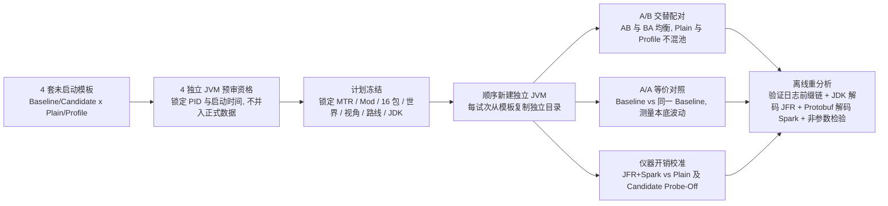

# MTR Memory Saver 技术原理与实验记录

本文档说明 **MTR Memory Saver**（Mod ID：`mtr_memory_sharing`，当前包名 `site.benli06` / `site.benli06.mixin`，历史 `0.3.x` 包名 `dev.abenli.mtrmemory`）的运行时设计、受控对照试验方法，以及自 `v0.1.1` 至 `0.4.8` 的实测数据与结论边界。

当前版本为 **`0.4.8`**（见 [gradle.properties](../gradle.properties)），默认目标为 **`official-nf265`**（Minecraft `1.21.1`、NeoForge `21.1.265`、Java `21`，定义于 [config/targets.json](../config/targets.json)）。`0.3.x` 英文历史技术文档见 [TECHNICAL.md](../TECHNICAL.md)。

---

## 概览与主要进展

在全部 16 个高负载测试资源包下，未安装 Memory Saver 的**原生官方 MTR `4.1.0-beta.2`**在模型精简与限流虚拟线程后依然会在 **`6 GiB` 与 `12 GiB` Java 堆下发生 `OutOfMemoryError`**（崩溃前堆冲顶 `11.98 GiB`，部分加载即保留 `9.87 GiB` 浅堆活跃对象，其中仅 `StoredVertexData` 与 `java.awt.Color` 即占 `5.67 GiB`）。引入早期伴侣 `v0.1.1` 后仍需 `8 GiB` 堆上限并滞留 `79,359,867` 个 `StoredVertexData`；未加 96 MiB LRU 前的 `v0.2.9` 在 `3 GiB` 启动期 OOM；`0.4.7` 在 `3 GiB` 堆下于第 4 次连续 `F3+T` 重载因 `String.join` 分配触发 OOM。

经过多阶段结构调整与工程迭代，面向官方 `4.1.0-beta.2` 的 **`0.4.8`**（`official-nf265` 预发布候选 `920c1f83...`）将全 16 包启动与热重载所需的 Java 堆上限压低至 `3 GiB`（`-Xmx3072M`，相比 `12 GiB` OOM 基线降低 `75%+`，相比 `v0.1.1` 降低 `62.5%`），彻底消除了 CPU 侧 `StoredVertexData` 对象常驻，在 `3 GiB` 堆下连续完成 `20 / 20` 次全包 `F3+T` 热重载（0 次 OOM），并实现了强杀无临时文件残留与不匹配 MTR JAR 启动前拒绝。在 65.26 MB 真实 BBModel 单输入微基准中，单遍摘要优化使 NF265 线程 CPU 减少 `19.24%`、耗时减少 `19.37%`。

### 关键内存占用对比：仅装官方 MTR `4.1.0-beta.2` vs 安装 Memory Saver

| 对比维度 | 仅装官方 MTR `4.1.0-beta.2`（不装 Memory Saver） | 官方 MTR + Memory Saver `v0.3.0`（同旧 16 包同夹具） | 官方 MTR + Memory Saver `0.4.8`（原生目录 16 包） |
| :--- | :--- | :--- | :--- |
| **夹具与加载器口径** | 旧 16 包（`2,541` 车），Fabric `0.20.1` | 旧 16 包（`2,541` 车），NeoForge `21.1.265` | 原生目录 16 包（`1,092` 声明 / `1,091` ID + `974` OBJ），NeoForge `21.1.248` / `21.1.265` |
| **最低稳定 `-Xmx` 堆上限** | **`> 12 GiB`**（`6 GiB` 与 `12 GiB` 均在解析期 OOM） | **`3 GiB`**（`-Xmx3072M`，较 `12 GiB` 降 `75%+`） | **`3 GiB`**（`-Xms512M -Xmx3072M`） |
| **采样 Java 堆实际使用量** | 崩溃前达 **`11.98 GiB`**（`12,867,687,504` B / `12 GiB`） | 启动峰值 **`2.812–2.815 GiB`** / 重载 **`2.890–2.896 GiB`** | 稳态 **`2.299–2.307 GiB`**（`NF248` Plain）；20 次重载中位 **`2.346 GiB`** / 峰值 **`2.873 GiB`**（`NF265`） |
| **堆直方图活跃对象（浅堆）** | 部分加载即 **`9.87 GiB`**（`76,641,609` `StoredVertexData` `3.43 GiB` + `75,312,045` `Color` `2.24 GiB` + `[B` `1.72 GiB`） | **`0`** 个 `StoredVertexData`（36 B 无损分块压缩） | **`0`** 个 `StoredVertexData`（36 B 分块压缩 + `.bbmodel`/`.obj`/`.mtl` 全流式读取） |
| **Windows 工作集 (Working Set)** | 早期基线未单独记录（OS 总占用高于 JVM 堆） | 采样 **`3.863–4.767 GiB`**（进程高水位 **`5.239–5.363 GiB`**） | 稳态 **`4.247–4.312 GiB`**（`NF248` Plain）；20 次重载中位 **`4.394 GiB`** / 高水位 **`5.593 GiB`**（`NF265`） |
| **Windows 私有提交 (Private)** | 早期基线未单独记录 | 采样启动 **`4.015–4.137 GiB`** / 重载 **`4.737–5.619 GiB`** | 稳态 **`4.455–4.474 GiB`**（`NF248` Plain）；20 次重载中位 **`4.870 GiB`** / 峰值 **`5.861 GiB`**（`NF265`） |
| **启动与 `F3+T` 热重载结果** | 启动 `OutOfMemoryError`（退出码 `-1`） | 启动与 `F3+T` 热重载全部通过（`2/2` 独立客户端） | 启动与 **`20 / 20` 次连续 `F3+T` 热重载**全部通过（`0` OOM，`Alt+F4` 退出码 `0`） |

> 边界说明：不装 Memory Saver 的原生 `12 GiB` OOM 测量与堆直方图（[without-companion-live-heap.txt](../evidence/without-companion-live-heap.txt)、[HISTORY.md](HISTORY.md#L303-L306)）采集于 Fabric `0.20.1` + 旧 16 包基线，未额外采集 Windows 私有提交且尚未单独封存不装伴侣模组的 NeoForge `21.1.265` 对照组。在同套旧 16 包下，[`v0.3.0`](../evidence/neoforge-v030-acceptance.json) 直接验证了堆需求从 `> 12 GiB` 降至 `3 GiB`；而 [`0.4.8`](../evidence/engineering-056/nf265-reload20/README.md) 在当前原生目录 16 包下保持 `3 GiB` 堆上限并将稳定性延伸到 `20/20` 次连续热重载（稳态数值来自 [`engineering-054`](../evidence/engineering-054/practical-spark/assessment.json) 与 [`nf265-reload20`](../evidence/engineering-056/nf265-reload20/observer/samples.jsonl) 原始采样）。注意 `-Xmx3072M` 仅约束 Java 堆，叠加堆外原生内存与显存驱动分配后，进程实际 Working Set / 私有提交约为 `4.25–5.86 GiB`。

### 核心指标变化

| 指标维度 | 基线 / 优化前状态 | 当前状态 / 优化后实测 | 夹具口径与边界说明 |
| :--- | :--- | :--- | :--- |
| **最低稳定启动 Java 堆上限** | **仅装原版 `> 12 GiB`**（`6 / 12 GiB` OOM）；`v0.1.1` `8 GiB`；`v0.2.9` `3 GiB` OOM | `3 GiB`（`-Xmx3072M`，较 `12 GiB` 降 `75%+`，较 `v0.1.1` 降 `62.5%`）（`v0.3.0` / `0.4.x`） | 实测两代官方 `4.1.0-beta.2` 16 包夹具；Windows 进程生命周期工作集 / 私有提交仍约 `4.25–5.86 GiB` |
| **CPU 侧顶点对象常驻** | `79,359,867` 个活跃 `StoredVertexData`（`v0.1.1`） | `0` 个（`v0.2.0+` 36 B/顶点 `Deflater.BEST_SPEED` 分块压缩） | 旧 16 包堆直方图；391 上海模型（`47,373,240` 顶点）压缩载荷为 `367,774,154` B |
| **非展示部位矩阵变换实例** | `2,494,194` 个 `StoredMatrixTransformations`（约 `753 MiB`） | `2,234` 个（`−99.91%`，仅保留 `PartType.DISPLAY`） | `v0.2.1` 5 GiB 堆直方图：整体浅堆由 `3.04 GiB` 降至 `2.31 GiB`（`−24.17%`） |
| **车辆配置 JSON DOM 浅堆** | 核心 MTR Gson 浅堆 `385,752,224` B（385.75 MB） | `99,865,272` B（99.87 MB，`−74.11%`） | `v0.2.2` 5 GiB 堆直方图：整体浅堆减少 `579 MiB`（`−24.50%`），118.25 MB 文本去重至 32.22 MB |
| **资源文本缓存驻留体积** | `2,000,187,675` 码元 / `592,010,155` B 压缩滞留 | `96 MiB`（`100,663,296` B）有界压缩 LRU（`v0.3.0+`） | 旧 16 包每周期驱逐 `3,010` 次；超预算条目旁路处理 |
| **大文本 SHA-256 哈希分配** | `16M` 码元：`134.22 MB`（ASCII）/ `536.87 MB`（混合）/ `738.20 MB`（Unicode） | `136.7–136.9 KB`（降低 `99.898%–99.981%`） | `v0.2.9` 起改用 4K/8K 固定数组流式编码；16M Unicode 最高降幅 `−99.981%` |
| **L1 路径优先 vs 先解码算哈希** | `0.4.0`：`608.67 MB` / `4,956.04 ms` | `0.4.2`：`228.98 MB`（`−62.38%`）/ `1,478.72 ms`（`−71.31%`），峰值堆 `−25.61%` | `0.4.2` 48-JVM 源码协议 A/B Plain；因 A/A 耗时跨越 `±15%` 门限，协议整体判为 `inconclusive` |
| **单遍边写边算哈希优化** | `0.4.8` 初版：写完快照后再整盘重读计算 SHA-256 | NF265 线程 CPU `−19.24%` / 耗时 `−19.37%`（NF248 `−16.88%` / `−18.50%`） | `engineering-055` 65.26 MB BBModel 6 对 AB/BA 微基准；NF265 6/6 对均改善 |
| **`3 GiB` 连续全 16 包 `F3+T` 重载** | `0.4.7` 第 4 次 OOM（`0/20`）；`0.4.8` 初版第 7 次 OOM（`0/20`） | `20 / 20` 次连续通过（NF248 `943b3d45...` 与优化 NF265 `920c1f83...` 均通过） | 原生目录全 16 包（1,092 声明 / 1,091 ID）、0 OOM、`Alt+F4` 退出码 `0`、JFR 可读 |
| **异常强杀残留与错包启动控制** | `0.4.6` `Runtime.halt(74)` 遗留 `.utf16`；`0.4.4` 错包继续进主菜单 | `4 / 4` 次强杀零残留；错包在注册前抛出 `MixinInitialisationError` 退出码 `1` | `DELETE_ON_CLOSE` 句柄由 Windows 内核关闭回收；`0.4.5+` 生效 |

### 版本演进概览

```text
仅装官方 MTR 4.1.0-beta.2 (> 12 GiB OOM，部分加载即留 9.87 GiB 浅堆)
  -> v0.1.1 (8 GiB 基线, 79.36M 顶点)
    -> v0.2.0-v0.2.9 (36B 压缩网格 -> DISPLAY 剪枝 -> JSON 共享 -> 分段读取 -> 流式哈希: 5 -> 4 -> 3.5 GiB)
      -> v0.3.0 (96 MiB 有界压缩 LRU: 首次在 3 GiB 下完成官方 4.1.0-beta.2 全 16 包启动与重载)
        -> 0.4.0-0.4.8 (精确二进制校验 + 两级单飞 2+64 队列 + 全流式 BBModel/OBJ + 单遍摘要: 3 GiB 连续 20/20 次重载)
```

> [!NOTE]
> **当前范围与结论边界（截至 `2026-11-24 +08:00`）**：
> - **已验证通过（`official-nf265` 预发布候选 `920c1f83...`）**：106 项 Java 回归测试、354 项 Python 工具测试、682 份历史脚本校验、69 项打包实机检查、假包/错包退出码 `1` 拒绝、`engineering-055` 单输入摘要微基准（CPU `−19.24%` / 耗时 `−19.37%`），以及 `engineering-056` 在 `3 GiB` 堆下连续 `20/20` 次全 16 包 `F3+T` 重载。
> - **未通过或无性能定论**：针对 `NF248` 的 12-JVM 实用 Spark 对照（`engineering-054`，对比同含 96 MiB LRU 的 `v0.3.0`）中，`0.4.8` 稳态私有内存仅变化 `−0.282%`（未达 `<= -10%` 且小于 AA 波动 `−0.415%`）、加载耗时 `+9.840%`（超出 `+5%` 护栏），叠加主机并发负载干扰，因果耗时归因判为 `inconclusive`，**未通过整客户端性能验收**。`0.4.2` 48-JVM 源码协议因 A/A 耗时跨越 `±15%` 亦判 `inconclusive`。
> - **待关闭门禁与分支状态**：优化后的 `920c1f83...` 尚未运行完整整客户端 [48-JVM 对照协议](../config/client-experiment.json)；独立显示帧采集（ETW/PresentMon 受限）、两小时连续路线（历史 01–03 失败）及全目录实景/交互验证仍在待办清单（见第 5.6 节）；针对定制版 `Performance v6` 的 `0.4.x` 移植当前暂停。

### 文档导航

| 主题方向 | 说明 | 对应章节与入口 |
| :--- | :--- | :--- |
| **问题成因与夹具说明** | 原生 5 类内存瓶颈、`0.3.x` 到 `0.4.x` 重构动机及两代 16 包夹具差异 | 第 1 节 |
| **运行时设计与实现原理** | 二进制校验、两级单飞调度、流式快照/单遍哈希、顶点压缩与 JSON 共享 | 第 2 节、[RUNTIME_DESIGN.md](RUNTIME_DESIGN.md) |
| **开发配置与 Mixin 列表** | 构建预设、7 项 `-D` 系统属性、内存口径边界及 19 处 Mixin 注入清单 | 第 3 节、[config/targets.json](../config/targets.json) |
| **试验方法与协议参数** | 独立 JVM 单位、无日志白名单归因、非参数二项区间及 3 套协议 | 第 4 节、[CLIENT_EXPERIMENT.md](CLIENT_EXPERIMENT.md)、[OPTIMIZATION.md](OPTIMIZATION.md) |
| **全阶段试验数据** | `v0.1.1` 至 `0.4.8` 所有通过、否决、OOM 与 `inconclusive` 记录 | 第 5 节 |
| **本地测试与离线复现** | Gradle/Python 回归命令、`evidence/` 离线重放脚本与核对清单 | 第 6 节、[BUILDING.md](../BUILDING.md) |

---

## 1. 背景与原生内存瓶颈

### 1.1 主要内存与加载瓶颈

通过对未修改和早期基线客户端进行堆直方图（GC Class Histogram）、JFR 采样、Windows 进程计数器与 OOM 堆栈分析（见 [2026-11-05 性能报告](../performance/20261105/README.md) 与 [ENGINEERING_REVIEW.md](ENGINEERING_REVIEW.md)），原生资源加载链路包含五类主要瓶颈：

| 瓶颈类别 | 原生代码行为 | 实测定量数据 | 直接后果 |
| :--- | :--- | :--- | :--- |
| **1. 同源模型重复解析** | 多涂装或编组车辆分别调用 `BlockbenchModelLoader` 与 `ObjModelLoader` | 旧 16 包中 `651` 独特 `.bbmodel` 触发 `4,608` 次解析；2026-11-05 JFR 中 ``BlockbenchModelLoader.lambda$loadModel$5`` 在启动栈占 `4,091 / 6,457`、重载栈占 `4,187 / 6,064` 样本 | 反复读写、解压并构型同一源文件 |
| **2. CPU 侧未压缩顶点常驻** | `NewOptimizedModelGroup` 为每个顶点保留 `StoredVertexData` 及嵌套 `java.awt.Color` | `v0.1.1` 直方图记录 `79,359,867` 个活跃 `StoredVertexData` | 对象头与嵌套引用开销远高于原始浮点缓冲，引发高频率 Full GC |
| **3. 非展示变换元数据滞留** | 对全部模型部件保留 `StoredMatrixTransformations`，但渲染器仅读取 `PartType.DISPLAY` | `v0.2.0` 直方图记录 `2,494,194` 个实例，占约 `753 MiB` 浅堆 | 大量不被消费的变换数据长期滞留老年代 |
| **4. 车辆配置 JSON 重复解析** | `VehicleModel.<init>` 为每辆车独立调用 Gson 解析相同的属性/位置 JSON | `v0.2.1` 直方图测得核心 MTR Gson 对象浅堆达 `385,752,224` 字节（385.75 MB） | 同结构 JSON 树在堆内多份存活 |
| **5. 文本无界缓存与 `String` 峰值** | `RESOURCE_CACHE` 持续累积文本；`IOUtils.toString` 倍增扩容、`String.getBytes` 全量复制、`String.join` 一次性分配连续大数组 | 单轮注册累计 `2,000,187,675` 码元（全压缩后仍占 `592,010,155` B）；重载期并发读入大体积 OBJ/BBModel | `3 GiB` 堆在冷启动（`v0.2.9`）或连续重载（`0.4.7` 第 4 次、`0.4.8` 初版第 7 次）触发 OOM |

### 1.2 从 0.3.x 重构为 0.4.x 的原因

`v0.3.0` 通过 `96 MiB` 有界文本 LRU 将启动堆需求降到 `3 GiB`，但代码审查发现四项结构性缺陷，促使 `0.4.x` 重新设计调度与 I/O 层：

1. **解析异常未完成 Future**：原生 `BlockbenchModelLoader` 捕获异常后仅记录日志而不调用 `setModelLoaded()`，导致 `0.3.x` 的共享 `CompletableFuture` 一直处于未完成状态。
2. **缓存查找顺序倒置**：`0.3.x` 在命中 Blockbench 源缓存前先经文本缓存还原字符串并计算 SHA-256，命中路径时依然产生 I/O 与哈希分配。
3. **非原子重载与无背压队列**：重载时释放索引与递增世代不在同一锁内完成，且未限流的解析队列会提前捕获大文本或回调。
4. **仅凭模组版本校验依赖**：当磁盘上安装了同版本号但字节码不同的 MTR JAR（如修改版或定制构建 JAR）时，无法在 Mixin 加载前阻断，导致运行期 `NoSuchMethodError` 或语义错误。

### 1.3 两套 16 包测试夹具说明

跨阶段对比数据时须区分两套“16 包”夹具，两者包含的注册条目与资源体积并不相同：

| 夹具代际 | 适用版本范围 | 车辆注册规模 | 每世代解析量 | 最大实际引用资源与说明 |
| :--- | :--- | :--- | :--- | :--- |
| **旧 16 包修复夹具** | `v0.1.1` – `v0.3.0` | `2,541` 辆车（290 物件 / 23 轨道） | `4,608` 次 Blockbench 请求 / `651` 独特源解析 | 包含旧 `02a05_arknight.bbmodel`（`65,255,687` UTF-8 字节）；记录见 [0.3.0 验收](../evidence/neoforge-v030-acceptance.json) |
| **MTR 4.1 原生目录 16 包夹具** | `0.4.x` 官方验证（含 `0.4.5`–`0.4.8`） | `1,092` 条车辆声明 / `1,091` 个去重 ID | 每世代 `651` 独特 BBModel + `974` OBJ 解析 | 最大引用 BBModel 为 `13,141,932` B；最大引用 OBJ 为 `mtr:hxd3d/25t__doors_b351ad1ecabb.obj`（`102,035,449` 字节/码元，SHA-256 `e43f1b6b...`）；旧 65 MB BBModel 未被目录引用，转用于单输入微基准 |

---

## 2. 0.4.8 运行时架构与实现原理

`0.4.8` 面向官方 MTR `4.1.0-beta.2` 的运行时采用四层架构：二进制校验、两级有界调度、流式快照与有界文本 LRU，以及无损网格与配置共享。全链路保留原生 MTR 的模型解析语义、坐标计算精度、`boxes` 包围盒计算、展示部位与车门/地板碰撞逻辑。


### 2.1 二进制指纹校验（CompatibilityPlugin / BinaryFingerprint）

- **源码位置**：[CompatibilityPlugin.java](../src/main/java/site/benli06/CompatibilityPlugin.java)、[BinaryFingerprint.java](../src/main/java/site/benli06/BinaryFingerprint.java)。
- **校验逻辑**：在 Mixin 插件加载阶段（`onLoad`），从 JAR 内嵌入的 `/mtr-memory-target.json` 读取预置 MTR 指纹，定位 `LoadingModList.get().getModFileById("mtr")` 的磁盘 JAR 文件，使用 `65,536` 字节缓冲区流式计算全文件 SHA-256 并比对。
- **行为修正（`0.4.4 -> 0.4.5`）**：早期如果 `onLoad` 抛出普通 `Exception`，Mixin 运行时会捕获后仅输出日志并跳过所有 Mixin 继续启动。自 `0.4.5` 起，不匹配时统一抛出 Mixin 标准的 **`MixinInitialisationError`**，在车辆注册开始前以**进程退出码 `1`** 终止启动。

### 2.2 两级单飞缓存与有界并发调度（GenerationWorkCache）

核心调度逻辑实现在 [GenerationWorkCache.java](../src/main/java/site/benli06/GenerationWorkCache.java)，分别支撑 [SharedBlockbenchCache.java](../src/main/java/site/benli06/SharedBlockbenchCache.java) 与 [StreamedObjCache.java](../src/targets/official/java/site/benli06/StreamedObjCache.java)：

1. **L1 路径键前置命中**：
   - 使用 [ResourceSourceKey.java](../src/main/java/site/benli06/ResourceSourceKey.java) 组合 `(providerIdentity, modelId, textureId, flipV)`。`providerIdentity` 使用 `System.identityHashCode` 与引用相等 `==` 判定，区分不同资源包或不同 `ResourceProvider` 实例在同路径下的资源。
   - L1 命中直接返回既有 `CompletableFuture`，不执行文件读取、UTF-16 解码与 SHA-256 计算。
2. **L2 内容去重与许可释放顺序**：
   - `SharedBlockbenchCache` 在工作线程捕获快照、算得 SHA-256 后计算 `Content(sha256Utf8Digest, textureId, flipV)`。若本世代已有相同内容键，线程在 `try (var owner = prepared.owner())` 内**先关闭快照通道并退出 `ReadAdmission` 作用域，再订阅主任务的 Future**，避免持有读许可等待其他任务造成死锁。
   - `StreamedObjCache` 有意将 L2 键也绑定为 `ResourceSourceKey`。原因是 `.obj` 文本按相对引用指向关联 `.mtl` 和贴图，文本完全一致但路径不同的 `.obj` 可能绑定不同的材质文件。
3. **有界队列、原生票据计数与异常保留**：
   - 使用公平信号量 `Semaphore(workerCount + queueCapacity, true)`（默认 `2 + 64 = 66` 槽位）、有界 `ArrayBlockingQueue`、`MTR-memory-parse` 守护线程池和 `MTR-memory-timeout`（默认 `300 s`）。入队任务仅携带轻量 `Supplier<Prepared<C, V>>` 描述符，不捕获完整源文本。
   - 每个任务创建时在锁内调用 `ModelLoaderBase::parseStarted`，直到原生代码返回后在 `Work.release()` 才归还许可并调用 `ModelLoaderBase::parseFinished`。因此 Future 超时取消后，若不可中断原生解析仍在执行，诊断中可观察到 `pending == 0` 而 `outstanding > 0`。
   - Blockbench 解析直接调用 `JsonParser.parseReader(...).getAsJsonObject()`，拒绝空对象或非对象 JSON 回退，并经 [ModelLoaderCompletionMixin.java](../src/main/java/site/benli06/mixin/ModelLoaderCompletionMixin.java) 校验原生确实对同源执行过 `setModelLoaded()` 才标记完成；失败则转为共享异常，并通过带访问集合的 BFS `preserveLateFailure` 防止异常环路。
4. **原子世代退役与释放**：
   - `beginReload()` 在同一把锁下把当前 `Epoch` 标记 `retired = true`、替换新 `Epoch`、清空索引并取消未决 Future；`finishRegistration()` 将 `retain` 置 `false` 并清理已完成索引键，门面各自保持模型和展示数据引用。

### 2.3 流式快照、单遍摘要与有界文本 LRU

1. **受限快照包装（[SnapshotResourceProvider.java](../src/main/java/site/benli06/SnapshotResourceProvider.java)）**：
   - [ResourceTextReadMixin.java](../src/targets/official/java/site/benli06/mixin/ResourceTextReadMixin.java) 通过 `@ModifyArg` 仅包装官方 MTR 字节码中已审计的 5 处默认 `ResourceProvider` 传参位点（`RailResource.<init>`、`CustomResourcesConverter.convertRails`、`convertObjects`、``CustomResourceLoader.lambda$reload$8``、``lambda$reload$10``），生成 [NativeResourceSnapshots.java](../src/targets/official/java/site/benli06/NativeResourceSnapshots.java) 快照句柄。遇自定义外部提供方或 `Keys.DEBUG` 本地文件调试时保留原 `provider.get(id)` 字符串行为。
2. **单通道快照与 `engineering-055` 单遍摘要（[Utf16TextSnapshot.java](../src/main/java/site/benli06/Utf16TextSnapshot.java) & [ResourceTextSnapshot.java](../src/main/java/site/benli06/ResourceTextSnapshot.java)）**：
   - 临时文件使用 `CREATE_NEW | READ | WRITE | DELETE_ON_CLOSE`（POSIX 下附 `rw-------`）创建 `.utf16` 通道；遇重名直接另取随机名，不覆盖其他进程文件。写入、等待配额、倒带和消费共用同一通道句柄；进程遇到 `Runtime.halt` 异常终止时，由 Windows 内核关闭最终句柄自动清理该临时文件。
   - **单遍边写边算哈希优化**：早期 `0.4.8` 在写完 UTF-16 快照后会再次读取整份通道计算 SHA-256；`engineering-055` 改由匿名 `FilterReader` 包装 `InputStreamReader`，在 [ResourceTextDigest.sha256(Reader)](../src/main/java/site/benli06/ResourceTextDigest.java) 流式算哈希的同一循环中完成 `admission.checkLength(length)` 校验与大端 UTF-16 写盘，省去磁盘重读过程。
   - **编码一致性**：对超过 `4,096` 码元的文本使用固定 `4,096`-char / `8,192`-byte 数组和 `CodingErrorAction.REPLACE`，并用 `CharBuffer.compact()` 跨块携带未配对高代理项，输出 SHA-256 与 `String.getBytes(UTF_8)` 逐字节一致。
   - **流式消费**：BBModel 直接通过 `JsonParser.parseReader(snapshot.reader())` 读取；OBJ 和每个 `.mtl` 经 `snapshot.utf8Stream()`（`8 KiB` `ReaderInputStream`）输入原生 `ObjReader.read` 与 `MtlReader.read`，且在调用 `@Invoker("loadModel")` 前关闭 `.obj` 快照。整个流程不在堆上拼接完整输入 `String`。
3. **非流式路径的加权溢写工作区（[TextWorkspace.java](../src/main/java/site/benli06/TextWorkspace.java) & [SegmentedResourceText.java](../src/main/java/site/benli06/SegmentedResourceText.java)）**：
   - 对于仍返回 `String` 的原生 `CustomResourceLoader.readResource`，线程进入 [ReadAdmission.java](../src/main/java/site/benli06/ReadAdmission.java)（默认 2 并发）并向 `TextWorkspace` 申请公平份额 `share = budget / readers`。
   - 累计码元达到 `4 * length > share` 时，将已收集的 `8,192`-char 内存分段写入 `Utf16TextSnapshot`、释放内存列表并**归还 `share`**；读完得知确切总长后再按 FIFO 顺序申请 `4 * length` 字节完整配额一次恢复。这样可以避免多个并发读取大文件的线程各自占用部分工作区并相互等待对方释放。同时通过 [StrictResourceText.java](../src/main/java/site/benli06/StrictResourceText.java) 向外抛出已存在资源的读取/超限异常。
4. **有界压缩文本 LRU（[BoundedTextCache.java](../src/main/java/site/benli06/BoundedTextCache.java)）**：
   - 默认预算 `96 MiB`（`100,663,296` B，由 [CompressedResourceTextCache.java](../src/main/java/site/benli06/CompressedResourceTextCache.java) 配置；历史 `0.3.0` 为 `maxMemory / 32`）。
   - 保守权重计算为 `weight = 192 + 2 * key.length() + (packed != null ? packed.length : 2 * length)`。若未压缩估算即超总预算则直接旁路；可准入条目在工作区非阻塞尝试 `tryClaim(5 * length)` 并以 `Deflater.BEST_SPEED` 压缩。压缩输出 `>= value.length()` 时抛出内部 `NoGain` 放弃压缩并保留原 `String`；准入由首个读取者直接返回原引用，后续命中按 `4 * length` 申请配额分段解压。

### 2.4 无损顶点压缩、展示部位剪枝与 JSON 共享

1. **无损分块顶点压缩（[PackedVertices.java](../src/targets/official/java/site/benli06/PackedVertices.java) & [PackedModelGroupStore.java](../src/main/java/site/benli06/PackedModelGroupStore.java)）**：
   - 每个顶点编码为 `36` 字节（9 个 32 位整型：`Float.floatToRawIntBits` 保存 `x, y, z`、`argb`、`u, v, nx, ny, nz`），按追加批经 `Deflater.BEST_SPEED` 压缩存储；暂存上限固定为 `1,024` 顶点（`36,864` B）。
   - `appendTransformed` 按原生 `(float)` 截断与顺序重放变换（`vx * factor + (float) x`、`vy + (float) y`、`vz * factor + (float) z` 含 `-0.0f` 语义），与 [PackedModelGroupOperations.java](../src/main/java/site/benli06/PackedModelGroupOperations.java) 一起保持 `boxes` 包围盒计算结果一致；GPU 上传阶段经 [PackedVertexEmitter.java](../src/main/java/site/benli06/PackedVertexEmitter.java) 附带 `OverlayTexture.NO_OVERLAY` 与 `IGui.DEFAULT_LIGHT` 发射到 `NewOptimizedModel`。
2. **展示变换按需留存（[DisplayRetention.java](../src/main/java/site/benli06/DisplayRetention.java) & [SharedBlockbenchLoader.java](../src/targets/official/java/site/benli06/SharedBlockbenchLoader.java)）**：
   - `DisplaySelectionMixin` 在车辆构造 `ModelProperties` 时收集 `PartType.DISPLAY` 部件名。门面在对象锁上同步 `whenComplete` 发布与 `selectDisplays` 剪枝，无论两者执行顺序如何，仅保留需要的展示部位条目，几何网格保持完整。
3. **车辆配置 JSON 共享（[VehicleJsonCache.java](../src/main/java/site/benli06/VehicleJsonCache.java)）**：
   - 在当前世代与读许可内，按 UTF-8 SHA-256 共享非空 `JsonObject`（空对象/异常回退原生实现），借助原生 `JsonReader` 将顶层键复制进读取器独立 `Map` 并只读访问子节点的特性保持各车属性隔离。

> [!NOTE]
> **定制版 `Performance v6` 说明**：仓库另在 `src/targets/v6/` 保留了面向定制版 `Performance v6`（`8bd419bd...`）的独立编译目标，用于适配其 `int` ARGB 顶点色、`ensureMutable()`、`builtModels` 缓存与 [V6LoaderLifecycleMixin.java](../src/targets/v6/java/site/benli06/mixin/V6LoaderLifecycleMixin.java) 关闭保护；该分支当前暂停维护，暂未移植 `0.4.8` 的 OBJ 流式组件。

---

## 3. 构建目标、运行参数与 Mixin 列表

### 3.1 构建目标矩阵

权威定义位于 [config/targets.json](../config/targets.json) 与 [gradle.properties](../gradle.properties)：

| 目标预设 (`-Ptarget=...`) | 绑定 MTR 依赖（完整 SHA-256 见第 6.4 节） | NeoForge 版本 | 当前状态 |
| :--- | :--- | :--- | :--- |
| **`official-nf265`**（默认与 CI 发布目标） | 官方 `4.1.0-beta.2`（`ff2b753d...`） | `21.1.265` | `0.4.8` 预发布候选目标（`920c1f83...`）：通过 106 Java 回归、69 打包检查、错包退出 1 与 20 次连续重载；整客户端 48-JVM 性能对照未运行 |
| `official-nf248` | 官方 `4.1.0-beta.2`（`ff2b753d...`） | `21.1.248` | 历史对照目标（`2026-11-23` 起停止新验证）；修订版 `943b3d45...` 完成 20 次重载与 12-JVM Spark 验证（性能未达标） |

> 注：[config/targets.json](../config/targets.json) 另保留面向定制版 `Performance v6` 的历史预设 `v6-nf248` 与 `v6-nf265`，当前新验证暂停。

### 3.2 JVM 系统属性与内存统计口径

所有运行参数在初始化时从 `-D` 系统属性读取一次。非法、非正整数或不一致的配置会立即抛出 `IllegalArgumentException`（见 [ReadAdmission.java](../src/main/java/site/benli06/ReadAdmission.java) 与 [RUNTIME_DESIGN.md](RUNTIME_DESIGN.md)）：

| JVM 系统属性 | `3 GiB` (`-Xmx3072M`) 默认参考值 | 约束条件与说明 |
| :--- | :--- | :--- |
| `mtr.memory.readers` | `2` | 并发读取 / 解压 / 模块解析作用域上限（`>= 1`，允许同线程嵌套） |
| `mtr.memory.parsers` | `2` | `GenerationWorkCache` 工作线程数（`>= 1`） |
| `mtr.memory.parseQueue` | `64` | 额外轻量描述符队列容量（`>= 1`；总槽位 = `parsers + parseQueue`） |
| `mtr.memory.parseTimeoutSeconds` | `300` | 入队等待与执行超时秒数（`>= 1`） |
| `mtr.memory.maxTextCodeUnits` | `201,326,592` (`min(Integer.MAX_VALUE - 8, maxHeap / 16)`) | 单资源 UTF-16 最大码元限制（`0.4.5` 曾为 `100,663,296`） |
| `mtr.memory.textWorkspaceBytes` | `805,306,368` (`max(maxHeap / 4, 4 * maxTextCodeUnits)`) | 加权文本工作区预算；须满足 `>= 4 * maxTextCodeUnits` |
| `mtr.memory.textCacheBytes` | `100,663,296`（`96 MiB`；`0.3.0` 曾名 `mtr.memory.resourceTextCacheBytes`） | `BoundedTextCache` 保守权重上限（`0` 表示禁用缓存） |

`3 GiB` 实机试验使用的基础 JVM 参数：

```text
-Xms512M -Xmx3072M -XX:+UseG1GC
```

> [!WARNING]
> **内存统计口径说明**：上述预算仅统计 LRU 缓存估算权重、瞬时工作区配额与并发槽位；调用方持有的返回值、原生 Gson/OBJ 对象图、待回收对象、OpenGL/驱动 VRAM 分配，以及 Windows 工作集（Working Set）和私有提交（Private Commit）均不计入其中。分析时不能将 Java Heap Used、Working Set、Private Commit 与 VRAM 相加，且 `jstat` 与 OS 轮询只能反映采样点观测下界。

### 3.3 Mixin 与 Accessor 列表（当前 Official 目标 18 项）

<details>
<summary>展开查看：0.4.8 Official 目标全部 18 个 Mixin / Accessor 注入点列表（13 公共 + 5 Official）</summary>

| 作用域 | Mixin / Accessor 类 | 目标 MTR 类与方法/字段 | 注入职责 |
| :--- | :--- | :--- | :--- |
| 公共 | [VehicleModelFactoryMixin](../src/main/java/site/benli06/mixin/VehicleModelFactoryMixin.java) | `VehicleModel.getModelLoaderBase` (`HEAD`) | 拦截 `.bbmodel` 请求并返回 `SharedBlockbenchCache.get` 独立门面 |
| 公共 | [BlockbenchParseExecutorMixin](../src/main/java/site/benli06/mixin/BlockbenchParseExecutorMixin.java) | `BlockbenchModelLoader.loadModel` (`ExecutorService.submit`) | 当线程持有 `OWNED_PARSE` 时内联同步执行解析 `Runnable`，外部调用保留原线程池 |
| 公共 | [ModelLoaderCompletionMixin](../src/main/java/site/benli06/mixin/ModelLoaderCompletionMixin.java) | `ModelLoaderBase.setModelLoaded` (`RETURN`) | 向 `OWNED_PARSE` 报告原生完成发布，区分成功发布与异常捕获未发布 |
| 公共 | [ModelLoaderAccess](../src/main/java/site/benli06/mixin/ModelLoaderAccess.java) | `ModelLoaderBase` 字段访问器 | 访问 `nameToNewOptimizedModelGroup` 与 `nameToRawModelDisplayParts` |
| 公共 | [DisplaySelectionMixin](../src/main/java/site/benli06/mixin/DisplaySelectionMixin.java) | `VehicleModel.createModelSupplier` | 提取 `PartType.DISPLAY` 部件名并配置门面剪枝 |
| 公共 | [DisplayPartAccess](../src/main/java/site/benli06/mixin/DisplayPartAccess.java) | `ModelPropertiesPartSchema` | 访问部件类型与部件名称集合 |
| 公共 | [PackedModelGroupMixin](../src/targets/official/java/site/benli06/mixin/PackedModelGroupMixin.java) | `NewOptimizedModelGroup` (`add` / `merge` / `build`) | 将 CPU 侧顶点列表存储替换为 `PackedModelGroupStore` 并在构建 GPU 模型时发射 |
| 公共 | [VehicleJsonCacheMixin](../src/main/java/site/benli06/mixin/VehicleJsonCacheMixin.java) | `VehicleModel.<init>` (`Utilities.parseJson`) | 按 UTF-8 SHA-256 共享非空 Gson `JsonObject` |
| 公共 | [VehicleJsonEpochMixin](../src/main/java/site/benli06/mixin/VehicleJsonEpochMixin.java) | `CustomResourceLoader.reload` (`HEAD` / `RETURN`) | 管理车辆配置缓存的世代清理 |
| 公共 | [CompressedResourceTextMixin](../src/main/java/site/benli06/mixin/CompressedResourceTextMixin.java) | `CustomResourceLoader.readResource` 与 `reload` | 将 `RESOURCE_CACHE` 接入 `CompressedResourceTextCache` 并在重载首尾重置与记日志 |
| 公共 | [SegmentedResourceTextMixin](../src/main/java/site/benli06/mixin/SegmentedResourceTextMixin.java) | ``ResourceManagerHelper.lambda$readResource$1`` (`IOUtils.toString`) | 用分段工作区读取器替代 `IOUtils.toString` |
| 公共 | [ResourceReloadMixin](../src/main/java/site/benli06/mixin/ResourceReloadMixin.java) | `CustomResourceLoader.reload` (`HEAD` / `RETURN`) | 协调世代切换、记录工作区与 LRU 状态，并清理原生残留集合 |
| 公共 | [SourceLifetimeMixin](../src/main/java/site/benli06/mixin/SourceLifetimeMixin.java) | `CustomResourceLoader.reload` (`HEAD` / `RETURN`) | 触发 `SharedBlockbenchCache.beginReload()` 与 `finishRegistration()` |
| Official | [ResourceTextReadMixin](../src/targets/official/java/site/benli06/mixin/ResourceTextReadMixin.java) | `CustomResourceLoader.reload`（5 处 `ResourceProvider`）及 ``lambda$readResource$22`` | 在 5 处已审计传参点包装 `NativeResourceSnapshots.wrap`；用 `StrictResourceText` 传播存在资源的 I/O 错误 |
| Official | [ObjVehicleFactoryMixin](../src/targets/official/java/site/benli06/mixin/ObjVehicleFactoryMixin.java) | `VehicleModel.getModelLoaderBase` (`HEAD`) | 对非 `DEBUG` 且来自快照提供方的 `.obj` 请求转交 `StreamedObjCache` |
| Official | [ObjModelInputMixin](../src/targets/official/java/site/benli06/mixin/ObjModelInputMixin.java) | `ObjModelLoader` | 流式接入 `.obj` / `.mtl` 输入并经 `@Invoker("loadModel")` 复用原生 `ObjSplitting.splitByGroups` |
| Official | [ObjSourceLifetimeMixin](../src/targets/official/java/site/benli06/mixin/ObjSourceLifetimeMixin.java) | `CustomResourceLoader.reload` (`HEAD` / `RETURN`) | 管理 `StreamedObjCache` 世代生命周期 |
| Official | [VertexColorMixin](../src/targets/official/java/site/benli06/mixin/VertexColorMixin.java) | `StoredVertexData.write` (`NEW java/awt/Color`) | 将 `(255, 255, 255, 255)` 纯白复用为 `Color.WHITE` |

</details>

> 定制 `v6` 目标另外包含分目标 `PackedModelGroupMixin` 与 `V6LoaderLifecycleMixin`（当前暂停维护）。

---

## 4. 对照试验设计

对照试验按照 [OPTIMIZATION.md](OPTIMIZATION.md) 与 [CLIENT_EXPERIMENT.md](CLIENT_EXPERIMENT.md) 的闭环规范设计，通过冻结计划、实例隔离、仪器校准与离线重分析避免单次测试误差影响判断。



### 4.1 实验控制原则

1. **独立样本单位为新建 JVM 进程**：同一 JVM 进程内的多次查询、时间采样或渲染帧具有缓存和 GC 自相关，不作为独立样本统计。
2. **模板复制与缓存边界声明**：每次试验从从未启动、无历史日志的模板冷复制到新临时目录，拒绝 `JAVA_TOOL_OPTIONS` 注入，显式固定 `-Xms512M -Xmx3072M -XX:+UseG1GC` 与 `-Dspark.backgroundProfiler=false`，并校验 `16` 个包顺序、世界存档、摄像机位姿（坐标差 `<= 0.1`、朝向差 `<= 0.1`）及位移门槛（`>= 1`）。因预启动与校验存在，试验范围明确记为 `fresh_jvm_warm_os_cache`（新 JVM + 暖 OS 文件缓存），不包含冷磁盘 I/O 对比。
3. **AB/BA 交替、A/A 对照与无探针校准**：按对轮换 `AB`/`BA` 顺序以抵消时间趋势；单独运行 `A/A` 对照度量噪声带宽，同时检验观察器及 Profiler 的额外内存和耗时开销是否处于预算内。
4. **基于 `native-invalid-model` 的逐次归因（[native-diagnostic-review.json](../config/native-diagnostic-review.json)）**：官方 MTR `4.1.0-beta.2` 默认空 `RailResource` 会输出一条关于 `transparent.png` 的 `Invalid model!` 日志。协议不使用日志字符串白名单过滤，而是捕获 `native-invalid-model.jsonl` 校验线程、栈深、MTR 调用者索引与返回实例，要求每个完整原生世代恰好 1:1 匹配；其余未归因报错或 OOM 直接判资格不通过。
5. **中立观察器 `1.0.3` 与防截断日志校验**：对比双方运行字节 SHA-256 完全一致的中立观察器 JAR。针对早先 `1.0.1/1.0.2` 下 `ReplaceFileW` 并发读取竞态（[publisher-race](../evidence/engineering-049/publisher-race/README.md)），`1.0.3` 改用 Windows `FileRenameInfoEx`（`REPLACE_IF_EXISTS | POSIX_SEMANTICS`）原位更新；离线验证核查进程 PID、创建时间顺序及 `latest.log` 逐前缀长度与 SHA-256。
6. **非参数置信区间与失败样本保留**：配对变化按 `100 * (B / A - 1)` 计算（零基线指标如 Full GC 用差值），置信区间由精确二项符号检验反演。在 6 对、95% 置信度下，双侧区间即观测配对差的最小至最大值；3 对无有限双侧边界，必判 `inconclusive`；A/A 检验须使整个置信区间落入容差带内。所有 OOM、超时和异常样本均保留在全量结果中；面临并发负载怀疑时，另由 [client_outlier_analysis.py](../tools/client_outlier_analysis.py) 输出配对 Tukey `1.5 × IQR` 与留一对敏感性并行报告。

### 4.2 三套配对试验协议

| 协议维度 | 协议一：源码查找 48-JVM（[source-experiment.json](../config/source-experiment.json)） | 协议二：整客户端 48-JVM 冻结协议（[client-experiment.json](../config/client-experiment.json)） | 协议三：实用 12-JVM Spark 验证（[client-practical-verification.json](../config/client-practical-verification.json)） |
| :--- | :--- | :--- | :--- |
| **验证目的** | 隔离对比 L1 路径优先 vs 先解码哈希在源码查找层的分配和耗时 | 整客户端稳态私有内存、加载时间、稳态堆、帧间隔与 GC 的正式评估 | 在 `NF248` 上快速完成全门禁配对检验并附带 Spark 剖析 |
| **进程排班** | **48 JVM**：6 对块 × 8 JVM（A/B Plain、A/B Profile、A/A Plain、A/A Profile），种子 `20261114` | **4 资格 + 48 试次**：6 对块 × 8 JVM，均衡 `AB`/`BA` 与仪器顺序，种子 `20261115` | **12 JVM**：2 对 Plain AB/BA + 2 对 Profile+Spark AB/BA + 1 对 Plain AA + 2 次 Candidate Probe-Off |
| **窗口与采样** | 默认 2 预热 + 2 实测世代（2026-11-14 实跑设为 1+1×2），10 ms 堆采样 | 启动至原生 RETURN 后首个静默样本为加载；随后 60 s 预热 + 180 s 稳态（2 s 采样，最大间隔 5 s） | 相同 60 s 预热 + 180 s 稳态；Profile 组叠 Spark `1.10.124`（100 ms 全线程采样 300 s）；Probe-Off 300 s 预热 + 180 s 稳态 |
| **主终点门限** | 存活线程分配字节：中位变化 `<= -10%` | Plain 稳态私有内存 (`steady_private_bytes`)：中位变化 `<= -10%` | Plain 稳态私有内存：中位变化 `<= -10%` |
| **护栏预算** | 耗时 `<= +5%` | Plain 加载 `<= +5%`；Plain 稳态堆 `<= +5%`；Profile 帧 p99 `<= +5%`；GC 总停顿 `<= +50 ms`；Full GC `<= 0` | 继承协议二全部 6 项护栏预算 |
| **A/A 与校准** | A/A 耗时 `±15%`、分配 `±5%`；Profile 与 Plain 分层统计 | A/A 私有/堆 `±5%`、加载 `±15%`、帧 p99 `±10%`、GC `±50 ms`/Full GC `0`；JFR 开销私有/堆 `±10%`、加载 `±15%`；要求 `neutral_probe_off_calibration` | AA 私有/堆 `±5%`、加载 `±15%`；JFR+Spark 私有/堆 `±10%`、加载 `±15%`；观察器+空闲 Spark vs Probe-Off 私有 `±10%` |

### 4.3 各类证据的适用范围

| 证据类型 | 可以验证的内容 | 不能直接外推的内容 |
| :--- | :--- | :--- |
| **静态代码审查与 Java 单测** | 数据结构约束、锁序、异常路径、字节编码等价性 | 运行期 Mixin 实际生效情况、客户端整体内存或帧率 |
| **隔离微基准与 64 MiB 负对照** | 特定子路径（L1 命中、单遍摘要、流式读写 vs `String.join`）的分配/CPU/OOM 行为 | 完整客户端冷/热加载总时长、Full GC 停顿或稳态私有内存 |
| **容量基线与 20 次重载耐久** | 给定 `-Xmx` 下是否能重复完成全包加载、`F3+T` 重载、句柄清理与退出 | 相同堆限下相对基线提升的耗时或内存百分比 |
| **受控配对对照（48-JVM / 12-JVM）** | 控制外部变量和仪器开销后的配对中位变化及精确二项区间 | 脱离硬件条件、包目录或未经无探针校准的普遍表现 |
| **局部实景与碰撞缓存对比** | 特定站点/车型渲染可见性与地板/车门计算等价性 | 全目录车系渲染质量、车窗透明性或两小时路线稳定性 |

---

## 5. 各阶段试验与实测结果

以下按时间顺序记录自 `v0.1.1` 到 `0.4.8` 的主要对照、消融、负对照和耐久结果，包括被否决方案、OOM 失败记录和 `inconclusive` 裁决。

### 各阶段结果概览

| 阶段 | 测试范围与夹具 | 主要定量输出 | 阶段结论 |
| :--- | :--- | :--- | :--- |
| **5.1** | `v0.1.1 -> v0.3.0`（旧 16 包 2,541 车 + `11-05` Profiling） | 经 13 轮消融/否决将官方 `4.1.0-beta.2` 启动堆上限降至 `3 GiB`；`v0.2.9` `3 GiB` 启动 OOM，对照 `v0.3.0` 双轮 `3 GiB` 通过 | `v0.3.0` 作为 `0.3.x` 官方 3 GiB 基线 |
| **5.2** | `0.4.0 vs 0.4.2`（源码查找 3 对试跑 + 48-JVM 协议一） | A/B Plain 分配 `−62.3803%`、耗时 `−71.3122%`；但 A/A 耗时 95% 区间 `[−35.87%, +48.19%]` 跨出 `±15%` | 协议一裁决 `inconclusive`（不通过性能验收） |
| **5.3** | `0.4.3 -> 0.4.7`（竞态、错包、102M OBJ、强杀、早期路线） | 竞态陈旧读 `1 -> 0`；错包退出码 `1`；102M OBJ 通过；`Runtime.halt(74)` 4/4 无残留；3 次 2 小时路线失败 | 正确性与门禁修复完成；2 小时路线未通过 |
| **5.4** | `0.4.7 -> 0.4.8`（64 MiB 对照 + NF248 20 次重载演进） | `0.4.7` 第 4 次 OOM -> `0.4.8` 初版第 7 次 OBJ OOM -> `0.4.8` 修订版 (`943b3d45...`) NF248 `20/20` 通过 | 流式读取闭环完成；ETW/PresentMon 采集受限 |
| **5.5** | `engineering-054`（`v0.3.0` vs `0.4.8` 12-JVM NF248 Spark） | Plain 稳态私有 `−0.282%`（未达 `−10%`）、加载 `+9.840%`（超 `+5%`）；稳态 MTR 占 CPU `1.90%–2.70%` | 性能验收未通过；受主机并发负载影响因果耗时 `inconclusive` |
| **5.6** | `engineering-055/056`（单遍摘要微基准 + NF265 20 次重载） | 单遍摘要 NF265 CPU `−19.237%` / 耗时 `−19.371%`（6/6 改善）；NF265 `920c1f83...` 连续 `20/20` 次重载通过 | 允许 `official-nf265` 限定开发预发布，尚有 P1/P2 待闭项 |

---

### 5.1 第一阶段：`v0.1.1` 至 `v0.3.0` 容量演进与 `2026-11-05` Profiling

在统一固定官方 MTR `4.1.0-beta.2`、旧 16 包夹具（`2,541` 车 / `651` 源解析）及 `-Djdk.virtualThreadScheduler.parallelism=2 -Djdk.virtualThreadScheduler.maxPoolSize=2` 下，无伴侣原版对照、`0.3.x` 容量边界与 `2026-11-05` 剖面测试数据如下（[HISTORY.md](HISTORY.md#L303-L306)、[without-companion-live-heap.txt](../evidence/without-companion-live-heap.txt)、[performance/20261105/README.md](../performance/20261105/README.md)、[neoforge-v029-3gb-baseline-startup.json](../evidence/neoforge-v029-3gb-baseline-startup.json)、[neoforge-v030-acceptance.json](../evidence/neoforge-v030-acceptance.json)）：

| 试验配置 | 堆上限 (`-Xmx`) | 注册结果 | 启动与进世界 | `F3+T` 重载 | GC 统计（启动 / 重载 / 稳态） | 稳态帧率与进程水位 |
| :--- | :--- | :--- | :--- | :--- | :--- | :--- |
| **仅装官方 `4.1.0-beta.2`（无伴侣，Fabric 参照）** | `12 GiB` (`12288M`) | `2,541` 声明未完成解析 | OOM 失败（退码 `-1`） | 未达 | 解析期 `OutOfMemoryError`，堆冲顶 `11.98 GiB` | 部分加载直方图 `9.87 GiB` 浅堆（`76.64M` 顶点 `3.43 GiB` + `75.31M` `Color` `2.24 GiB`）；未采 OS 计数器 |
| **`v0.2.9` 对照（NF265 失败）** | `3 GiB` (`3072M`) | 回退仅 `423` 内置 | OOM 失败（未进世界） | 未达 | 启动期堆耗尽，`jstat` 超时 | 采样峰值 WS `4.02 GiB` (`4,317,102,080` B) |
| **`Official + v0.3.0`（NF265 双轮）** | `3 GiB` (`3072M`) | `2,541` 车 / `651` 源 | 通过（两轮皆过） | 通过（各稳定 60 s） | 独立剖面测得启动 4 Full GC (`10.904 s`)、重载 10 Full GC (`13.750 s`)、稳态 0 Full GC (`0.075 s`) | 采样堆 `2.812 / 2.815 GiB`（启）、`2.890 / 2.896 GiB`（重）；全周期 WS 峰值 `5.239 / 5.363 GiB`；稳态 `58.85 FPS` (`p99 = 29.22 ms`) |
| **`Official + v0.3.0`（NF248 单次参照）** | `3 GiB` (`3072M`) | `2,541` 车 / `651` 源 | `166.74 s` 通过 | `143.54 s` 通过 | — | 单次顺序试跑，不作 NF248/NF265 对比 |

> 附注：`2026-11-05` 另对定制版 `Performance v6` 做过对照参考——单独运行时全 16 包在 `8 GiB` 堆仍发生 `165` 次 Full GC（停顿 `339.621 s`）并 OOM，配合历史 `v0.3.1-v6` 可在 `3 GiB` 完成启动与重载（详见 [performance/20261105/README.md](../performance/20261105/README.md) 与 [v6 验收](../compatibility/performance-v6/acceptance.json)）。

> [!NOTE]
> `v0.3.0` 虽然在 `3 GiB` 堆下完成了启动与单次重载，但进程生命周期 Working Set 仍达到 `5.24–5.36 GiB`，启动/重载 GC 停顿约 `10–13.7 s` 并伴随约 `25.8 / 23.4 GiB` 瞬时字节数组分配；该批剖面测试使用 `Intel HD Graphics P530`。后续 `0.4.x` 版本单独重新校验，不沿用历史数字作为自身性能证据。

<details>
<summary>展开查看：v0.1.1 至 v0.3.0 共 13 轮官方目标算法演进与否决记录</summary>

| 版本 | 引入机制 / 消融变更 | 离线等价 / 隔离审计结果 | 实机堆上限与诊断结果 | 工程裁决 |
| :--- | :--- | :--- | :--- | :--- |
| `v0.1.1` | 共享 Blockbench 源、独立门面、`Color.WHITE` 复用、注册后清 `RESOURCE_CACHE` | — | `8 GiB` 通过；直方图保留 `79,359,867` 个 `StoredVertexData` | 初始基线 |
| `v0.1.2` | 复用未变更 `StoredVertexData` 记录 | `1,002,880` 原始浮点位比对通过 | `8 GiB` 通过，`6 GiB` 失败；活跃顶点数仍为 `79,359,867`（未缩减） | 否决并归档 |
| `v0.2.0` | `PackedVertices` 36B 压缩块存储网格 | `1,200,028` 合成 + 391 上海模型（`47,373,240` 顶点）通过；压缩载荷 `367,774,154` B | `6 GiB` 与 `5 GiB` 通过（`4 GiB` OOM 回退 423 内置）；消除 `StoredVertexData` 行，6 GiB 浅堆 `3.04 GiB` | 采纳（最低 `5 GiB`） |
| `v0.2.1` | `DisplayRetention` 仅留 `PartType.DISPLAY` + 注册后清理源索引 | 10 类部位 / 16 展示实例审计全通过；20 类中的 10 类网格字节一致 | `5 GiB` 通过（`4 GiB` OOM）；5 GiB 浅堆 `3.04 -> 2.31 GiB`（`−24.17%`），`StoredMatrixTransformations` 由 `2,494,194 -> 2,234` | 采纳（进程峰值近似未变） |
| `v0.2.2` | 共享车辆构造非空属性/位置 JSON 树 | 1,397 真实输入 + 2,818 读取器通过（118.25 MB 去重至 32.22 MB） | `5 GiB` 通过（`4 GiB` OOM）；5 GiB 浅堆 `2.48 -> 1.87 GiB`（`−579 MiB / −24.50%`），Gson 行 `385.75 -> 99.87 MB` | 采纳 |
| `v0.2.3` | 不可变变换网格视图共享源压缩块字节 | 1,400,028 合成 + 391 上海模型通过；128 视图共享 1 个 741 B 数组 | `5 GiB` 通过，`4 GiB` OOM；浅堆 `1,872,474,744` B 比 `v0.2.2` (`1,871,160,520` B) 高约 `1.3 MiB` | 否决 |
| `v0.2.4` | 世代级内容驻留压缩顶点块池 | 数组去重与碰撞测试通过；391 模型通过 | `4 GiB` 注册期 OOM；无可见运行时收益 | 否决 |
| `v0.2.5` | 构造前按车辆属性预筛选源模型展示组 | 10 部位 / 16 实例测试通过；日志跳过 `2,505,577` 展示部件 | `5 GiB` 启动通过，但 `5 GiB` 重载与 `4 GiB` 启动均在读文本时 OOM | 否决 |
| `v0.2.6` | UTF-16 `Deflater` 压缩资源文本缓存 | 8,534 真实输入（`2,902,944,597` 码元压至 `1,026,235,694` B）通过 | 首轮 `4 GiB` 通过（WS 启动 `4.97` / 重载 `5.57 GiB` vs `v0.2.2` `6.00 / 6.57 GiB`）；搭乘客运模组时在 `4 GiB` 读取 OOM | 过渡采纳（暴露 `IOUtils` 扩充问题） |
| `v0.2.7` | 分段原生资源文本读取（`SegmentedResourceText`） | 8,534 真实 + 51 合成通过；8.8M ASCII 分配 `−58.1%` (`127.27 -> 53.28 MB`)，4.8M Unicode `−44.2%` | 2 次独立 `4 GiB` 启动+重载通过（采样堆 `3.73–3.87 GiB`，WS `5.37–5.60 GiB`） | 采纳（`4 GiB` 可重复） |
| `v0.2.8` | 4,096 码元分段解压压缩缓存命中 | 8,534 真实 + 44 合成通过；8 次 16M 命中分配 ASCII `−32.75%`、混合 `−39.61%`、Unicode `+0.46%` | 2 次独立 `4 GiB` 通过；`3.5 GiB` 首轮通过但复测重载 OOM，`3 GiB` OOM | 采纳（仍需 `4 GiB`） |
| `v0.2.9` | 4K/8K 有界数组流式计算大文本 UTF-8 SHA-256 | 8,534 真实（`2,902,870,923` 码元）+ 85 合成通过；16M 哈希分配 ASCII `−99.898%`、混合 `−99.974%`、Unicode `−99.981%` | 2 次独立 `3.5 GiB` (`-Xmx3584M`) 通过；`3 GiB` (`-Xmx3072M`) 启动 OOM 回退至 423 内置 | 采纳（最低 `3.5 GiB`） |
| `v0.3.0` | `maxHeap / 32` 预算（3 GiB 下 `96 MiB`）压缩文本 LRU | 8,534 真实 + 64 并发 + 500 抖动 + 20,000 空值通过；`v0.2.9` 超出 64 KiB 预算 | 2 次独立 `3 GiB` (`-Xmx3072M`) 启动+F3+T 重载通过（每周期驱逐 `3,010` 次） | `0.3.x` 官方基线 |

</details>

---

### 5.2 第二阶段：`0.4.0` 与 `0.4.2` 源码查找配对对照

为评估 `GenerationWorkCache` 中 L1 路径键命中先于文本解码与 SHA-256 计算的收益，试验选取 4 个真实模型（`02a05_arknight.bbmodel` 65.26 MB、`11a01.bbmodel` 20.69 MB、`02a05_arknight__doors` 1.83 MB、`zt_n9_extras.bbmodel` 11.68 KB）与 `3 GiB` G1 堆执行两组对照：

- **试验 2A（3 对交替试跑，2 世代 × 3 次查询，[report.json](../evidence/engineering-042/benchmark/report.json)）**：
  - Pair 1 (A->B)：哈希/读 `24/8 -> 8/8`，分配 `1,590,031,504 -> 457,858,728` B（`−71.20%`），耗时 `44,233.35 -> 4,161.34` ms，峰值堆 `643.5M -> 346.3M`；
  - Pair 2 (B->A)：分配 `1,589,029,200 -> 457,923,520` B（`−71.18%`），耗时 `17,357.55 -> 5,422.56` ms，峰值堆 `645.0M -> 343.7M`；
  - Pair 3 (A->B)：分配 `1,589,028,472 -> 457,838,216` B（`−71.19%`），耗时 `17,935.89 -> 4,694.75` ms，峰值堆 `561.9M -> 338.5M`。
  - 同期 `0.4.2` 完成 NF248 官方目标 Mixin 冒烟验证。

- **试验 2B（48-JVM 源码协议，[analysis.json](../evidence/source-protocol-20261114/analysis.json) & [README.md](../evidence/source-protocol-20261114/README.md)）**：按协议一运行 6 对块 × 8 JVM = 48 个独立 JVM（预设 1 预热 + 1 实测 × 2 查询）：

| 分层与指标 | 基线 (`0.4.0`) 中位数 | 候选 (`0.4.2`) 中位数 | 配对中位变化 | 精确 95% 二项符号区间 | 预设门限 | 单项状态 |
| :--- | ---: | ---: | ---: | --- | --- | --- |
| **A/B Plain**：存活线程分配 | `608,668,484` B | `228,983,192` B | `−62.3803%` | `[−62.3810%, −62.3783%]` | `<= -10%` | 通过 |
| **A/B Plain**：耗时 | `4,956.043` ms | `1,478.717` ms | `−71.3122%` | `[−73.1666%, −67.1779%]` | `<= +5%` | 通过 |
| **A/B Plain**：峰值堆 / 哈希 | `327.04 MB` / `8` | `243.22 MB` / `4` | `−25.605%` / `−50%` | `[−26.62%, −21.64%]` | 辅助观察 | — |
| **A/B Profile**：分配 / 耗时 | `608.66 MB` / `4,927.75 ms` | `228.97 MB` / `1,447.18 ms` | `−62.3823% / −70.9908%` | `[−62.3825%, −62.3804%]` / `[−71.5957%, −66.9015%]` | 仪器对照 | — |
| **A/A Plain & Profile**：存活分配 | `608.70` / `608.68 MB` | `608.66` / `608.68 MB` | `−0.0019%` / `+0.0021%` | `[−0.0203%, +0.0207%]` / `[−0.0039%, +0.0130%]` | `±5%` 等价 | 通过 |
| **A/A Plain**：耗时 | `5,483.139` ms | `4,877.895` ms | `−4.0068%` | `[−35.8728%, +48.1922%]` | `±15%` 等价 | `Inconclusive` |
| **A/A Profile**：耗时 | `5,318.916` ms | `5,359.934` ms | `+4.7945%` | `[−8.1040%, +22.5473%]` | `±15%` 等价 | `Inconclusive` |
| **JFR+GC 开销**：基线 / 候选耗时 | — | — | `+0.2923%` / `+2.1080%` | `[−11.80%, +2.19%]` / `[−11.10%, +20.46%]` | 描述控制 | — |

**试验 2B 结论：`inconclusive`（`performance_accepted = false`）**。A/B 分配与耗时降幅稳定，但 A/A 背景耗时置信区间跨越 `±15%` 容差边界，因此不授予性能验收通过。

---

### 5.3 第三阶段：`0.4.3` 至 `0.4.7` 正确性、强杀清理与早期路线测试

| 验证主题与版本 | 对照与故障注入方法 | 基线（负对照）表现 | 候选实测表现 | 状态与证据 |
| :--- | :--- | :--- | :--- | :--- |
| **世代退役等待竞态 (`0.4.2 vs 0.4.3`)** | 原生持锁阻塞时并发触发 `beginReload()` | `0.4.2` 出现 `model_stale_reads = 1`、`text_stale_reads = 1` | `0.4.3` 立即拒绝等待者，陈旧读 `0 / 0`，清理计数平衡 | 已修复；[result.json](../evidence/engineering-043/admission-regression/result.json) |
| **畸形 Blockbench 传播 (`0.4.4`)** | 注入非法 JSON 至原生解析与异步 Future | `Utilities.parseJson` 静默返回 `{}` | 以异常结束并清理索引；正常输入与原生结果一致 | 已修复；[verification-plan.json](../evidence/engineering-044/verification-plan.json) |
| **同版本假 MTR 拦截 (`0.4.4 vs 0.4.5`)** | 仅修改官方 MTR JAR 的 ZIP 注释（12,462 条目全一致，SHA `ff2b75... -> b4a1da...`） | `0.4.4` 记录日志并跳过 Mixin，游戏继续进入主菜单 | `0.4.5` 在注册前抛 `MixinInitialisationError` 并以退出码 `1` 中止，零探针注入 | 已修复；[044 失败](../evidence/engineering-044/packaged-mismatch-nf248/assessment.json) / [045 通过](../evidence/engineering-045/packaged-mismatch-nf248/assessment.json) |
| **102M 超大 OBJ 门限 (`0.4.5 vs 0.4.6`)** | 3 GiB 堆读取 `hxd3d/25t__doors_b351ad1ecabb.obj`（`102,035,449` 码元）与 CompactStrings 对照 | `0.4.5` 上限 `100,663,296` 拒载致全 16 包启动门禁失败 | `0.4.6` 双 CompactStrings 模式匹配哈希 `e43f1b6b...`、工作区归零；NF248 全包达 `1,092` 声明 / `1,091` ID | 已修复；[045 失败](../evidence/engineering-045/packaged-full-load-before-text-fix-nf248/failed-full-load-assessment.json) / [046 通过](../evidence/engineering-046/text-workspace/attempt-02/assessment.json) |
| **`Runtime.halt(74)` 强杀清理 (`0.4.6 vs 0.4.7`)** | 每目标 5 个独立小 JVM（写入至 `65,536/90,008` B 强杀、等待 `120,000` B 强杀 + 正常重启） | `0.4.6` 两阶段在盘上均遗留 `.utf16` 文件 | `0.4.7` 4 次强杀均由 Windows 内核清除自身文件，他方哨兵完整；双目标通过 24 生命周期 + 18 严格资源检查 + 错包退出 1 | 已修复；[owned-channel](../evidence/engineering-048/snapshot-owned-channel/README.md) / [packaged-047](../evidence/engineering-048/packaged-owned-channel/final-assessment.json) |
| **观察器 `1.0.3` 启动与路线 01–03 (`0.4.6` / `0.4.7`)** | 观察器从 `ReplaceFileW` 改用 `FileRenameInfoEx`；NF248 两小时路线尝试 01–03 | 路线 01（`1,432.81 s` 19 次重复态 + GPU 不可用）、02（`349.26 s` 间隙 `20.84 s > 20 s`）、03（首 `2,400 s` 窗通过，2,710 s 于 `textinputframework.dll` exit `1653` 崩溃） | 观察器 `1.0.3` 通过 27 项测试与千次发布压测（`768,317` / `1,293,774` 次读无错）；`0.4.7` NF248 稳态启动封存（`13/13` 样本，`60.015 / 59.747 s`，`1,092` 声明 / `1,091` ID） | 2 小时路线未通过；启动与观察器通过；[route-01](../evidence/engineering-046/route-attempt-01/assessment.json) / [route-02](../evidence/engineering-046/route-attempt-02/assessment.json) / [route-03](../evidence/engineering-048/route-recovery/README.md) / [1.0.3 启动](../evidence/engineering-050/neutral103-startup/README.md) |

---

### 5.4 第四阶段：`0.4.7` 至 `0.4.8` 流式输入对照与 20 次连续重载演进

1. **`0.4.7` NF248 第四次重载 OOM（[owned049d-reload-attempt03-oom](../evidence/engineering-050/owned049d-reload-attempt03-oom/README.md)）**：
   JVM `45784` 前 3 轮通过，第 4 次 `F3+T`（原生 epoch 5）在 BBModel 路径 `String.join -> SegmentedResourceText.read:55/28 -> StrictResourceText -> BoundedTextCache -> SharedBlockbenchCache` 抛出两次 `OutOfMemoryError: Java heap space`。最终记录 `0 / 20`，同时促使等待器失效检查改为 fail-fast。
2. **`-Xmx64M` 极限堆流式对照（[streamed-blockbench-input](../evidence/engineering-051/streamed-blockbench-input/README.md) & [streamed-obj-input](../evidence/engineering-051/streamed-obj-input/README.md)）**：
   在 `-Xmx64M` 堆下加载合成 `40 MiB` BBModel（`41,943,042` 码元）与 `40 MiB` OBJ：
   - 完整 `String.join` 对照组均在 `String.join` 处抛出 `OutOfMemoryError` 并以退出码 `1` 终止；
   - 流式快照候选组均以退出码 `0` 正常结束，输出 SHA-256 与原生解析结果等价且所有权计数清零。
3. **仅流式化 BBModel 的初版 `0.4.8` (`34c0b277...`) 第七次重载 OOM（[streamed051a-reload-oom](../evidence/engineering-051/streamed051a-reload-oom/README.md)）**：
   JVM `58036` 前 6 轮通过，第 7 次 `F3+T`（epoch 8 未返回 RETURN，回退 epoch 9 仅注册 `422 ID / 423 声明`）在 OBJ 同步链路 `String.join -> SegmentedResourceText -> CustomResourceLoader.readResource -> SnapshotResourceProvider.get -> VehicleModel` 发生 `OutOfMemoryError`（1,392 样本，最终 `verified_reload_count = 0`）。随后补齐了 OBJ/MTL 的 `StreamedObjCache` 流式实现。
4. **修订版 `0.4.8` (`943b3d45...`) NF248 20 次连续全包重载通过（[revised048-reload20](../evidence/engineering-052/revised048-reload20/README.md)）**：
   双官方目标各通过 105 项 Java 回归、69 项打包检查及错包拒载后，独立世界 JVM `65404`（`-Xms512M -Xmx3072M`、全部 16 包、观察器 `1.0.3`）在 epochs 2–21 连续通过 `20` 次 `F3+T`（1,016 样本中 417 有效；19 个中间间隔均满足双时钟 `>= 60 s`；末轮后 `14/14` 样本覆盖 `65.00 s` / 原生 `65.45 s`），全程 `1,091 ID / 1,092 声明`、0 OOM、`Alt+F4` 退出码 `0`、`191,350,424` 字节 JFR 可读。
5. **外围诊断工具限制（`engineering-052` / `053`）**：
   - [frame-permission-differential](../evidence/engineering-053/frame-permission-differential/README.md)：普通用户权限启用 ETW `Kernel-Process` 返回拒绝访问，PresentMon 返回 `0` 但未输出有效 CSV；
   - [spark-pilot](../evidence/engineering-053/spark-pilot/README.md)：`4 ms` 全线程触发高频 ThreadDump safepoint 停顿，调为 `100 ms` 采样 `30 s` 后跑通离线 Protobuf 导出。

---

### 5.5 第五阶段：`engineering-054` 12-JVM NF248 实用 Spark 对照

按协议三（[client-practical-verification.json](../config/client-practical-verification.json)）在 `official-nf248` 对比 `v0.3.0`（`b9c95bbe...`）与修订版 `0.4.8`（`943b3d45...`），固定全 16 包、`-Xms512M -Xmx3072M`、G1 与观察器 `1.0.3`，Profile 组叠全历史 JFR 与 Spark `1.10.124`（`100 ms` 采样 `300 s`）。共保留 18 次捕获（含 5 次失败尝试与 1 次被替代试次），从中选定 12 个无重叠窗口的合格独立 JVM：

#### 配对结论（[decision.json](../evidence/engineering-054/practical-spark/decision.json) & [outlier-sensitivity](../evidence/engineering-054/outlier-sensitivity/README.md)）

| 配对层与指标 | Pair 1 / 3 变化 | Pair 2 / 4 变化 | 中位变化 | 预算门限 | 门禁判定 |
| :--- | ---: | ---: | ---: | --- | :--- |
| **Plain AB**：稳态私有内存（主终点） | `−0.296%` (`−13.56 MiB`) | `−0.268%` (`−12.29 MiB`) | `−0.282%`（约 `−12.93 MiB`） | `<= -10%` | 未通过 |
| **Plain AB**：资源加载耗时（护栏） | `+9.401%` | `+10.279%` | `+9.840%` | `<= +5%` | 未通过 |
| **Plain AB**：稳态 Java 堆（护栏） | `+4.662%` | `+1.550%` | `+3.106%` | `<= +5%` | 通过 |
| **Profile+Spark AB**：稳态私有内存 | `−0.065%` | `−0.042%` | `−0.053%` | 控制对照 | — |
| **Profile+Spark AB**：加载 / 稳态堆 | `+11.757%` / `−0.548%` | `+14.311%` / `−0.680%` | `+13.034%` / `−0.614%` | — | — |
| **Profile+Spark AB**：帧 p99（护栏） | `−5.548%` | `+1.154%` | `−2.197%` | `<= +5%` | 通过 |
| **Profile+Spark AB**：GC 总停顿 / Full GC | `−2.083 ms` / `0` | `−7.739 ms` / `0` | `−4.911 ms` / `0` | `<= +50 ms` / `0` | 通过 |
| **AA Plain 噪声对照 (Pair 5)** | 私有 `−0.415%`、加载 `+5.793%`、堆 `+4.812%` | — | — | 私有/堆 `±5%`、加载 `±15%` | AA 私有波动大于 AB |
| **JFR+Spark 仪器开销** | 基线私有 `+1.293%`、加载 `−7.109%`、堆 `+1.765%` | 候选私有 `+1.525%`、加载 `−4.484%`、堆 `−1.881%` | — | 私有/堆 `±10%`、加载 `±15%` | 通过 |
| **观察器+空闲 Spark vs Probe-Off** | 稳态私有 `−0.310%` | — | — | `±10%` | 通过 |

- **Spark 稳态采样分析**：稳态期间渲染线程主要耗时位于 `LWJGL JNI.invokeV`（帧率同步与 GL 调度，`41.83%–66.07%`）与纹理上传/绘制（`nglTexSubImage2D`、`nglDrawElements`），MTR 模组 CPU 占比为 `1.90%–2.70%`；服务端线程 `94.50%–95.67%` 处于 `Unsafe.park`；`MTR-memory-parse` 线程池 `100.0%` 空闲。由于 `v0.3.0` 基线已具备 96 MiB 文本 LRU，稳态私有内存主要由渲染资源和 JVM 基础内存支配，`0.4.8` 未能在稳态私有内存上进一步降低 10%。
- **宿主机并发负载的事后敏感性分析（`2026-11-23`）**：由于该批次采样期间存在并发主机负载，使用 [client_outlier_analysis.py](../tools/client_outlier_analysis.py) 运行事后检验：
  1. 每组样本数为 `2`（低于 `minimum_group_samples = 6`），Tukey `1.5 × IQR` 筛查返回 `insufficient_replicates`（0 对被排除）；
  2. 留一对敏感性重算（分别移除 Pair 1–4 后的中位变化为 `+10.279% / −0.268%`、`+9.401% / −0.296%`、`+14.311% / −0.042%`、`+11.757% / −0.065%`）仍均处于验收门限之外。加载变慢的因果归因因缺少宿主机同期 CPU/磁盘遥测而判 `inconclusive`，`0.4.8` 整客户端性能验收保持不通过。

<details>
<summary>展开查看：engineering-054 12 个合格独立 JVM 逐试次实测数据（assessment.json）</summary>

| 试次 ID | PID | 组别与处理 | 加载耗时 (`loading_ms`) | 稳态私有内存 (GiB / B) | 稳态 WS (GiB) | 稳态堆 (GiB) | 启动峰值 WS / 堆 (GiB) | 帧 p99 / max (ms) | 稳态 GC 次数 / 总停顿 (ms) / Full GC |
| :--- | ---: | --- | ---: | ---: | ---: | ---: | ---: | ---: | ---: |
| `01-ab-plain-baseline` | `74208` | Plain 基线 (Pair 1) | `128,091.227` | `4.468` (`4,797,915,136`) | `4.274` | `2.196` | `4.041 / 2.271` | — | — |
| `01-ab-plain-candidate` | `57112` | Plain 候选 (Pair 1) | `140,132.884` | `4.455` (`4,783,693,824`) | `4.247` | `2.299` | `4.023 / 2.080` | — | — |
| `02-ba-plain-candidate` | `30432` | Plain 候选 (Pair 2) | `170,091.074` | `4.474` (`4,804,147,200`) | `4.312` | `2.307` | `4.017 / 2.773` | — | — |
| `02-ba-plain-baseline` | `36436` | Plain 基线 (Pair 2) | `154,236.910` | `4.486` (`4,817,039,360`) | `4.308` | `2.272` | `4.047 / 2.783` | — | — |
| `03-ab-profile-baseline` | `20864` | Profile+Spark 基线 (Pair 3) | `136,155.329` | `4.527` (`4,860,332,032`) | `4.330` | `2.279` | `4.058 / 2.607` | `28.033 / 144.003` | `12 / 90.404 / 0` |
| `03-ab-profile-candidate` | `64304` | Profile+Spark 候选 (Pair 3) | `152,163.253` | `4.524` (`4,857,176,064`) | `4.330` | `2.267` | `4.034 / 2.679` | `26.478 / 44.180` | `12 / 88.322 / 0` |
| `04-ba-profile-candidate` | `65132` | Profile+Spark 候选 (Pair 4) | `144,149.973` | `4.542` (`4,876,861,440`) | `4.336` | `2.252` | `4.080 / 2.637` | `26.990 / 45.906` | `12 / 86.755 / 0` |
| `04-ba-profile-baseline` | `476` | Profile+Spark 基线 (Pair 4) | `126,102.910` | `4.544` (`4,878,905,344`) | `4.338` | `2.268` | `4.085 / 2.581` | `26.682 / 45.899` | `13 / 94.494 / 0` |
| `05-aa-plain-a` | `36452` | Plain AA 基线 A (Pair 5) | `142,094.729` | `4.488` (`4,818,784,256`) | `4.334` | `2.196` | `4.044 / 2.267` | — | — |
| `05-aa-plain-b` | `39032` | Plain AA 基线 B (Pair 5) | `150,326.060` | `4.469` (`4,798,775,296`) | `4.310` | `2.302` | `4.009 / 2.756` | — | — |
| `06-probe-off-01` | `58176` | Probe-Off 候选 1 (Pair 6) | `208,186.180` | `4.486` (`4,816,470,016`) | `4.325` | — | `3.866 / —` | — | — |
| `06-probe-off-02` | `1640` | Probe-Off 候选 2 (Pair 6) | `190,161.025` | `4.471` (`4,801,224,704`) | `4.271` | — | `3.872 / —` | — | — |

</details>

---

### 5.6 第六阶段：`0.4.8` 单遍摘要微基准、NF265 20 次重载与待关闭门禁

#### 试验 6A：单遍摘要微基准对比（[snapshot-digest/README.md](../evidence/engineering-055/snapshot-digest/README.md)）

以 `65,255,687` 字节 `02a05_arknight.bbmodel` 为输入，每轮采用 6 对 AB/BA 新建 JVM（3 预热 + 3 实测），12 个结果全部匹配 Python 独立 SHA-256 且零淘汰：

| 微基准轮次 | 基线 vs 优化候选 | 指标 | 6 对各自配对变化 (`100*(B/A-1)`) | 配对中位数变化 | 测试上下文说明 |
| :--- | :--- | :--- | :--- | ---: | :--- |
| **NF248 初测** ([assessment.json](../evidence/engineering-055/snapshot-digest/assessment.json)) | `943b3d45...` vs `442c3e5a...` | 线程 CPU | `−16.22%, −16.60%, −17.16%, −3.26%, −18.89%, −18.22%` | `−16.883%` | 首对与客户端启动重叠；桌面并发运行；无 AA 校准 |
| 同上 | 同上 | 实测耗时 | `−14.15%, −18.45%, −24.80%, +3.24%, −20.10%, −18.54%` | `−18.499%` | 同上 |
| **NF265 独立复测** ([nf265-benchmark.json](../evidence/engineering-055/snapshot-digest/nf265-benchmark.json)) | `134770ac...` vs `920c1f83...` | 线程 CPU | `−19.72%, −16.59%, −20.45%, −16.59%, −23.01%, −18.75%` | `−19.237%` | 客户端退出后单独运行；6/6 对改善；仅改动 3 类 + 1 匿名 `Reader`；无 AA 校准 |
| 同上 | 同上 | 实测耗时 | `−20.94%, −16.97%, −20.64%, −16.14%, −23.11%, −18.11%` | `−19.371%` | 同上 |

> [!NOTE]
> `engineering-055` 仅测量单输入捕获+摘要+读回微基准；优化后的 `920c1f83...` 尚未在整客户端上重跑 48-JVM 或 12-JVM 对照，因此微基准结果不直接等价于整客户端加载加速。

#### 试验 6B：NF265 预发布候选（`920c1f83...`）封存结果（[release-decision/README.md](../evidence/engineering-056/release-decision/README.md)）

自 `2026-11-23` 起验证聚焦到 `official-nf265` 产物（SHA-256 `920c1f83...`）：

1. **回归与打包检查**：106 项 Java 回归测试、354 项 Python 工具测试与 682 份历史脚本校验通过；组件故障 JVM `38188` 通过 69 项检查（24 生命周期 + 18 严格资源 + 27 OBJ）、工作区清零、退出码 `0`；错包 JVM `60548` 注册前退出码 `1`；全 16 包启动 JVM `21632` 完成 `1,092` 声明 / `651` BBModel / `974` OBJ（[nf265-packaged](../evidence/engineering-056/nf265-packaged/README.md)、[nf265-runtime.json](../evidence/engineering-055/snapshot-digest/nf265-runtime.json)）。
2. **20 次连续全 16 包 `F3+T` 重载（[nf265-reload20/README.md](../evidence/engineering-056/nf265-reload20/README.md)）**：
   独立世界 JVM `71724`（全部 16 包、`-Xms512M -Xmx3072M`、G1、观察器 `1.0.3`、无测试探针）在 epochs 3–22 连续完成 20 次 `F3+T`（epoch 1 为启动，epoch 2 为先前的输入法校准不计入 20），`verified_reload_count = 20`、`longest_verified_reload_run = 20`。全量保留 1,199 样本（482 有效 + 717 加载期未就绪），19 个中间间隔满足消费/原生双时钟 `>= 60 s`，第 20 轮后独立观察器 `14/14` 样本覆盖 `65.003 s` / 原生 `64.795 s`；注册稳定 `1,091 ID / 1,092 声明`、0 OOM、`Alt+F4` 退出码 `0`、`213,901,766` 字节 JFR 可读。
3. **当前发布边界**：允许将 `official-nf265` 作为限定范围的 `0.4.8` 开发预发布候选打包发布，并在支持文档中明确保留未完成门禁。

#### 待关闭门禁

| 优先级 | 未关闭门禁 | 缺口与后续需求 |
| :--- | :--- | :--- |
| **P1** | **优化后 `NF265` (`920c1f83...`) 整客户端 48-JVM 对照** | 需在无高并发干扰宿主机上重跑 [client-experiment.json](../config/client-experiment.json) 与独立 `neutral_probe_off_calibration`，并采集对齐的宿主机资源遥测。 |
| **P1** | **独立显示帧呈现时间戳采集** | 普通用户权限 ETW 拒绝访问且 PresentMon 未产出有效 CSV，需补充真实显卡呈现时间戳证据。 |
| **P1** | **两小时连续路线耐久** | 历史 01–03 失败；需在最新 `0.4.8` 采集完整三段 `7,200 s` 窗口与可读 JFR。 |
| **P1** | **全目录实景渲染、车门、地板与上下车交互** | 局部 DC01 缓存一致验证不能覆盖全车系外观、车窗透明渲染、动画与物理上下车。 |
| **P2** | **定制版 `Performance v6` 的 `0.4.x` 移植** | 当前暂停 |

---

## 6. 本地验证与离线复现

### 6.1 本地构建与自动化测试（PowerShell 7）

参考 [BUILDING.md](../BUILDING.md) 与 [tests/README.md](../tests/README.md)，无需游戏实例即可运行单元测试与确定性打包：

```powershell
# 运行 Java 单元测试与回归测试
./gradlew.bat test

# 构建 official-nf265 JAR 与 .build.json 清单
./gradlew.bat build -Ptarget=official-nf265

# 运行 Python 工具测试与历史脚本完整性校验
python -m pip install -r requirements-test.txt
python -X utf8 -m minecraft_testkit verify
python -X utf8 -m minecraft_testkit test
```

### 6.2 离线校验封存证据

仓内 `evidence/` 目录包含离线验证脚本，可直接核对载荷哈希、日志前缀链、原生 epoch 序列及重构结论：

```powershell
# 只读离线复验（退出码 0 表示全项校验一致）
python -X utf8 evidence/engineering-056/nf265-reload20/verify_sealed.py
python -X utf8 evidence/engineering-052/revised048-reload20/verify_sealed.py
python -X utf8 evidence/engineering-051/streamed051a-reload-oom/verify_sealed.py

# 需输出汇总 JSON 的离线脚本（输出至临时 .cache/ 目录）
python -X utf8 evidence/engineering-050/owned049d-reload-attempt03-oom/verify_sealed.py .cache/recheck-050.json
python -X utf8 tools/client_outlier_analysis.py --assessment evidence/engineering-054/practical-spark/assessment.json --output .cache/recheck-054-outlier.json

# 离线解码 .sparkprofile（基于公开 Protobuf getter，不加载 Minecraft）
javac -d .cache/spark-export tools/SparkProfileExport.java
java -cp ".cache/spark-export;<audited-spark.jar>" SparkProfileExport --self-test
java -cp ".cache/spark-export;<audited-spark.jar>" SparkProfileExport <local.sparkprofile>
```

### 6.3 复核检查项

- **身份与指纹**：核对 `build/libs/*.build.json` 与第 6.4 节 64 位 SHA-256，确认被测 JAR 与官方 MTR `4.1.0-beta.2` 对应 `official-nf265` 预设完全一致。
- **夹具口径**：确认对比 `v0.1–v0.3` 时对应“旧 16 包 `2,541` 车”，对比 `0.4.x` 时对应“原生目录 `1,092` 声明 / `1,091` ID + `974` OBJ”。
- **失败记录**：检查 `engineering-050`（`0/20`）、`051`（`0/20`）、`054`（12-JVM 未达标）与 `0.4.2`（`inconclusive`）均保留在原始结果中。
- **日志归因**：确认 `native-invalid-model.jsonl` 与 [native-diagnostic-review.json](../config/native-diagnostic-review.json) 为逐世代 1:1 精确匹配，未使用正则忽略。
- **范围声明**：区分单输入微基准、`20/20` 重载耐久与完整整客户端 48-JVM 性能验收的适用边界。

### 6.4 构件 SHA-256 与文件索引

<details>
<summary>展开查看：全版本构件与绑定依赖完整 64 位 SHA-256 列表</summary>

| 构件 / 依赖条目 | 版本与说明 | 完整 64 位 SHA-256 |
| :--- | :--- | :--- |
| **官方 MTR（NeoForge 1.21.1）** | `4.1.0-beta.2` 绑定目标 | `ff2b753d03f2bcc000d053a9014e4250c8ba720daa9b69b6899fe7dc26be1efa` |
| **官方 MTR（Fabric 1.21.1 参考）** | `4.1.0-beta.2` | `5da075f7d63daea89da17348ace0959a0c216cbaf14a322d063a64bec44aae94` |
| **`0.4.8` NF265 预发布候选** | 单遍摘要优化后 + 20 次重载通过 | `920c1f833b6f173c7443ff5956493b779acfeceb293fa640817a459985db3f5b` |
| **`0.4.8` NF265 优化前基线** | `a632149` 修订期对照版本 | `134770acd53ec81325993604e8441d213d9ea1be990adb3bc2877b0cb7cc17dd` |
| **`0.4.8` NF248 修订版** | 20 次重载通过 / 12-JVM Spark 未达标 | `943b3d455fa3ce9d3ede74bc1a2071ece7bf70b09d9b7f829027347b53a9b588` |
| **`0.4.8` NF248 摘要优化中间版** | 单遍摘要 NF248 初测候选 | `442c3e5abf2067ddc0545a1d0fed32231e11e9175ac5f98da2f804c5f4aa2bae` |
| **`0.4.8` NF248 初版（仅 BBModel 流式）** | 第 7 次重载 OBJ `String.join` OOM | `34c0b27780f7a3d4d5f29845f98a655f22cae0b1eeca1a4a95ab86b60921b0c1` |
| **`0.4.8` NF265 初版（仅 BBModel 流式）** | 初版构建记录 | `89720d30c76b4f5dfc6a71a398bb67c3138cf4f8f4e0afd0dbb062753552e735` |
| **`0.4.7` NF265 / NF248** | 第 4 次重载 BBModel `String.join` OOM | `12162be2d0e75962e58d33dec6951e0a82b1455ef1466f9b94c3dce1c4d36a02` / `e8b5b40230d0f44c541c12b32c8a30d4c2ea056b8a972335ae10166496837a99` |
| **`0.4.2` / `0.4.0` NF248** | 48-JVM 源码协议对比双方 | `70ed09564bd41a09cf08f468d73474bad3bdc2cd287ed4dca389c8f74c73a885` / `2da554aaa25daf4438cd994d916f858cd8becb1f8432bd73b63867bc1050eb2f` |
| **`v0.3.0` NF265 / NF248** | `0.3.x` 官方 3 GiB 基线 | `eb21c0062f7944a7d2c015cb2eee5a1d24c11be4af2286bbbbfa4625d6cd2d54` / `b9c95bbe79c6c76fe6a0c9af6bdb4f9ed7ce6b007fecdb1c9f543544ce562f02` |
| **`v0.2.9` NF265** | `3 GiB` 启动 OOM 对照基线 | `b8e903a3292cca032d6b1038d58f5f0b18be4823148e633ca4114263e2a83b6d` |
| **定制 MTR Performance v6** | `4.1.0-beta.2-mc1.21.1-performance-v6`（暂停维护参考） | `8bd419bd798c2ab2fa03e08850409387804fdeb2e4f2987c66b9984236263585` |

</details>

| 主题分类 | 相关文档与源码、证据目录 |
| :--- | :--- |
| **工程设计与使用文档** | [RUNTIME_DESIGN.md](RUNTIME_DESIGN.md)、[OPTIMIZATION.md](OPTIMIZATION.md)、[CLIENT_EXPERIMENT.md](CLIENT_EXPERIMENT.md)、[SPARK_PROFILING.md](SPARK_PROFILING.md)、[ENGINEERING_REVIEW.md](ENGINEERING_REVIEW.md)、[SUPPORT.md](SUPPORT.md)、[INSTALL.md](INSTALL.md)、[CI_CD.md](CI_CD.md)、[HISTORY.md](HISTORY.md) |
| **核心 Java 实现** | [CompatibilityPlugin.java](../src/main/java/site/benli06/CompatibilityPlugin.java)、[GenerationWorkCache.java](../src/main/java/site/benli06/GenerationWorkCache.java)、[ResourceTextSnapshot.java](../src/main/java/site/benli06/ResourceTextSnapshot.java)、[BoundedTextCache.java](../src/main/java/site/benli06/BoundedTextCache.java)、[PackedModelGroupStore.java](../src/main/java/site/benli06/PackedModelGroupStore.java)、[StreamedObjCache.java](../src/targets/official/java/site/benli06/StreamedObjCache.java) |
| **协议与封存证据** | [config/targets.json](../config/targets.json)、[performance/20261105/README.md](../performance/20261105/README.md)、[source-protocol-20261114](../evidence/source-protocol-20261114/README.md)、[engineering-050](../evidence/engineering-050/owned049d-reload-attempt03-oom/README.md)、[engineering-051](../evidence/engineering-051/streamed051a-reload-oom/README.md)、[engineering-052](../evidence/engineering-052/revised048-reload20/README.md)、[engineering-054](../evidence/engineering-054/practical-spark/README.md)、[engineering-055](../evidence/engineering-055/snapshot-digest/README.md)、[engineering-056](../evidence/engineering-056/nf265-reload20/README.md) |
