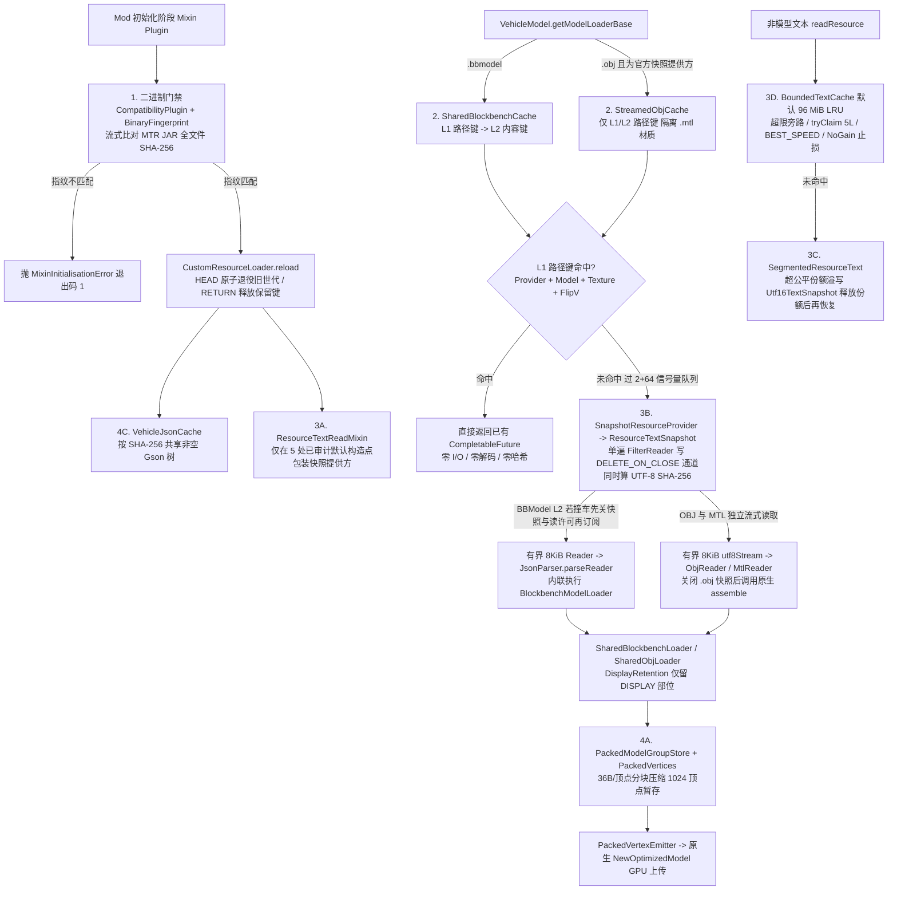
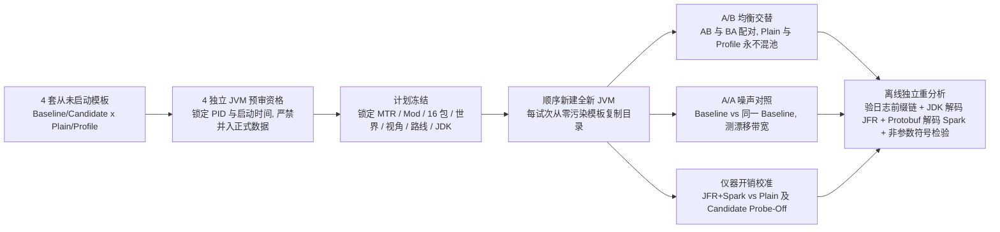

# MTR Memory Saver 技术原理、对照试验设计与全阶段实测报告

> **定位**：面向模组开发者、架构维护者与社区审计人员的官方网站级技术参考手册。
>
> **适用范围**：Mod ID `mtr_memory_sharing`（当前包名 `site.benli06` / `site.benli06.mixin`，`0.3.x` 历史包名 `dev.abenli.mtrmemory`）· 当前版本 **`0.4.8`** · 首选目标 **`official-nf265`**（Minecraft `1.21.1` / NeoForge `21.1.265` / Java `21`）· `0.3.x` 英文历史归档见 [TECHNICAL.md](../TECHNICAL.md)。

---

## 一眼看懂：我们实现了多大进步

原生 **Minecraft Transit Railway (MTR 4.1.0-beta.2)** 在全 16 套大体积资源包下存在严重的对象图滞留与瞬时大字符串分配问题：定制版本 `Performance v6` 单独开启 **`8 GiB` Java 堆**仍在启动阶段经历 **`165` 次 Full GC（累计停顿 `339.621 s`，占启动总耗时 `71%`）并因 OOM 退出**；早期基线 `v0.1.1` 需要 `8 GiB` 堆并在堆直方图中留下 **`79,359,867` 个 `StoredVertexData`**；即便到了 `0.4.7`，在 `3 GiB` 堆下连续 `F3+T` 重载仍会在第 4 次因 `String.join` 拼装大文本触发 `OutOfMemoryError`。

经过从 `v0.1.1` 到 `0.4.8` 的连续六阶段结构改造，**`0.4.8`（`official-nf265` 预发布候选 `920c1f83...`）将全 16 包运行与热重载门槛从 `8 GiB` 降至 `3 GiB`（`-Xmx3072M`，Java 堆上限降低 `62.5%`），将 CPU 侧顶点对象归零，并在 `3 GiB` 堆下连续通过 `20 / 20` 次全包 `F3+T` 重载、0 次 OOM、强杀零临时文件残留与秒级错包阻断。**

### 核心进步对比（Before → After）

| 性能与可靠性维度 | 优化前 / 基线状态 | 优化后 / 当前实测表现 | 夹具口径与验证边界 |
| :--- | :--- | :--- | :--- |
| **最低稳定启动 Java 堆上限** | `8 GiB`（`v0.1.1`）；`Performance v6` 单独在 **`8 GiB` 仍 OOM**（165 Full GC / `339.621 s`） | **`3 GiB`（`-Xmx3072M`，堆上限 −62.5%）**（`v0.3.0` / `v0.3.1-v6` / `0.4.x`） | 实测两代 16 包夹具；注：Windows 进程生命周期工作集 / 私有提交仍约 `4.46–5.36 GiB` |
| **CPU 侧顶点对象图常驻** | `79,359,867` 个活跃 `StoredVertexData`（`v0.1.1`） | **`0` 个**（`v0.2.0+` 36 B/顶点 `Deflater.BEST_SPEED` 无损分块压缩） | 旧 16 包直方图；391 上海模型（`47,373,240` 顶点）压缩为 `367,774,154` B |
| **非展示部位原始矩阵变换** | `2,494,194` 个 `StoredMatrixTransformations`（约 `753 MiB`） | **`2,234` 个（−99.91%）**（仅保留 `PartType.DISPLAY`） | `v0.2.1` 5 GiB 堆直方图：整体浅堆由 `3.04 -> 2.31 GiB`（**−24.17%**） |
| **车辆配置 JSON DOM 浅堆** | 核心 MTR Gson 浅堆 `385,752,224` B（385.75 MB） | **`99,865,272` B（99.87 MB，−74.11%）** | `v0.2.2` 5 GiB 堆直方图：整体浅堆 `−579 MiB`（**−24.50%**），118.25 MB 去重至 32.22 MB |
| **资源文本缓存驻留体积** | `2,000,187,675` 码元 / `592,010,155` B 压缩滞留 | **`96 MiB`（`100,663,296` B）有界压缩 LRU**（`v0.3.0+`） | 旧 16 包实测每注册周期稳定驱逐 `3,010` 次；超预算直接旁路不挤压堆 |
| **大文本 SHA-256 哈希分配** | `16M` 码元输入：`134.22 MB` / `536.87 MB` / `738.20 MB` | **`136.7–136.9 KB`（−99.898% ~ −99.981%）**（ASCII / 混合 / Unicode） | `v0.2.9` 起采用 4K/8K 固定数组流式编码；16M Unicode 最高降幅达 **−99.981%** |
| **缓存路径命中前置（L1 vs 先哈希）** | `0.4.0` 先读解码算哈希：`608.67 MB` / `4,956.04 ms` | **`228.98 MB`（−62.38%） / `1,478.72 ms`（−71.31%）**（峰值堆 **−25.61%**） | `0.4.2` 48-JVM 源码协议 A/B Plain；注：因 A/A 耗时超 `±15%` 门限，整协议裁决为 `inconclusive` |
| **单遍“边写边算哈希”优化** | `0.4.8` 初版写完 UTF-16 快照后再整盘重读算哈希 | **NF265 线程 CPU −19.24% / 耗时 −19.37%**（NF248 −16.88% / −18.50%） | `engineering-055` 65.26 MB 真实 BBModel 6 对 AB/BA 微基准；NF265 **6/6 对全部改善** |
| **`3 GiB` 连续全包 `F3+T` 重载** | `0.4.7` 第 4 次 OOM（`0/20`）；`0.4.8` 初版第 7 次 OOM（`0/20`） | **`20 / 20` 次连续通过**（NF248 `943b3d45...` 与优化 NF265 `920c1f83...` 均达标） | 全 16 套原生目录包（1,092 声明 / 1,091 ID）、0 OOM、`Alt+F4` 退出码 `0`、JFR 可读 |
| **强杀恢复与伪造/错包门禁** | `0.4.6` `Runtime.halt(74)` 遗留 `.utf16`；`0.4.4` 错包仍进主菜单 | **`4 / 4` 次强杀零残留 + 错包注册前以退出码 `1` 强制中止** | `DELETE_ON_CLOSE` 单通道由 Windows 内核兜底回收；`MixinInitialisationError` 硬拦截 |

### 演进路线速览

```text
v0.1.1 (8 GiB 基线, 79.36M 顶点)
  └──▶ v0.2.0–v0.2.9 (36B 压缩网格 -> DISPLAY 剪枝 -> JSON 树共享 -> 分段读 -> 流式哈希: 5 GiB -> 4 GiB -> 3.5 GiB)
         └──▶ v0.3.0 / v0.3.1-v6 (96 MiB LRU + v6 整数色适配: 首次实现 3 GiB 全 16 包启动 + 重载)
                └──▶ 0.4.0–0.4.8 (精确二进制门禁 + 两级单飞 2+64 队列 + 全流式 BBModel/OBJ + 单遍摘要: 3 GiB 连续 20/20 次重载)
```

> [!IMPORTANT]
> **透明工程边界声明（截至 `2026-11-24 +08:00`）**：本着社区可审计原则，下表数据严格区分“已获证能力”与“未通过/待关闭门禁”：
> - **已明确获证（`official-nf265` 预发布候选 `920c1f83...`）**：已通过 106 项 Java 回归、354 项 Python 工具测试、682 份历史脚本校验、69 项打包实机检查、假包/错包退出码 `1` 拒绝、`engineering-055` 单输入快照摘要 **−19.24% CPU / −19.37% 耗时**，以及 `engineering-056` **`3 GiB` 堆下连续 `20/20` 次全 16 包 `F3+T` 热重载**。
> - **未通过或不授予整客户端性能认证**：在针对 `NF248` 的 12-JVM 实用 Spark 对照（`engineering-054`，对比同样拥有 96 MiB LRU 的 `v0.3.0`）中，`0.4.8` 的稳态私有内存仅变化 `−0.282%`（未达 `<= -10%` 门限且低于 AA 波动 `−0.415%`）、加载耗时 `+9.840%`（超出 `+5%` 护栏），叠加上机台并发负载干扰，因果耗时归因判为 `inconclusive`，**未通过整客户端性能验收**。
> - **待关闭门禁**：优化了单遍摘要后的 `920c1f83...` 尚未运行完整整客户端 [48-JVM 对照协议](../config/client-experiment.json)；独立显示帧呈现采集（ETW/PresentMon 受限）、两小时无暂停连续路线（历史 01–03 失败）、全目录外观/车门交互，以及 `Performance v6` 的 `0.4.x` 移植仍在待办/暂停清单中（见第 5.6 节）。

### 按角色快速导航

| 读者角色 | 你最关心什么 | 推荐直达章节与核心入口 |
| :--- | :--- | :--- |
| **模组整合包作者 / 运维** | 启动 JVM 参数怎么配、到底省了哪部分内存、支持哪个 MTR 版本 | **第 3 节**（JVM 属性与边界）、**第 5.6 节**（待关闭门禁）、[config/targets.json](../config/targets.json) |
| **MTR / NeoForge Mixin 开发者** | 19 个 Mixin 钩在哪、L1/L2 单飞缓存与防死锁溢写怎么写 | **第 1 节**（瓶颈拆解）、**第 2 节**（五层架构）、**第 3 节**（Mixin 清单） |
| **性能测试与方法论研究人员** | 为何用 48/12 独立 JVM、不用日志白名单、`inconclusive` 怎么判 | **第 4 节**（试验方法论与三套协议）、[CLIENT_EXPERIMENT.md](CLIENT_EXPERIMENT.md)、[OPTIMIZATION.md](OPTIMIZATION.md) |
| **社区审查者 / 验证贡献者** | 如何一行命令本地跑通回归测试、离线重放已封存实机证据 | **第 5 节**（全部正负对照与失败数据）、**第 6 节**（复现命令与 6 步审计清单） |

---

## 1. 问题拆解：为什么原生 MTR 会耗尽 8 GiB 堆？

通过对未修改/早期基线客户端进行堆直方图（GC Class Histogram）、JFR 采样、Windows 进程计数器与 OOM 堆栈联合剖析（见 [2026-11-05 性能报告](../performance/20261105/README.md) 与 [ENGINEERING_REVIEW.md](ENGINEERING_REVIEW.md)），原生资源注册与模型构建链路存在五类叠加型瓶颈：

| 瓶颈类别 | 原生代码根因 | 实测定量证据 | 引发的失效现象 |
| :--- | :--- | :--- | :--- |
| **1. 同源模型重复解析** | 多涂装/多编组车辆独立调用 `BlockbenchModelLoader` 与 `ObjModelLoader` | 旧 16 包：`651` 独特 `.bbmodel` 触发 **`4,608` 次解析**；2026-11-05 JFR 中 ``BlockbenchModelLoader.lambda$loadModel$5`` 占启动栈 `4,091 / 6,457`、重载栈 `4,187 / 6,064` 样本 | CPU 与 I/O 反复读取、解压并构建重复模型实例 |
| **2. CPU 侧未压缩顶点常驻** | `NewOptimizedModelGroup` 为每个顶点在 CPU 侧保留 `StoredVertexData` 及嵌套 `java.awt.Color` | `v0.1.1` 直方图记录 **`79,359,867` 个活跃 `StoredVertexData`**，对象头与引用开销远超原始浮点数组 | 即使 8 GiB 堆也被海量短命/中寿命小对象塞满，触发剧烈 Full GC |
| **3. 非展示变换元数据滞留** | 对全部模型部件保留原始 `StoredMatrixTransformations`，而渲染器仅消费 `PartType.DISPLAY` | `v0.2.0` 直方图记录 **`2,494,194` 个实例**，占据约 **`753 MiB`** 浅堆 | 大量永不被渲染逻辑消费的变换矩阵长期滞留老年代 |
| **4. 车辆配置 JSON DOM 膨胀** | `VehicleModel.<init>` 每辆车独立调用 Gson 解析相同的属性/位置 JSON | `v0.2.1` 直方图测得核心 MTR Gson 对象浅堆达 **`385,752,224` 字节（385.75 MB）** | 相同结构配置树在堆上成百份重复存活 |
| **5. 文本无界滞留与 `String` 峰值** | `CustomResourceLoader.RESOURCE_CACHE` 注册期不断累积；`IOUtils.toString` 倍增扩容、`String.getBytes` 全量复制、`String.join` 一次性分配超大连续数组 | 单轮注册文本累计 **`2,000,187,675` 码元**（全压缩后仍占 **`592,010,155` B**）；重载期间并发读取超大 OBJ/BBModel | `3 GiB` 堆在冷启动（`v0.2.9`）或连续重载（`0.4.7` 第 4 次、`0.4.8` 初版第 7 次）直接抛出 `OutOfMemoryError` |

> [!NOTE]
> **为什么不能停在 `v0.3.0`，必须重构为 `0.4.x`？**
> `v0.3.0` 虽然借助 `96 MiB` LRU 首达 `3 GiB` 启动，但代码级审计暴露出四项深层架构缺陷：
> 1. **异常静默挂死**：原生 `BlockbenchModelLoader` 捕获异常后只打日志、不调 `setModelLoaded()`，使 `0.3.x` 共享 `CompletableFuture` 永不结束；
> 2. **缓存顺序倒置**：`0.3.x` 先解压缩大字符串并算完 SHA-256 才查源缓存，路径已命中时仍白白制造分配峰值；
> 3. **重载非原子与队列无背压**：世代递增与缓存清理未在同一锁内完成，且未限流队列持有着重型回调与原始字符串；
> 4. **仅按版本号校验依赖**：无法拦截“同版本号但字节被替换”的 MTR JAR（例如误装 `Performance v6` 或魔改包），会导致运行期 `NoSuchMethodError` 或内存损坏。

### 跨版本对比时的硬约束：两套“全 16 包”夹具切勿混为一谈

所有历史数据必须按其使用的测试夹具代际分别对照——同样的“16 个压缩包”，内部车辆声明数量与资源构成截然不同：

| 夹具代际 | 适用版本 | 车辆注册规模 | 每世代解析量 | 最大实际引用资源与特点 |
| :--- | :--- | :--- | :--- | :--- |
| **旧 16 包修复夹具** | `v0.1.1` – `v0.3.1-v6` | `2,541` 辆车（290 物件 / 23 轨道） | `4,608` 次 Blockbench 请求 / `651` 独特源解析 | 包含旧 `02a05_arknight.bbmodel`（**`65,255,687` UTF-8 字节**）；见 [0.3.0 验收](../evidence/neoforge-v030-acceptance.json) |
| **MTR 4.1 原生目录 16 包夹具** | `0.4.x` 官方验证（含 `0.4.5`–`0.4.8`） | `1,092` 条车辆声明 / `1,091` 个去重 ID | 每世代 `651` 独特 BBModel + `974` OBJ 解析 | 最大引用 BBModel `13,141,932` B；最大引用 OBJ 为 `mtr:hxd3d/25t__doors_b351ad1ecabb.obj`（**`102,035,449` 字节/码元**，SHA-256 `e43f1b6b...`）；旧 65 MB BBModel 未被目录引用，转作单输入微基准压测样本 |

---

## 2. 0.4.8 核心架构与五层技术原理

`0.4.8` 采用五层解耦架构：**外部先过精确二进制指纹门禁 → 调度层 L1 路径键命中直出 + `2 + 64` 轻量队列背压 → 输入层流式写盘同时单遍计算 UTF-8 SHA-256 与 96 MiB LRU → 数据层 36B 压缩顶点、`DISPLAY` 剪枝与配置树共享 → 分目标适配 `Performance v6` ABI**。全程不修改原生 MTR 的几何公式、坐标精度、AABB 包围盒、车门/地板状态与碰撞语义。



### 2.1 第一层：精确二进制身份门禁

- **痛点**：不同目标版本（Official MTR `4.1.0-beta.2` vs 定制 `Performance v6`）的字节码方法签名不兼容，且用户目录中常出现“版本号字符串相同但字节码已被替换”的 JAR。
- **实现机制**：[CompatibilityPlugin.java](../src/main/java/site/benli06/CompatibilityPlugin.java) 在 Mixin `onLoad` 阶段从打包产物 `/mtr-memory-target.json` 读取期望目标指纹，借助 `LoadingModList.get().getModFileById("mtr")` 获取磁盘上实际的 MTR JAR，由 [BinaryFingerprint.java](../src/main/java/site/benli06/BinaryFingerprint.java) 以 `65,536` 字节缓冲流式计算全文件 SHA-256。
- **关键纠偏（`0.4.4 -> 0.4.5`）**：实机负对照证明，若 `IMixinConfigPlugin.onLoad` 抛出普通 `Exception`，Mixin 运行时会将其捕获为一条普通警告后跳过全部 Mixin 继续启动游戏（导致模组看似“已安装”实则完全未生效）。因此 `0.4.5` 起统一改为抛出 Mixin 标准致命错误 **`MixinInitialisationError`**，在任何车辆模型注册开始前以**进程退出码 `1`** 立刻硬中止。

### 2.2 第二层：两级单飞缓存与有界并发调度

核心调度器位于 [GenerationWorkCache.java](../src/main/java/site/benli06/GenerationWorkCache.java)，同时服务 [SharedBlockbenchCache.java](../src/main/java/site/benli06/SharedBlockbenchCache.java) 与 [StreamedObjCache.java](../src/targets/official/java/site/benli06/StreamedObjCache.java)。

1. **L1 路径键命中先于一切重操作**：
   - 使用 [ResourceSourceKey.java](../src/main/java/site/benli06/ResourceSourceKey.java) 组合 `(providerIdentity, modelId, textureId, flipV)`。`providerIdentity` 以 `System.identityHashCode` 与引用的 `==` 做精确身份区分，避免多个 `ResourceProvider` 实例或热重载切换时在相同 `ResourceLocation` 下串读错误字节。
   - **命中 L1 时直接返回既有 `CompletableFuture`**，跳过打开资源流、UTF-16 解码与 SHA-256 计算（见第 5.2 节：仅此一项即消除了 48-JVM 协议 A/B 中 **−62.38%** 的存活分配）。
2. **L2 内容别名去重与“先释放许可、再订阅异步任务”防死锁**：
   - 仅 `SharedBlockbenchCache` 启用 L2 内容键 `Content(sha256Utf8Digest, textureId, flipV)`。当工作线程捕获快照算出 SHA-256 后若发现同一世代已有相同内容键，代码严格在 `try (var owner = prepared.owner())` 中**先关闭当前线程持有的临时通道并退出 `ReadAdmission` 读许可，然后再订阅主任务的 Future**，从而根除“线程 A 占着读许可等线程 B，线程 B 又等不到读许可”的环形死锁。
   - **为何 `StreamedObjCache` 故意不跨路径做 L2 内容别名？** `.obj` 文件内部通过相对声明引用关联的 `.mtl` 材质与贴图；两个存放路径不同但 `.obj` 文本恰好相同的模型，极可能指向各自目录下的不同 `.mtl` 文件。因此 OBJ 将 L2 键也绑定为 `ResourceSourceKey`，保证材质解析严格隔离。
3. **有界背压队列、原生票据诚实性与异常无环保留**：
   - 并发信号量 `Semaphore(workerCount + queueCapacity, true)`（默认 `2 + 64 = 66` 槽位）配合有界 `ArrayBlockingQueue`、`MTR-memory-parse` 守护池与 `MTR-memory-timeout`（默认 `300 s`）控制并发峰值。入队对象仅是轻量描述符 `Supplier<Prepared<C, V>>`，**不持有大文本字节**。
   - 每次任务进入即在锁内调用 `ModelLoaderBase::parseStarted`，直到底层不可中断 I/O/解析彻底返回并在 `Work.release()` 中才归还槽位并调用 `ModelLoaderBase::parseFinished`（故超时或取消后诊断中可见 `pending == 0` 而 `outstanding > 0` 的真实在途状态）。
   - 解析阶段改用严格 `JsonParser.parseReader(...).getAsJsonObject()` 拒绝畸形 JSON，并依托 [ModelLoaderCompletionMixin.java](../src/main/java/site/benli06/mixin/ModelLoaderCompletionMixin.java) 核验原生确实回调了同源 `setModelLoaded()` 才允许完成发布；否则视为异常失败，并由带身份集合的 BFS `preserveLateFailure` 无环附加压制异常。
4. **原子世代切换与注册后卸荷**：
   - `beginReload()` 在同一把锁内设置当前 `Epoch.retired = true`、清空活跃索引、原子换入新 `Epoch` 并取消在途 Future；`finishRegistration()` 将 `Epoch.retain = false` 并清掉本轮已完成索引键，把网格/展示引用留给各自独立门面。

### 2.3 第三层：流式快照、单遍边写边算哈希与有界文本 LRU

1. **受限注入的快照能力提供方（[SnapshotResourceProvider.java](../src/main/java/site/benli06/SnapshotResourceProvider.java)）**：
   - [ResourceTextReadMixin.java](../src/targets/official/java/site/benli06/mixin/ResourceTextReadMixin.java) 仅对官方 MTR 字节码中经过 ASM 契约审计的 **5 处原生 `ResourceProvider` 传入位点**（`RailResource.<init>`、`CustomResourcesConverter.convertRails`、`convertObjects`、``CustomResourceLoader.lambda$reload$8``、``lambda$reload$10``）做 `@ModifyArg` 包装，生成 [NativeResourceSnapshots.java](../src/targets/official/java/site/benli06/NativeResourceSnapshots.java) 快照句柄。
   - 若遇到其他模组传入的自定义 `ResourceProvider` 或开启 `Keys.DEBUG` 本地路径模式，则透明回退原生 `provider.get(id)` 字符串契约。
2. **原子删除即关闭通道与 `engineering-055` 单遍边写边哈希优化**：
   - [Utf16TextSnapshot.java](../src/main/java/site/benli06/Utf16TextSnapshot.java) 使用 `Files.newByteChannel` 配合 `CREATE_NEW | READ | WRITE | DELETE_ON_CLOSE`（POSIX 下附 `rw-------`）创建临时 `.utf16` 通道；遇文件名撞车直接换新随机名（永不删写他方文件）。整个“解码写入 → 等工作区配额 → `rewind()` → 读取消费”共用**同一个内核句柄**，即使宿主进程遭 `Runtime.halt` 强杀，Windows 内核在关闭句柄时也会自动清理该文件。
   - **单遍哈希消除重读（[ResourceTextSnapshot.java](../src/main/java/site/benli06/ResourceTextSnapshot.java)）**：修订版 `0.4.8` 初版需把 UTF-16 快照写完磁盘后再重读整盘计算 SHA-256；`engineering-055` 引入匿名 `FilterReader` 包裹 `InputStreamReader`，在 [ResourceTextDigest.sha256(Reader)](../src/main/java/site/benli06/ResourceTextDigest.java) 流式计算摘要的同一遍读取循环里，同步校验长度上限 `admission.checkLength(length)` 并向临时通道写入大端 UTF-16 字节——**彻底省去整盘重读遍**（微基准实测 NF265 线程 CPU 下降 **19.24%**）。
   - **编码精确等价性**：[ResourceTextDigest.java](../src/main/java/site/benli06/ResourceTextDigest.java) 对超过 `4,096` 码元的输入采用固定 `4,096`-char / `8,192`-byte 数组与 `CodingErrorAction.REPLACE`，利用 `CharBuffer.compact()` 精确跨块衔接孤立代理项，保证任意 UTF-16/代理对/BOM/NUL 边界下的 SHA-256 与 `String.getBytes(UTF_8)` 逐字节相同。
   - **流式消费闭环**：BBModel 走 `JsonParser.parseReader(snapshot.reader())`；OBJ 与每个 `.mtl` 走 `snapshot.utf8Stream()`（`8 KiB` `ReaderInputStream`）直连原生 `ObjReader.read` 与 `MtlReader.read`，并在调用 `@Invoker("loadModel")` 拼装模型前先关闭 `.obj` 快照。**模块侧自始至终不在堆上拼接完整模型 `String`。**
3. **非流式旧接口的防死锁溢写工作区（[TextWorkspace.java](../src/main/java/site/benli06/TextWorkspace.java) & [SegmentedResourceText.java](../src/main/java/site/benli06/SegmentedResourceText.java)）**：
   - 对于仍按 `String` 返回的 `CustomResourceLoader.readResource`，线程先进入 [ReadAdmission.java](../src/main/java/site/benli06/ReadAdmission.java)（默认 2 并发）并向 `TextWorkspace` 申请公平份额 `share = budget / readers`。
   - 一旦累计读取长度满足 `4 * length > share`，即刻将 `8,192`-char 分段刷入 `Utf16TextSnapshot`、清空堆内存分段列表并**立即归还 `share`**；直到读取结束得知准确总长后，再在 FIFO 队列原子申领 `4 * length` 字节一次性还原，从算法上杜绝双线程并发各占半池引发的死锁。配合 [StrictResourceText.java](../src/main/java/site/benli06/StrictResourceText.java) 对已存在资源的 I/O 错失不再吞错返回空串。
4. **有界压缩文本 LRU（[BoundedTextCache.java](../src/main/java/site/benli06/BoundedTextCache.java)）**：
   - 预算由 [CompressedResourceTextCache.java](../src/main/java/site/benli06/CompressedResourceTextCache.java) 配置（默认 **`96 MiB` = `100,663,296` B**；历史 `0.3.0` 按 `maxMemory / 32` 计算）。
   - 保守权重公式：`weight = 192 + 2 * key.length() + (packed != null ? packed.length : 2 * length)`。
   - 若单条文本未压缩权重已超总预算则直接旁路；其余条目通过非阻塞 `tryClaim(5 * length)` 以 `Deflater.BEST_SPEED` 压缩大端 UTF-16 字节。若压缩后体积 `>= value.length()`（相比 JVM CompactStrings 已无增益），立即抛出内部 `NoGain` 止损保留原 `String`；准入后首个读取者直接保留原 `String` 引用，后续命中或并发跟随者按 `4 * length` 申请工作区并分段解压。

### 2.4 第四层：无损顶点压缩、展示变换剪枝与配置 JSON 共享

1. **36 字节无损分块顶点压缩（[PackedVertices.java](../src/targets/official/java/site/benli06/PackedVertices.java) & [PackedModelGroupStore.java](../src/main/java/site/benli06/PackedModelGroupStore.java)）**：
   - 单个顶点定长编码为 **36 字节**（9 个 `int`：`Float.floatToRawIntBits` 精确保留 `x, y, z`、`argb`、`u, v, nx, ny, nz` 原生浮点位），按追加批次经 `Deflater.BEST_SPEED` 压缩保存；暂存缓冲上限固定为 `1,024` 顶点（`36,864` B）。
   - `appendTransformed` 严格按原生公式与 `(float)` 截断重放镜像与平移（`vx * factor + (float) x`、`vy + (float) y`、`vz * factor + (float) z` 含 `-0.0f` 语义），与 [PackedModelGroupOperations.java](../src/main/java/site/benli06/PackedModelGroupOperations.java) 协同维持 `boxes` 包围盒计算一致；GPU 上传由 [PackedVertexEmitter.java](../src/main/java/site/benli06/PackedVertexEmitter.java) 附带 `OverlayTexture.NO_OVERLAY` 与 `IGui.DEFAULT_LIGHT` 注入原生 `NewOptimizedModel`。
2. **展示变换按需剪枝（[DisplayRetention.java](../src/main/java/site/benli06/DisplayRetention.java) & [SharedBlockbenchLoader.java](../src/targets/official/java/site/benli06/SharedBlockbenchLoader.java)）**：
   - `DisplaySelectionMixin` 在生成车辆 `ModelProperties` 后收集 `PartType.DISPLAY` 部位名；无论源模型 `whenComplete` 发布与属性就绪谁先谁后，门面均在同一把对象锁上对称完成剔除非展示变换，而不影响普通几何网格或复用网格组。
3. **车辆配置 JSON 树共享（[VehicleJsonCache.java](../src/main/java/site/benli06/VehicleJsonCache.java)）**：
   - 在当前世代内按 SHA-256 共享非空 Gson `JsonObject`（空值/异常回退原生路径），依赖原生 `JsonReader` 构造期将顶层键复制到局部 `Map` 且对共享子节点只读的机制实现各车属性隔离。

### 2.5 第五层：Performance v6 专属 ABI 与生命周期适配

定制 `Performance v6` 修改了模型组底层方法与颜色表示，因此代码在 `src/targets/official/` 与 `src/targets/v6/` 分别编译并由精确目标 JAR 锁定：

| 适配项目 | Official `4.1.0-beta.2` (`src/targets/official/`) | Performance v6 (`src/targets/v6/`) |
| :--- | :--- | :--- |
| **`StoredVertexData.color()` 返回类型** | `java.awt.Color`（打包读取 `v.color().getRGB()`） | 原始 `int` ARGB（打包直接读 `v.color()`，混用会引发 `int cannot be dereferenced` 编译/加载错） |
| **`VertexColorMixin`** | 启用（将 `(255, 255, 255, 255)` 纯白复用为 `Color.WHITE`） | 移除（原生已无 `Color` 对象构造） |
| **模型组可变性守卫** | 无需额外前置调用 | `add` 与 `merge` 头部必须先调原生 `ensureMutable()` |
| **`NewOptimizedModelGroup.build()`** | 每次按组构型并保留压缩块 | 若 `builtModels != null` 直接复用已有结果；首次构建后赋值 `builtModels` 并仅清空当前目标组 ``mtrMemory$meshes`` |
| **`ModelLoaderBase.close()` 并发竞态** | 标准门面对象锁 | 新增 [V6LoaderLifecycleMixin.java](../src/targets/v6/java/site/benli06/mixin/V6LoaderLifecycleMixin.java) 在 `close()` 头部调用 `beforeNativeClose()` 置 `closed = true`，防止延迟完成的异步源重填已关门面 |
| **OBJ 流式化扩展** | `0.4.8` 已完整启用 `StreamedObjCache` 等 | 按工程暂停决定，暂未向 `v6` 目标移植 `0.4.8` OBJ 流式组件 |

---

## 3. 开发者速查手册：目标矩阵、JVM 参数、内存边界与 Mixin 清单

### 3.1 构建目标矩阵（权威源：[config/targets.json](../config/targets.json) / [gradle.properties](../gradle.properties)）

| 目标预设 (`-Ptarget=...`) | 绑定 MTR 版本（SHA-256 见附录） | NeoForge 版本 | 当前工程状态 |
| :--- | :--- | :--- | :--- |
| **`official-nf265`**（默认与 CI 发布目标） | 官方 `4.1.0-beta.2`（`ff2b753d...`） | `21.1.265` | **`0.4.8` 限定预发布目标**：候选 JAR `920c1f83...`；通过 106 Java + 69 打包检查 + 错包退出 1 + 20 次重载；整客户端性能对照未运行 |
| `official-nf248` | 同官方 `4.1.0-beta.2` | `21.1.248` | 历史对比目标（`2026-11-23` 起停跑新试次）；修订版 `943b3d45...` 曾完成 20 次重载与 12-JVM Spark 对照（未达标） |
| `v6-nf248` | 定制 `performance-v6`（`8bd419bd...`） | `21.1.248` | `0.4.2` 冒烟与 100 次合成 GPU 生命周期循环通过；新验证暂停 |
| `v6-nf265` | 同定制 `performance-v6` | `21.1.265` | 新验证暂停；历史 `v0.3.1-v6` (`ab6d372f...`) 曾完成 3 GiB 启动/重载 |

### 3.2 JVM 运行时参数（Fail-Fast 严格校验）

全部开关在子系统初始化时从 `-D` 系统属性一次性读入。**任意非正数、格式错误或相互矛盾的配额关系都会直接抛出 `IllegalArgumentException` 终止初始化，绝不静默降级或回退**（源码见 [ReadAdmission.java](../src/main/java/site/benli06/ReadAdmission.java) 与 [RUNTIME_DESIGN.md](RUNTIME_DESIGN.md)）：

| JVM 系统属性 | `3 GiB` (`-Xmx3072M`) 默认参考值 | 约束条件与调优说明 |
| :--- | :--- | :--- |
| `mtr.memory.readers` | `2` | 并发资源读取/解压/模块解析最大许可数（`>= 1`，允许同线程重入） |
| `mtr.memory.parsers` | `2` | `GenerationWorkCache` 解析工作线程数（`>= 1`） |
| `mtr.memory.parseQueue` | `64` | 等待队列轻量描述符上限（`>= 1`；总背压槽位 = `parsers + parseQueue`） |
| `mtr.memory.parseTimeoutSeconds` | `300` | 队列等待与单任务解析超时秒数（`>= 1`） |
| `mtr.memory.maxTextCodeUnits` | `201,326,592` (`min(Integer.MAX_VALUE - 8, maxHeap / 16)`) | 单资源 UTF-16 最大许可码元（旧 `0.4.5` 为 `100,663,296`，触发了 102M OBJ 拒载） |
| `mtr.memory.textWorkspaceBytes` | `805,306,368` (`max(maxHeap / 4, 4 * maxTextCodeUnits)`) | 加权文本工作区总字节预算；强制要求 `>= 4 * maxTextCodeUnits` |
| `mtr.memory.textCacheBytes` | `100,663,296`（`96 MiB`；`0.3.0` 旧名 `mtr.memory.resourceTextCacheBytes`） | `BoundedTextCache` 保守权重预算（`= 0` 表示禁用缓存） |

**`3 GiB` 客户端实测推荐启动参数参考（源自已封存 `0.4.8` NF265 会话）：**

```text
-Xms512M -Xmx3072M -XX:+UseG1GC
```

> [!WARNING]
> **切勿混淆内存口径！**
> 上述预算仅统计 **LRU 缓存保守权重、瞬时文本工作区配额与并发槽位**；调用者持有的返回值、原生 Gson/OBJ 对象图、等待 GC 回收的废弃对象、OpenGL/显卡驱动 VRAM 分配，以及 Windows 工作集（Working Set）与私有提交（Private Commit）均**不在其中**。**严禁把 Java Heap Used + Working Set + Private Commit + VRAM 简单相加**，且外部 `jstat` 与操作系统抽样得到的峰值只是采样时刻观测下界。

### 3.3 全部 19 处 Mixin 与 Accessor 注入矩阵

<details>
<summary>展开查看：0.4.8 全部 19 个 Mixin / Accessor 精确注入点对照表（13 公共 + 5 Official + 1 V6）</summary>

| 作用域 | Mixin / Accessor 类 | 目标 MTR 类与方法/字段 | 注入职责与工程语义 |
| :--- | :--- | :--- | :--- |
| 公共 | [VehicleModelFactoryMixin](../src/main/java/site/benli06/mixin/VehicleModelFactoryMixin.java) | `VehicleModel.getModelLoaderBase` (`HEAD`) | 拦截 `.bbmodel` 模型请求并转交 `SharedBlockbenchCache.get` 返回独立门面 |
| 公共 | [BlockbenchParseExecutorMixin](../src/main/java/site/benli06/mixin/BlockbenchParseExecutorMixin.java) | `BlockbenchModelLoader.loadModel` (`ExecutorService.submit`) | 仅当当前线程位于模块 `OWNED_PARSE` 作用域时内联同步执行解析，外来任务保留原线程池 |
| 公共 | [ModelLoaderCompletionMixin](../src/main/java/site/benli06/mixin/ModelLoaderCompletionMixin.java) | `ModelLoaderBase.setModelLoaded` (`RETURN`) | 向 `OWNED_PARSE` 汇报原生确实完成模型发布，区分正常完成与原生捕获异常跳过 |
| 公共 | [ModelLoaderAccess](../src/main/java/site/benli06/mixin/ModelLoaderAccess.java) | `ModelLoaderBase` 字段访问器 | 访问 `nameToNewOptimizedModelGroup` 与 `nameToRawModelDisplayParts` |
| 公共 | [DisplaySelectionMixin](../src/main/java/site/benli06/mixin/DisplaySelectionMixin.java) | `VehicleModel.createModelSupplier` | 构建 `ModelProperties` 后提取 `PartType.DISPLAY` 部件名并通知门面剪枝 |
| 公共 | [DisplayPartAccess](../src/main/java/site/benli06/mixin/DisplayPartAccess.java) | `ModelPropertiesPartSchema` | 访问部件类型与部件名称集合 |
| 公共 | [PackedModelGroupMixin (Official)](../src/targets/official/java/site/benli06/mixin/PackedModelGroupMixin.java) / [V6](../src/targets/v6/java/site/benli06/mixin/PackedModelGroupMixin.java) | `NewOptimizedModelGroup` (`add` / `merge` / `build`) | 分目标将 CPU 侧顶点列表存储替换为 `PackedModelGroupStore` 压缩块并在 GPU 上传时解压发射 |
| 公共 | [VehicleJsonCacheMixin](../src/main/java/site/benli06/mixin/VehicleJsonCacheMixin.java) | `VehicleModel.<init>` (`Utilities.parseJson`) | 按 UTF-8 SHA-256 共享非空 Gson `JsonObject` DOM 树 |
| 公共 | [VehicleJsonEpochMixin](../src/main/java/site/benli06/mixin/VehicleJsonEpochMixin.java) | `CustomResourceLoader.reload` (`HEAD` / `RETURN`) | 管理车辆 JSON 缓存的世代切换与注册结束清理 |
| 公共 | [CompressedResourceTextMixin](../src/main/java/site/benli06/mixin/CompressedResourceTextMixin.java) | `CustomResourceLoader.readResource` 与 `reload` | 将无界 `RESOURCE_CACHE` 重定向至 `CompressedResourceTextCache` 并在重载首尾清算与输出预算日志 |
| 公共 | [SegmentedResourceTextMixin](../src/main/java/site/benli06/mixin/SegmentedResourceTextMixin.java) | ``ResourceManagerHelper.lambda$readResource$1`` (`IOUtils.toString`) | 用带公平工作区防死锁溢写的分段流式读取器替代 `IOUtils.toString` |
| 公共 | [ResourceReloadMixin](../src/main/java/site/benli06/mixin/ResourceReloadMixin.java) | `CustomResourceLoader.reload` (`HEAD` / `RETURN`) | 协调新旧资源世代切换、打印工作区/LRU 统计并清零原生残留集合 |
| 公共 | [SourceLifetimeMixin](../src/main/java/site/benli06/mixin/SourceLifetimeMixin.java) | `CustomResourceLoader.reload` (`HEAD` / `RETURN`) | 调用 `SharedBlockbenchCache.beginReload()` 与 `finishRegistration()` 管理源索引寿命 |
| Official | [ResourceTextReadMixin](../src/targets/official/java/site/benli06/mixin/ResourceTextReadMixin.java) | `CustomResourceLoader.reload`（5 处 `ResourceProvider`）及 ``lambda$readResource$22`` | 仅在 5 处已审计默认传入点包装 `NativeResourceSnapshots.wrap`；通过 `StrictResourceText` 传播存在资源的 I/O 错误 |
| Official | [ObjVehicleFactoryMixin](../src/targets/official/java/site/benli06/mixin/ObjVehicleFactoryMixin.java) | `VehicleModel.getModelLoaderBase` (`HEAD`) | 对非 `DEBUG` 且来自快照提供方的 `.obj` 请求转交 `StreamedObjCache` |
| Official | [ObjModelInputMixin](../src/targets/official/java/site/benli06/mixin/ObjModelInputMixin.java) | `ObjModelLoader` | 流式接入 `.obj` / `.mtl` 输入并通过 `@Invoker("loadModel")` 复用原生 `ObjSplitting.splitByGroups` |
| Official | [ObjSourceLifetimeMixin](../src/targets/official/java/site/benli06/mixin/ObjSourceLifetimeMixin.java) | `CustomResourceLoader.reload` (`HEAD` / `RETURN`) | 管理 `StreamedObjCache` 的世代切换与注册后键值释放 |
| Official | [VertexColorMixin](../src/targets/official/java/site/benli06/mixin/VertexColorMixin.java) | `StoredVertexData.write` (`NEW java/awt/Color`) | 将 `(255, 255, 255, 255)` 纯白复用为常量 `Color.WHITE` |
| V6 | [V6LoaderLifecycleMixin](../src/targets/v6/java/site/benli06/mixin/V6LoaderLifecycleMixin.java) | `ModelLoaderBase.close` (`HEAD`) | 同步设置门面 `closed = true`，避免已销毁 GPU 模型被异步源迟到回调再次填充 |

</details>

---

## 4. 对照试验设计与防误判机制

为了避免“凭单次截图、没有基线对比、或者把低堆启动等同于整体运行提速”，项目确立了九步闭环验证规范（详见 [OPTIMIZATION.md](OPTIMIZATION.md) 与 [CLIENT_EXPERIMENT.md](CLIENT_EXPERIMENT.md)），并用可离线重放的冻结脚本与签名日志严格约束每一步。



### 4.1 防止实验假象的六道核心工程防线

1. **唯一独立自由度是“新启动的独立 JVM 进程”**：同一 JVM 内的多次模型查询、多次抽样或数千渲染帧之间存在强烈缓存与 GC 序列自相关，**绝对不能充当独立样本自由度**。
2. **零污染实例复制与明确的热盘边界**：每轮试验由 `packaged_client.py` 从未启动过的模板冷复制到全新临时目录执行；严禁注入 `JAVA_TOOL_OPTIONS`；显式固定 `-Xms512M -Xmx3072M -XX:+UseG1GC` 与 `-Dspark.backgroundProfiler=false`，并锁定 `16` 个包字节顺序、世界存档、摄像机位姿容差（坐标 `<= 0.1`、视角 `<= 0.1`）与稳态位移门限（`>= 1`）。因预校验与预热存在，实验明确声明度量的是 `fresh_jvm_warm_os_cache`（新 JVM + 暖 OS 缓存），不虚称冷盘 I/O 提升。
3. **强制均衡配对 + A/A 背景波动检验 + 无探针对照**：按对执行 `AB`/`BA` 交替以抵消主机热漂与时间趋势；并行运行同版本 `A/A` 对照测量本底噪声；同时要求“有探针 vs 无探针”的开销与偏移控制在预算内。
4. **拒绝日志白名单，实行 `native-invalid-model` 逐次实时归因（[native-diagnostic-review.json](../config/native-diagnostic-review.json)）**：官方 MTR `4.1.0-beta.2` 默认空 `RailResource` 会触发 `transparent.png` 的 `Invalid model!` 日志。协议**严禁通过字符串屏蔽日志**，而是要求观察器捕获每次 `native-invalid-model.jsonl` 并核查渲染线程、栈深、MTR 调用者索引与返回实例，做到每个完整世代恰好精确匹配 1 次此记录，其余任何未归因错误或 `OutOfMemoryError` 直接一票否决。
5. **中立观察器 `1.0.3` 单次原子发布与前缀链校验**：两组必须运行字节码 SHA-256 完全相同的观察器 JAR；针对早期 `1.0.1/1.0.2` 下 `ReplaceFileW` 并发读取竞态（[publisher-race](../evidence/engineering-049/publisher-race/README.md)），`1.0.3` 改为 Windows `FileRenameInfoEx`（`REPLACE_IF_EXISTS | POSIX_SEMANTICS`）原位更新，并由分析器离线复核进程 Windows PID、创建时间序列及完整日志前缀链哈希。
6. **非参数精确二项符号检验 + 保留一切失败/慢试次**：对配对变化 `100 * (B / A - 1)` 使用精确二项符号检验反演置信区间（不做正态分布或自助法虚高估计）：在 **6 对 + 95% 置信度**下保守区间等于最小至最大配对差，**3 对无有限边界必判 `inconclusive`**；`A/A` 等价性要求整个置信区间完全落入容差带以内。所有 OOM、超时、掉帧或慢试次均保留在全量分母中，面对并发负载疑虑时仅另行用 [client_outlier_analysis.py](../tools/client_outlier_analysis.py) 输出配对 Tukey `1.5 × IQR` 与留一对敏感性并行报告，**永不靠人工剔除样本过关**。

### 4.2 三套正式配对试验协议对照表

| 协议维度 | 协议一：源码查找 48-JVM（[source-experiment.json](../config/source-experiment.json)） | 协议二：整客户端 48-JVM 冻结协议（[client-experiment.json](../config/client-experiment.json)） | 协议三：实用 12-JVM Spark 验证（[client-practical-verification.json](../config/client-practical-verification.json)） |
| :--- | :--- | :--- | :--- |
| **验证目标** | 隔离检验 L1 路径优先 vs 先解码算哈希的分配与耗时收益 | 完整客户端稳态私有内存、加载耗时、稳态堆、帧 p99 与 GC 的正式统计验收 | 针对 `NF248 0.4.8` 快速走完配对门禁并结合 Spark 剖析热点 |
| **进程排班规模** | **48 JVM**：6 对块 × 8 JVM（A/B Plain、A/B Profile、A/A Plain、A/A Profile），随机种子 `20261114` | **4 资格 + 48 试次**：6 对块 × 8 JVM，均衡 `AB`/`BA` 与仪器顺序，种子 `20261115` | **12 JVM**：2 对 Plain AB/BA + 2 对 Profile+Spark AB/BA + 1 对 Plain AA + 2 次 Candidate Probe-Off |
| **采样窗口设置** | 默认 2 预热 + 2 实测世代（2026-11-14 实跑显式声明为 1+1×2），10 ms 堆采样 | 启动至原生 RETURN 后首个静默快照为加载；后续 60 s 预热 + 180 s 稳态（2 s 采样，最大间隙 5 s） | 相同 60 s 预热 + 180 s 稳态；Profile 叠加 Spark `1.10.124`（100 ms 全线程采样 300 s）；Probe-Off 300 s 预热 + 180 s 稳态 |
| **主终点与达标阈值** | 存活线程分配字节：中位变化 `<= -10%` | Plain 稳态私有内存 (`steady_private_bytes`)：中位变化 `<= -10%` | Plain 稳态私有内存：中位变化 `<= -10%` |
| **护栏预算** | 耗时 `<= +5%` | Plain 加载 `<= +5%`；Plain 稳态堆 `<= +5%`；Profile 帧 p99 `<= +5%`；GC 总停顿 `<= +50 ms`；Full GC `<= 0` | 继承协议二全部 6 项护栏预算 |
| **A/A 与仪器校准门限** | A/A 耗时 `±15%`、分配 `±5%`；Profile 与 Plain 永不混池 | A/A 私有/堆 `±5%`、加载 `±15%`、帧 p99 `±10%`、GC `±50 ms`/Full GC `0`；JFR 开销私有/堆 `±10%`、加载 `±15%`；**强制无探针校准** | AA 私有/堆 `±5%`、加载 `±15%`；JFR+Spark 私有/堆 `±10%`、加载 `±15%`；观察器+空闲 Spark vs Probe-Off 私有 `±10%` |

### 4.3 证据证明力边界速查

| 证据类别 | 它能确凿证明什么 | 它**不能**单独证明什么 |
| :--- | :--- | :--- |
| **静态代码审查与 Java 单测** | 数据结构约束、锁顺序、异常处理、编码字节精确等价 | Mixin 运行期实际注入成功、整客户端内存收益与帧率 |
| **隔离微基准与 64 MiB 负对照** | 特定子路径（L1 命中、单遍哈希、流式读写 vs `String.join`）的分配/CPU/OOM 机理 | 整游戏冷热加载总时长、Full GC 停顿或稳态私有内存 |
| **容量基线与 20 次重载耐久** | 特定 `-Xmx` 下能否反复完成全包启动、原生 `F3+T` 热重载、句柄回收与正常退出 | 同堆限下优于基线多少百分比的速度或常驻内存 |
| **受控配对试验（48-JVM / 12-JVM）** | 严格控制外部变量与仪器开销后的中位数变化及精确非参数置信区间 | 脱离硬件、目录或未完成无探针校准的普适推广结论 |
| **局部实景与碰撞缓存检查** | 特定站点/列车渲染可见性与地板/车门计算等价 | 全目录所有车系外观、车窗透视或两小时不间断路线稳定 |

---

## 5. 历次对照试验与验证结果全景记录

下文完整保留 `v0.1.1` 至 `0.4.8` 全部对照试验、消融、负对照与耐久测试实测数据——**所有被否决方案、OOM 失败现场与 `inconclusive` 裁决均如实呈现，不做筛选隐藏**。

### 六阶段试验结果总览

| 阶段 | 测试对象与夹具 | 核心结论与关键定量输出 | 最终工程裁决 |
| :--- | :--- | :--- | :--- |
| **5.1** | `v0.1.1 → v0.3.1-v6`（旧 16 包 2,541 车 + `11-05` Profiling） | 经 14 轮消融/否决，最低 Java 堆从 `8 GiB` 降至 `3 GiB`；单独 `Performance v6` 在 `8 GiB` OOM（165 Full GC / `339.621 s`） | `v0.3.0` / `v0.3.1-v6` 成为 `0.3.x` 3 GiB 基线 |
| **5.2** | `0.4.0 vs 0.4.2`（源码查找 3 对试跑 + 48-JVM 协议一） | A/B Plain 分配 **−62.3803%**、耗时 **−71.3122%**；但 A/A 耗时 95% 区间 `[−35.87%, +48.19%]` 超 `±15%` | 协议一裁决 **`inconclusive`**（不授予性能通过） |
| **5.3** | `0.4.3 → 0.4.7`（并发竞态、错包、102M OBJ、强杀、早期路线） | 竞态陈旧读 `1 -> 0`；错包改为退出码 `1`；102M OBJ 通过；`Runtime.halt(74)` 4/4 零残留；3 次 2 小时路线失败 | **正确性与安全门禁通过**；2 小时路线门禁未关闭 |
| **5.4** | `0.4.7 → 0.4.8`（64 MiB 对照 + NF248 20 次全包重载演进） | `0.4.7` 第 4 次 OOM → `0.4.8` 初版第 7 次 OBJ OOM → `0.4.8` 修订版 (`943b3d45...`) **NF248 连续 20/20 通过** | 流式闭环达成；NF248 重载通过，ETW/PresentMon 受限 |
| **5.5** | `engineering-054`（`v0.3.0` vs `0.4.8` 12-JVM NF248 Spark） | Plain 稳态私有 **−0.282%**（未达 −10%）、加载 **+9.840%**（超 +5%）；稳态 MTR 自重仅 `1.90%–2.70%` | **性能验收未通过**；受主机并发干扰因果耗时 `inconclusive` |
| **5.6** | `engineering-055/056`（单遍摘要微基准 + NF265 20 次重载） | 单遍摘要 NF265 CPU **−19.237%** / 耗时 **−19.371%**（6/6 改善）；NF265 `920c1f83...` **连续 20/20 次重载通过** | **`official-nf265` 限定开发预发布放行**（尚存 P1/P2 待闭项） |

---

### 5.1 第一阶段：`v0.1.1` → `v0.3.1-v6` 容量突破与 `2026-11-05` Profiling

在统一固定官方 MTR `4.1.0-beta.2` + NF265 + 旧 16 包（`2,541` 车 / `651` 源解析）与 `-Djdk.virtualThreadScheduler.parallelism=2 -Djdk.virtualThreadScheduler.maxPoolSize=2` 环境下，`0.3.x` 容量边界与 `2026-11-05` 剖面对比实测如下（详见 [performance/20261105/README.md](../performance/20261105/README.md)、[neoforge-v029-3gb-baseline-startup.json](../evidence/neoforge-v029-3gb-baseline-startup.json)、[neoforge-v030-acceptance.json](../evidence/neoforge-v030-acceptance.json) 与 [v6 验收](../compatibility/performance-v6/acceptance.json)）：

| 试验配置 | 堆上限 (`-Xmx`) | 注册结果 | 启动与进世界 | `F3+T` 热重载 | GC 实测（启动 / 重载 / 稳态） | 稳态帧率与进程水位 |
| :--- | :--- | :--- | :--- | :--- | :--- | :--- |
| **`v0.2.9` 对照（失败基线）** | `3 GiB` (`3072M`) | 回退仅 `423` 内置 | **OOM 失败**（未进世界） | 未达 | 启动即堆枯竭，外部 `jstat` 超时 | 采样峰值 WS `4.02 GiB` (`4,317,102,080` B) |
| **`Official + v0.3.0`（双轮）** | `3 GiB` (`3072M`) | `2,541` 车 / `651` 源 | **通过**（两轮皆过） | **通过**（每轮稳定 60 s） | 剖面测得启动 4 Full GC (`10.904 s`)、重载 10 Full GC (`13.750 s`)、稳态 0 Full GC (`0.075 s`) | 采样堆 `2.812 / 2.815 GiB`（启）、`2.890 / 2.896 GiB`（重）；**全周期 WS 峰值 `5.239 / 5.363 GiB`**；稳态 `58.85 FPS` (`p99 = 29.22 ms`) |
| **`Performance v6` 单独（全包）** | **`8 GiB`** | 宣布 `2,541`；模型未完成 | **OOM 失败，退出码 `1`** | 未达 | 476.3 s 内 **`165` 次 Full GC**，停顿 **`339.621 s`（占 71%）**，最终 `8182M->8175M(8192M)` | 采样 WS `9.015 GiB`，Private Commit `9.219 GiB` |
| **`Performance v6` 单独（DC01 子集）** | `3 GiB` | `425` 车（423+2 DC01） | **通过** (~50.4 s) | **通过** (~20.5 s) | 启动 0 Full GC (`1.201 s`)；重载 0 Full GC (`0.686 s`)；稳态 0 Full GC (`0.083 s`) | 稳态 `59.23 FPS` (`p99 = 26.37 ms`)，WS `4.180 GiB` |
| **`Performance v6 + v0.3.1-v6`（NF265）** | `3 GiB` (`3072M`) | `2,541` 车 / `651` 源 | **通过** (`155.16 / 156.92 s`) | **通过** (`136.88 / 133.99 s`) | 启动 2/2 Full GC (`7.530 / 7.744 s`)；重载 **11/10 Full GC (`13.512 / 13.635 s`)**；稳态 0 Full GC | 稳态 `58.91 / 58.87 FPS`，最大帧间隔 `55.31 / 102.51 ms`；GPU 检查 `12/12`；WS 峰值 `5.40 GiB` |
| **NF248 低版本参照（单次）** | `3 GiB` (`3072M`) | `2,541` 车 / `651` 源 | v6 `165.81 s`；官方 `166.74 s` | v6 `136.72 s`；官方 `143.54 s` | — | 单次顺序试跑，不作 NF248/NF265 快慢对比 |

> [!WARNING]
> **早期 `v0.3.0` 的遗留限制**：虽然已将堆门槛降到 `3 GiB`，但进程生命周期 WS 仍达 `5.24–5.36 GiB`，启动/重载累计 GC 停顿高达 `10–13.7 s`、伴随约 `25.8 / 23.4 GiB` 瞬时字节数组分配；且 `2026-11-05` 实机渲染设备为 **Intel HD Graphics P530**。后续 `0.4.x` 不再直接沿用这些历史数字作为自身性能证明。

<details>
<summary>展开查看：v0.1.1 至 v0.3.1-v6 全部 14 轮算法演进与否决对照明细（含 v0.1.2 / v0.2.3 / v0.2.4 / v0.2.5 否决原因）</summary>

| 版本 | 引入机制 / 消融变更 | 离线等价 / 隔离审计结果 | 实机堆上限与诊断结果 | 工程裁决 |
| :--- | :--- | :--- | :--- | :--- |
| `v0.1.1` | 共享 Blockbench 源、独立门面、`Color.WHITE` 复用、注册后清 `RESOURCE_CACHE` | — | `8 GiB` 通过；直方图保留 `79,359,867` 个 `StoredVertexData` | 原始基线 |
| `v0.1.2` | 尝试复用未变更 `StoredVertexData` 记录 | `1,002,880` 原始浮点位比对通过 | `8 GiB` 通过，**`6 GiB` 失败**；活跃顶点数仍为 **`79,359,867`**（无缩减） | **否决并归档** |
| `v0.2.0` | `PackedVertices` 36B 压缩块存储网格 | `1,200,028` 合成顶点 + 391 上海模型（`47,373,240` 顶点）通过；压缩载荷 `367,774,154` B | **`6 GiB` 与 `5 GiB` 通过**（`4 GiB` OOM 回退 423 内置）；消除 `StoredVertexData` 行，6 GiB 浅堆 `3.04 GiB` | **采纳**（最低 `5 GiB`） |
| `v0.2.1` | `DisplayRetention` 仅留 `PartType.DISPLAY` 变换 + 注册后释放源索引 | 10 类部位 / 16 展示实例审计全通过；20 类中的 10 类网格字节一致 | **`5 GiB` 通过**（`4 GiB` OOM）；5 GiB 浅堆由 `3.04 -> 2.31 GiB`（**−24.17%**），`StoredMatrixTransformations` 由 `2,494,194 -> 2,234` | **采纳**（进程峰值近似未变） |
| `v0.2.2` | 共享车辆构造非空属性/位置 JSON 树 | 1,397 真实输入 + 2,818 读取器对比通过（118.25 MB 去重至 32.22 MB） | **`5 GiB` 通过**（`4 GiB` OOM）；5 GiB 浅堆由 `2.48 -> 1.87 GiB`（`−579 MiB / −24.50%`），Gson 行 `385.75 -> 99.87 MB` | **采纳** |
| `v0.2.3` | 不可变变换网格视图共享源压缩块字节 | 1,400,028 合成 + 391 上海模型通过；128 视图共享 1 个 741 B 数组 | **`5 GiB` 通过**，`4 GiB` OOM；浅堆 `1,872,474,744` B 反比 `v0.2.2` (`1,871,160,520` B) **高约 `1.3 MiB`** | **否决**（不进主链） |
| `v0.2.4` | 世代级内容驻留压缩顶点块池 | 物理数组去重与碰撞控制通过；391 模型通过 | **`4 GiB` 注册期 OOM**；无可见运行时内存收益 | **否决**（不进主链） |
| `v0.2.5` | 构造前按车辆属性提前筛选源模型展示组 | 10 部位 / 16 实例与清理测试通过；日志跳过 `2,505,577` 个展示部件 | `5 GiB` 启动通过，但 **`5 GiB` 重载与 `4 GiB` 启动均在读文本时 OOM** | **否决**（不进主链） |
| `v0.2.6` | UTF-16 `Deflater` 压缩资源文本缓存 | 8,534 真实输入（`2,902,944,597` 码元压至 `1,026,235,694` B）通过 | 首轮 **`4 GiB` 通过**（WS 启动 `4.97` / 重载 `5.57 GiB` vs `v0.2.2` `6.00 / 6.57 GiB`）；后续搭乘客运模组在 **`4 GiB` 读取时 OOM** | **过渡采纳**（暴露 `IOUtils` 扩充） |
| `v0.2.7` | 分段原生资源文本读取（`SegmentedResourceText`） | 8,534 真实 + 51 合成通过；8.8M ASCII 分配 **−58.1%** (`127.27 -> 53.28 MB`)，4.8M Unicode **−44.2%** | **2 次独立 `4 GiB` 启动+重载全通过**（采样堆 `3.73–3.87 GiB`，WS `5.37–5.60 GiB`） | **采纳**（`4 GiB` 可重复） |
| `v0.2.8` | 4,096 码元分段解压压缩缓存命中 | 8,534 真实 + 44 合成通过；8 次 16M 命中分配 ASCII **−32.75%**、混合 **−39.61%**、全 Unicode `+0.46%` | 修正观察器后 **2 次独立 `4 GiB` 全通过**；`3.5 GiB` 首轮通过但**复测重载 OOM**，`3 GiB` OOM | **采纳**（仍需 `4 GiB`） |
| `v0.2.9` | 4K/8K 有界数组流式计算大文本 UTF-8 SHA-256 | 8,534 真实（`2,902,870,923` 码元）+ 85 合成通过；16M 哈希分配 ASCII **−99.898%**、混合 **−99.974%**、Unicode **−99.981%** | **2 次独立 `3.5 GiB` (`-Xmx3584M`) 启动+重载全通过**；**`3 GiB` (`-Xmx3072M`) 启动 OOM 回退至 423 内置** | **采纳**（最低 `3.5 GiB`） |
| `v0.3.0` | `maxHeap / 32` 预算（3 GiB 下 `96 MiB`）压缩文本 LRU | 8,534 真实 + 64 并发 + 500 抖动 + 20,000 空值通过；`v0.2.9` 负对照超出 64 KiB 预算 | **2 次独立 `3 GiB` (`-Xmx3072M`) 启动+F3+T 重载全通过**（每注册周期驱逐 `3,010` 次） | **`0.3.x` 官方交付基线** |
| `v0.3.1-v6` | `int` ARGB、`v6` `builtModels` 缓存与关闭竞态锁 | 1,400,028 合成 + 9 真实模型（`1,267,536` 顶点）通过 | NF265 **2 次 `3 GiB` 全通过**（12/12 GPU 检查）；NF248 1 次 `3 GiB` 通过 | **`0.3.x` `v6` 交付基线** |

</details>

---

### 5.2 第二阶段：`0.4.0` → `0.4.2` 源码查找配对对照（3 对试跑 + 48-JVM 协议）

为验证 `GenerationWorkCache`“L1 路径键命中先于文本解码和 SHA-256 哈希”的收益，使用 4 个真实输入（`02a05_arknight.bbmodel` 65.26 MB、`11a01.bbmodel` 20.69 MB、`02a05_arknight__doors` 1.83 MB、`zt_n9_extras.bbmodel` 11.68 KB）与 `3 GiB` G1 堆执行两组对照：

- **试验 2A（3 对交替试跑，2 世代 × 3 次查询，[report.json](../evidence/engineering-042/benchmark/report.json)）**：
  - Pair 1 (A→B)：哈希/读 `24/8 -> 8/8`，分配 `1,590,031,504 -> 457,858,728` B（**−71.20%**），耗时 `44,233.35 -> 4,161.34` ms，峰值堆 `643.5M -> 346.3M`；
  - Pair 2 (B→A)：分配 `1,589,029,200 -> 457,923,520` B（**−71.18%**），耗时 `17,357.55 -> 5,422.56` ms，峰值堆 `645.0M -> 343.7M`；
  - Pair 3 (A→B)：分配 `1,589,028,472 -> 457,838,216` B（**−71.19%**），耗时 `17,935.89 -> 4,694.75` ms，峰值堆 `561.9M -> 338.5M`。
  - 同期 `0.4.2` 通过 NF248 Mixin 冒烟与 v6 100 次合成 GPU 生命周期循环。

- **试验 2B（正式 48-JVM 源码协议，[analysis.json](../evidence/source-protocol-20261114/analysis.json) & [README.md](../evidence/source-protocol-20261114/README.md)）**：严格按协议一运行 **6 对块 × 8 JVM = 48 个独立 JVM**（预声明调为 1 预热 + 1 实测 × 2 查询，离线校验逐字节匹配）：

| 分层与终点指标 | 基线 (`0.4.0`) 中位数 | 候选 (`0.4.2`) 中位数 | 配对中位变化 | 精确 95% 二项符号区间 | 预设门限 | 单项门禁结果 |
| :--- | ---: | ---: | ---: | --- | --- | --- |
| **A/B Plain**：存活线程分配 | `608,668,484` B | `228,983,192` B | **−62.3803%** | `[−62.3810%, −62.3783%]` | `<= -10%` | **通过** |
| **A/B Plain**：耗时 | `4,956.043` ms | `1,478.717` ms | **−71.3122%** | `[−73.1666%, −67.1779%]` | `<= +5%` | **通过** |
| **A/B Plain**：峰值堆 / 哈希 | `327.04 MB` / `8` | `243.22 MB` / `4` | **−25.605%** / `−50%` | `[−26.62%, −21.64%]` | 辅助观察 | — |
| **A/B Profile**：分配 / 耗时 | `608.66 MB` / `4,927.75 ms` | `228.97 MB` / `1,447.18 ms` | **−62.3823% / −70.9908%** | `[−62.3825%, −62.3804%]` / `[−71.5957%, −66.9015%]` | 仪器对照 | — |
| **A/A Plain & Profile**：存活分配 | `608.70` / `608.68 MB` | `608.66` / `608.68 MB` | `−0.0019%` / `+0.0021%` | `[−0.0203%, +0.0207%]` / `[−0.0039%, +0.0130%]` | `±5%` 等价 | **通过** |
| **A/A Plain**：耗时 | `5,483.139` ms | `4,877.895` ms | `−4.0068%` | **`[−35.8728%, +48.1922%]`** | `±15%` 等价 | **`Inconclusive`** |
| **A/A Profile**：耗时 | `5,318.916` ms | `5,359.934` ms | `+4.7945%` | **`[−8.1040%, +22.5473%]`** | `±15%` 等价 | **`Inconclusive`** |
| **JFR+GC 开销**：基线 / 候选耗时 | — | — | `+0.2923%` / `+2.1080%` | `[−11.80%, +2.19%]` / `[−11.10%, +20.46%]` | 描述控制 | — |

**试验 2B 总裁决：`inconclusive`（`performance_accepted = false`）**——虽然 A/B 分配与实测耗时降幅稳定显著，但 A/A 背景耗时抖动区间横跨 `±15%` 容差边界，严格依规不授予性能通过。

---

### 5.3 第三阶段：`0.4.3` → `0.4.7` 正确性负对照、强杀清理与早期路线尝试

| 验证主题与版本 | 对照与故障注入设计 | 基线（负对照）暴露问题 | 候选实测表现 | 结论与证据索引 |
| :--- | :--- | :--- | :--- | :--- |
| **世代退役等待竞态 (`0.4.2 vs 0.4.3`)** | 并发构造原生持锁阻塞期间调用 `beginReload()` | `0.4.2` 出现 **`model_stale_reads = 1`、`text_stale_reads = 1`** | `0.4.3` 双项等待者立即拒绝，陈旧读 **`0 / 0`**、清理计数平衡 | **修复**；[result.json](../evidence/engineering-043/admission-regression/result.json) |
| **畸形 Blockbench 传播 (`0.4.4`)** | 注入非法 JSON 至原生解析与异步 Future | `Utilities.parseJson` 静默回落 `{}` 掩盖失败 | 显式以异常终结并清理映射；合法模型与原算法完全一致 | **修复**；[verification-plan.json](../evidence/engineering-044/verification-plan.json) |
| **同版本假 MTR 门禁 (`0.4.4 vs 0.4.5`)** | 仅改动官方 MTR ZIP 注释（12,462 条目全一致，SHA `ff2b75... -> b4a1da...`） | `0.4.4` 仅打警告并跳过 Mixin 配置，**继续进主菜单**（门禁穿透） | `0.4.5` 起在注册前抛出 `MixinInitialisationError` 以**退出码 `1`** 中止，零探针注入 | **修复**；[044 失败](../evidence/engineering-044/packaged-mismatch-nf248/assessment.json) / [045 通过](../evidence/engineering-045/packaged-mismatch-nf248/assessment.json) |
| **102M 超大 OBJ 门限 (`0.4.5 vs 0.4.6`)** | 3 GiB 堆加载真实 `hxd3d/25t__doors_b351ad1ecabb.obj`（`102,035,449` 码元）+ CompactStrings 双模式对照 | `0.4.5` 默认 `100,663,296` 拒载致全 16 包启动失败 | `0.4.6` 双 CompactStrings 模式下精准匹配哈希 `e43f1b6b...`、工作区归零；NF248 全包达 `1,092` 声明 / `1,091` ID | **修复**；[045 失败](../evidence/engineering-045/packaged-full-load-before-text-fix-nf248/failed-full-load-assessment.json) / [046 通过](../evidence/engineering-046/text-workspace/attempt-02/assessment.json) |
| **`Runtime.halt(74)` 强杀清理 (`0.4.6 vs 0.4.7`)** | 每目标 5 个独立小 JVM（写入至 `65,536/90,008` B 强杀、等待 `120,000` B 强杀 + 正常重启） | `0.4.6` 两阶段均在盘上**遗留 `.utf16` 文件** | `0.4.7` 4 次强杀均由 Windows 内核自动清除自身文件且他方哨兵完整；双目标通过 **24 生命周期 + 18 严格资源** + 错包退出 1 | **修复**；[owned-channel](../evidence/engineering-048/snapshot-owned-channel/README.md) / [packaged-047](../evidence/engineering-048/packaged-owned-channel/final-assessment.json) |
| **观察器 `1.0.3` 启动与路线 01–03 (`0.4.6` / `0.4.7`)** | 观察器从 `ReplaceFileW` 升级为 `FileRenameInfoEx`；实机 2 小时路线尝试 01–03 | 路线 01（`1,432.81 s` 19 次重复态 + GPU 不可用失败）、02（`349.26 s` 间隙 `20.84 s > 20 s` 失败）、03（首 `2,400 s` 窗过，2,710 s 于 `textinputframework.dll` exit `1653` 崩溃） | 观察器 `1.0.3` 通过 27 项测试与千次发布压测（`768,317` / `1,293,774` 次读无错）；`0.4.7` NF248 全 16 包稳态启动封存（`13/13` 样本，`60.015 / 59.747 s`，`1,092` 声明 / `1,091` ID） | **2 小时路线未关闭**；启动与观察器工程通过；[route-01](../evidence/engineering-046/route-attempt-01/assessment.json) / [route-02](../evidence/engineering-046/route-attempt-02/assessment.json) / [route-03](../evidence/engineering-048/route-recovery/README.md) / [1.0.3 启动](../evidence/engineering-050/neutral103-startup/README.md) |

---

### 5.4 第四阶段：`0.4.7` → `0.4.8` 流式输入负对照与 20 次连续全包重载演进

围绕“彻底消除连续重载期大文本 `String.join` OOM”，研发经历了两轮实机故障封存、小堆对照控制与最终突破：

1. **实机失败 #1：`0.4.7` NF248 第四次重载 OOM（[owned049d-reload-attempt03-oom](../evidence/engineering-050/owned049d-reload-attempt03-oom/README.md)）**：
   JVM `45784` 前 3 轮前缀通过，第 4 次 `F3+T`（原生 epoch 5）在 BBModel 路径 `String.join -> SegmentedResourceText.read:55/28 -> StrictResourceText -> BoundedTextCache -> SharedBlockbenchCache` 抛出两次 `OutOfMemoryError: Java heap space`。最终严格计数 **`0 / 20`**（后续已将等待器失效判据改写为 fail-fast）。
2. **`-Xmx64M` 极限小堆流式对照（[streamed-blockbench-input](../evidence/engineering-051/streamed-blockbench-input/README.md) & [streamed-obj-input](../evidence/engineering-051/streamed-obj-input/README.md)）**：
   针对合成的 `40 MiB` BBModel（`41,943,042` 码元）与 `40 MiB` OBJ：
   - **完整 `String.join` 负对照**：两项均在 `String.join` 处以**退出码 `1` 抛出 `OutOfMemoryError` 崩溃**；
   - **流式快照候选**：两项均以**退出码 `0` 正常结束**，输出 SHA-256 与原生解析结构逐项等价且所有权计数清零。
3. **实机失败 #2：仅流式化 BBModel 的初版 `0.4.8` (`34c0b277...`) 第七次重载 OOM（[streamed051a-reload-oom](../evidence/engineering-051/streamed051a-reload-oom/README.md)）**：
   JVM `58036` 前 6 轮通过，第 7 次 `F3+T`（epoch 8 无 RETURN，回退残缺 epoch 9 仅注册 `422 ID / 423 声明`）在 **OBJ 同步读取链路** `String.join -> SegmentedResourceText -> CustomResourceLoader.readResource -> SnapshotResourceProvider.get -> VehicleModel` 发生 `OutOfMemoryError`（1,392 样本，最终 `verified_reload_count = 0`）。该现场直接驱动补齐 OBJ/MTL 全链路流式读取（`StreamedObjCache`）。
4. **实机通过 #1：修订版 `0.4.8`（BBModel + OBJ/MTL 全流式，`943b3d45...`）NF248 20 次连续全包重载（[revised048-reload20](../evidence/engineering-052/revised048-reload20/README.md)）**：
   - 先通过双官方目标各 105 项 Java 回归 + 69 项打包实机检查（24 生命周期 + 18 严格资源 + 27 OBJ）+ 错包拒载。
   - 独立世界 JVM `65404`（`-Xms512M -Xmx3072M`、全部 16 包、观察器 `1.0.3`）**连续通过 epochs 2–21 共 `20` 轮 `F3+T` 重载**（1,016 样本中 417 有效；19 个中间间隔均满足消费/原生双时钟 `>= 60 s`；末轮后独立观察器 `14/14` 样本覆盖 `65.00 s` / 原生 `65.45 s`），注册全程稳定 `1,091 ID / 1,092 声明`，`0` OOM，`Alt+F4` 退出码 `0`，`191,350,424` 字节 JFR 可读。
5. **外围诊断工具限制（`engineering-052` / `053`）**：
   - [frame-permission-differential](../evidence/engineering-053/frame-permission-differential/README.md)：普通用户权限启用 ETW `Kernel-Process` 拒绝访问，PresentMon 返回 `0` 但未生成有效 CSV，独立显示帧呈现门禁仍悬而未决；
   - [spark-pilot](../evidence/engineering-053/spark-pilot/README.md)：`4 ms` 全线程触发高频 ThreadDump safepoint 停顿，调为 **`100 ms` 全线程采样 `30 s` 自动保存**后成功验证离线 Protobuf 导出链路。

---

### 5.5 第五阶段：`engineering-054` 12-JVM NF248 实用配对 Spark 对照与敏感性分析

按协议三（[client-practical-verification.json](../config/client-practical-verification.json)）在 **`official-nf248`** 上对比历史 3 GiB 基线 **`v0.3.0`**（`b9c95bbe...`）与修订版 **`0.4.8`**（`943b3d45...`），全程固定全部 16 包、`-Xms512M -Xmx3072M`、G1、观察器 `1.0.3`；Profile 组叠全历史 JFR 与 Spark `1.10.124`（`100 ms` 采样 `300 s`）。共保留 18 次捕获（含 5 次失败尝试与 1 次因整对重跑被替代的候选），选出 12 个无重叠窗口的合格独立 JVM：

#### 配对裁决总结（[decision.json](../evidence/engineering-054/practical-spark/decision.json) & [outlier-sensitivity](../evidence/engineering-054/outlier-sensitivity/README.md)）

| 配对层与终点指标 | Pair 1 / 3 变化 | Pair 2 / 4 变化 | 中位变化 | 预算门限 | 裁决状态 |
| :--- | ---: | ---: | ---: | --- | :--- |
| **Plain AB**：稳态私有内存（主终点） | `−0.296%` (`−13.56 MiB`) | `−0.268%` (`−12.29 MiB`) | **`−0.282%`（约 −12.93 MiB）** | `<= -10%` | **未通过** |
| **Plain AB**：资源加载耗时（护栏） | `+9.401%` | `+10.279%` | **`+9.840%`** | `<= +5%` | **未通过** |
| **Plain AB**：稳态 Java 堆（护栏） | `+4.662%` | `+1.550%` | `+3.106%` | `<= +5%` | 通过 |
| **Profile+Spark AB**：稳态私有内存 | `−0.065%` | `−0.042%` | `−0.053%` | 控制对照 | — |
| **Profile+Spark AB**：加载 / 稳态堆 | `+11.757%` / `−0.548%` | `+14.311%` / `−0.680%` | `+13.034%` / `−0.614%` | — | — |
| **Profile+Spark AB**：帧 p99（护栏） | `−5.548%` | `+1.154%` | `−2.197%` | `<= +5%` | 通过 |
| **Profile+Spark AB**：GC 总停顿 / Full GC | `−2.083 ms` / `0` | `−7.739 ms` / `0` | `−4.911 ms` / `0` | `<= +50 ms` / `0` | 通过 |
| **AA Plain 噪声对照 (Pair 5)** | 私有 **`−0.415%`**、加载 **`+5.793%`**、堆 `+4.812%` | — | — | 私有/堆 `±5%`、加载 `±15%` | **AA 自身私有差幅已大于 AB** |
| **JFR+Spark 仪器开销** | 基线私有 `+1.293%`、加载 `−7.109%`、堆 `+1.765%` | 候选私有 `+1.525%`、加载 `−4.484%`、堆 `−1.881%` | — | 私有/堆 `±10%`、加载 `±15%` | 通过 |
| **观察器+空闲 Spark vs Probe-Off** | 稳态私有 **`−0.310%`** | — | — | `±10%` | 通过 |

- **Spark 稳态剖析发现**：四个稳态 Profile 中，原生渲染线程大头在 `LWJGL JNI.invokeV`（锁帧与 GL 调度，占 `41.83%–66.07%`）和纹理绘制（`nglTexSubImage2D`、`nglDrawElements`），**MTR 模组总占比仅 `1.90%–2.70%`**；服务端线程 `94.50%–95.67%` 处于 `Unsafe.park` 等待下个 tick；`MTR-memory-parse` 工作池 **`100.0%` 休眠**。说明一旦加载结束进入世界，`0.4.8` 相对同样拥有 `96 MiB` LRU 的 `v0.3.0` 不可能再在由 OpenGL/JVM 常数支配的稳态私有内存中降出 `>= 10%`。
- **并发宿主机负载的事后敏感性分析（`2026-11-23`）**：针对实测期主机存在并发高负载的用户反馈，运行 [client_outlier_analysis.py](../tools/client_outlier_analysis.py)：
  1. 因每组样本仅 `2` 个（低于最低分组门槛 `6`），Tukey `1.5 × IQR` 筛查返回 `insufficient_replicates`（0 对被自动剥离）；
  2. 留一对敏感性重算结果（删 Pair 1 剩 `+10.279% / −0.268%`、删 Pair 2 剩 `+9.401% / −0.296%`、删 Pair 3 剩 `+14.311% / −0.042%`、删 Pair 4 剩 `+11.757% / −0.065%`）显示无论去除哪一对均未跨入 `<= -10%` 与 `<= +5%` 阈值。因此 **加载变慢的因果归因因缺乏宿主机并发时间序列而判 `inconclusive`，但 `0.4.8` 全客户端性能验收仍然判定不通过**。

<details>
<summary>展开查看：engineering-054 全部 12 个合格独立 JVM 逐试次原始观测数据（assessment.json）</summary>

| 试次 ID | PID | 组别与处理 | 加载耗时 (`loading_ms`) | 稳态私有内存 (GiB / B) | 稳态 WS (GiB) | 稳态堆 (GiB) | 启动峰值 WS / 堆 (GiB) | 帧 p99 / max (ms) | 稳态 GC 次数 / 总停顿 (ms) / Full GC |
| :--- | ---: | --- | ---: | ---: | ---: | ---: | ---: | ---: | ---: |
| `01-ab-plain-baseline` | `74208` | Plain 基线 (Pair 1) | `128,091.227` | `4.468` (`4,797,915,136`) | `4.274` | `2.196` | `4.041 / 2.271` | — | — |
| `01-ab-plain-candidate` | `57112` | Plain 候选 (Pair 1) | `140,132.884` | `4.455` (`4,783,693,824`) | `4.247` | `2.299` | `4.023 / 2.080` | — | — |
| `02-ba-plain-candidate` | `30432` | Plain 候选 (Pair 2) | `170,091.074` | `4.474` (`4,804,147,200`) | `4.312` | `2.307` | `4.017 / 2.773` | — | — |
| `02-ba-plain-baseline` | `36436` | Plain 基线 (Pair 2) | `154,236.910` | `4.486` (`4,817,039,360`) | `4.308` | `2.272` | `4.047 / 2.783` | — | — |
| `03-ab-profile-baseline` | `20864` | Profile+Spark 基线 (Pair 3) | `136,155.329` | `4.527` (`4,860,332,032`) | `4.330` | `2.279` | `4.058 / 2.607` | `28.033 / 144.003` | `12 / 90.404 / 0` |
| `03-ab-profile-candidate` | `64304` | Profile+Spark 候选 (Pair 3) | `152,163.253` | `4.524` (`4,857,176,064`) | `4.330` | `2.267` | `4.034 / 2.679` | `26.478 / 44.180` | `12 / 88.322 / 0` |
| `04-ba-profile-candidate` | `65132` | Profile+Spark 候选 (Pair 4) | `144,149.973` | `4.542` (`4,876,861,440`) | `4.336` | `2.252` | `4.080 / 2.637` | `26.990 / 45.906` | `12 / 86.755 / 0` |
| `04-ba-profile-baseline` | `476` | Profile+Spark 基线 (Pair 4) | `126,102.910` | `4.544` (`4,878,905,344`) | `4.338` | `2.268` | `4.085 / 2.581` | `26.682 / 45.899` | `13 / 94.494 / 0` |
| `05-aa-plain-a` | `36452` | Plain AA 基线 A (Pair 5) | `142,094.729` | `4.488` (`4,818,784,256`) | `4.334` | `2.196` | `4.044 / 2.267` | — | — |
| `05-aa-plain-b` | `39032` | Plain AA 基线 B (Pair 5) | `150,326.060` | `4.469` (`4,798,775,296`) | `4.310` | `2.302` | `4.009 / 2.756` | — | — |
| `06-probe-off-01` | `58176` | Probe-Off 候选 1 (Pair 6) | `208,186.180` | `4.486` (`4,816,470,016`) | `4.325` | — | `3.866 / —` | — | — |
| `06-probe-off-02` | `1640` | Probe-Off 候选 2 (Pair 6) | `190,161.025` | `4.471` (`4,801,224,704`) | `4.271` | — | `3.872 / —` | — | — |

</details>

---

### 5.6 第六阶段：`0.4.8` 单遍快照摘要微基准、NF265 20 次重载封存与未关闭门禁

#### 试验 6A：单遍“边写边算哈希”微基准对比（[snapshot-digest/README.md](../evidence/engineering-055/snapshot-digest/README.md)）

以真实的 `65,255,687` 字节 `02a05_arknight.bbmodel` 为输入，每轮采用 **6 对均衡 AB/BA 新建 JVM**（3 预热 + 3 实测），12 个结果全部匹配 Python 独立算出的 SHA-256 且零淘汰：

| 微基准轮次 | 基线 vs 优化候选 | 指标 | 6 对各自配对变化 (`100*(B/A-1)`) | 配对中位数变化 | 测试边界声明 |
| :--- | :--- | :--- | :--- | ---: | :--- |
| **NF248 初测** ([assessment.json](../evidence/engineering-055/snapshot-digest/assessment.json)) | `943b3d45...` vs `442c3e5a...` | 线程 CPU | `−16.22%, −16.60%, −17.16%, −3.26%, −18.89%, −18.22%` | **−16.883%** | 首对与客户端启动重叠；桌面背景运行；无 AA 校准 |
| 同上 | 同上 | 实测耗时 | `−14.15%, −18.45%, −24.80%, +3.24%, −20.10%, −18.54%` | **−18.499%** | 同上 |
| **NF265 独立复测** ([nf265-benchmark.json](../evidence/engineering-055/snapshot-digest/nf265-benchmark.json)) | `134770ac...` vs `920c1f83...` | 线程 CPU | `−19.72%, −16.59%, −20.45%, −16.59%, −23.01%, −18.75%` | **−19.237%** | 客户端退出后独占跑测；**6/6 全部改善**；仅改动 3 类 + 1 匿名 `Reader`；无 AA 校准 |
| 同上 | 同上 | 实测耗时 | `−20.94%, −16.97%, −20.64%, −16.14%, −23.11%, −18.11%` | **−19.371%** | 同上 |

> [!NOTE]
> `engineering-055` 证明移除整盘重读遍将大输入快照+摘要+读回 CPU/耗时压低了约 **19.2%–19.4%**，但它属于单输入微基准（`920c1f83...` 尚未运行整客户端 48-JVM/12-JVM 对照），因此**不作为整客户端加载达标证据**。

#### 试验 6B：NF265 预发布候选（`920c1f83...`）全套实机与 20 次重载封存（[release-decision/README.md](../evidence/engineering-056/release-decision/README.md)）

自 `2026-11-23` 起验证聚焦至唯一释放目标 **`official-nf265`**（精确 JAR SHA-256 `920c1f83...`）：

1. **自动化回归**：**106 项 Java 回归测试** + **354 项 Python 工具测试** + **682 份历史脚本校验**全部通过。
2. **打包实机与门禁**：组件故障测试 JVM `38188` 通过 **69 项检查**（24 生命周期 + 18 严格资源 + 27 OBJ）、工作区清零、退出码 `0`、JFR 可读；错包负对照 JVM `60548` 注册前退出码 `1`；全 16 包启动 JVM `21632` 完成 `1,092` 声明 / `651` BBModel / `974` OBJ（[nf265-packaged](../evidence/engineering-056/nf265-packaged/README.md)、[nf265-runtime.json](../evidence/engineering-055/snapshot-digest/nf265-runtime.json)）。
3. **20 次连续全 16 包 `F3+T` 重载（[nf265-reload20/README.md](../evidence/engineering-056/nf265-reload20/README.md)）**：
   - 独立世界 JVM **`71724`**（全部 16 包、`-Xms512M -Xmx3072M`、G1、观察器 `1.0.3`、无测试探针）；
   - 连续完成 **epochs 3–22 共 `20` 次真实 `F3+T`**（epoch 1 为启动，epoch 2 为输入法校准另案封存不计入 20），`verified_reload_count = 20`、`longest_verified_reload_run = 20`；
   - 全量保留 **1,199 样本**（482 有效 + 717 加载期未就绪），19 个中间间隔满足双时钟 `>= 60 s`，第 20 轮后独立观察器 **`14/14` 样本通过**（`65.003 s` / 原生 `64.795 s`），注册稳定 **`1,091 ID / 1,092 声明`**，无 OOM 与未归因模型错误，`Alt+F4` 正常退出码 `0`，**`213,901,766` 字节 JFR** 经 JDK 检验可读，离线重放脚本 `verify_sealed.py` 全项复现通过。
4. **发布放行裁决**：同意将 `official-nf265` 作为限定范围的 `0.4.8` 开发预发布候选合并发布，同时明确标注以下尚未关闭门禁。

#### 尚未关闭的验收门禁清单

| 优先级 | 未关闭门禁 | 当前缺口与下一步必须执行的验证 |
| :--- | :--- | :--- |
| **P1** | **优化后 `NF265` (`920c1f83...`) 整客户端 48-JVM 受控性能对照** | 尚未在无并发高负载宿主机上对优化了单遍摘要的新二进制运行完整 [client-experiment.json](../config/client-experiment.json) 与独立 `neutral_probe_off_calibration`，并需同步采集宿主机 CPU/磁盘/他进程序列遥测。 |
| **P1** | **独立显示帧呈现时间戳采集** | 普通用户权限下 ETW 返回拒绝访问、PresentMon 未输出有效 CSV，Render Thread JFR 样本间隔不能替代真实显卡呈现时间验证。 |
| **P1** | **两小时无暂停连续路线耐久** | 历史尝试 01–03 均失败（尝试 03 在 `2,710 s` 处因 `textinputframework.dll` exit `1653` 崩溃），需在最新 `0.4.8` 完成全三段 `7,200 s` 窗口与可读 JFR。 |
| **P1** | **全目录实景渲染、车门、地板与上下车交互** | 局部 DC01 缓存一致与截图不能替代全车系外观、车窗透明渲染、动画与物理上下车验证。 |
| **P2** | **`Performance v6` 的 `0.4.x` 移植与重启验证** | 目前遵循决定处于暂停；若重启，须将 `StreamedObjCache` 等 `0.4.8` 特性移植至 `src/targets/v6/` 并重跑全套实机与 GPU 生命周期验证。 |

---

## 6. 社区自检与离线复现指南

任何开发者与社区成员无需游戏客户端、无需网络（若已有 `.gradle` / Maven 缓存）或直接借助仓内封存证据，即可按以下步骤独立复核源码契约、回归测试与实机结论。

### 6.1 本地构建与自动化回归测试（PowerShell 7）

所有构建与测试说明见 [BUILDING.md](../BUILDING.md) 与 [tests/README.md](../tests/README.md)：

```powershell
# 1. 运行 106 项 Java 单元测试与回归测试（零游戏实例依赖）
./gradlew.bat test

# 2. 构建并核对 official-nf265 确定性发布包与 .build.json 指纹清单
./gradlew.bat build -Ptarget=official-nf265

# 3. 运行 Python 工具与历史研究脚本校验（682 份历史脚本、数据集与 354 项工具单元测试）
python -m pip install -r requirements-test.txt
python -X utf8 -m minecraft_testkit verify
python -X utf8 -m minecraft_testkit test
```

### 6.2 一键离线复验已封存实机证据（无需启动游戏）

仓内多个核心 `evidence/` 目录均自带校验所有字节、前缀、日志链、原生 `F3+T` 序列与回放逻辑的离线验证脚本（不启动游戏或写入已追踪文件）：

```powershell
# A. 纯只读复验：直接校验 sha256 索引、样本/日志前缀流、20 次重载与未修改记录（退出码 0 即全项匹配）
python -X utf8 evidence/engineering-056/nf265-reload20/verify_sealed.py
python -X utf8 evidence/engineering-052/revised048-reload20/verify_sealed.py
python -X utf8 evidence/engineering-051/streamed051a-reload-oom/verify_sealed.py

# B. 带输出文件的离线复验：写入临时目录 .cache/，切勿覆盖已提交证据文件
python -X utf8 evidence/engineering-050/owned049d-reload-attempt03-oom/verify_sealed.py .cache/recheck-050.json
python -X utf8 tools/client_outlier_analysis.py --assessment evidence/engineering-054/practical-spark/assessment.json --output .cache/recheck-054-outlier.json

# C. 离线解码任意本地 .sparkprofile（基于公开 Protobuf getter，不初始化 Minecraft/Spark）
javac -d .cache/spark-export tools/SparkProfileExport.java
java -cp ".cache/spark-export;<audited-spark.jar>" SparkProfileExport --self-test
java -cp ".cache/spark-export;<audited-spark.jar>" SparkProfileExport <local.sparkprofile>
```

### 6.3 社区审计 6 步核对清单

审阅本项目宣传或拉取分支做二次评估时，可按以下清单逐项打勾校验：

- [ ] **身份核验**：对照 `build/libs/*.build.json` 与下表 64 位 SHA-256，确认测试包确实对应目标 `official-nf265`（而非误用未移植 0.4.8 OBJ 流式的 `v6` 或篡改包）。
- [ ] **夹具口径隔离**：检查历史 `v0.1–v0.3` 数据是否仍基于“旧 16 包 `2,541` 车”，而 `0.4.x` 数据基于“原生目录 `1,092` 声明 / `1,091` ID + `974` OBJ”。
- [ ] **失败样本零删减**：在 `engineering-050 / 051 / 054` 封存中核查 OOM 会话（`0/20`）、`inconclusive`（`0.4.2` 48-JVM）、以及 `engineering-054` 的 12-JVM 未达标结果均完整入库且可重算。
- [ ] **拒绝日志白名单**：核查观察器 `native-invalid-model.jsonl` 与 [native-diagnostic-review.json](../config/native-diagnostic-review.json) 是否逐世代 1:1 匹配默认空轨道，无通用正则吞错。
- [ ] **非参数口径诚实**：核查配对对比报告中是否保留了原量与敏感性并行视图、且未把 `insufficient_replicates` 或微基准结果外推成整客户端表现。
- [ ] **待闭项公开透明**：确认发布文档仍显式列明尚未完成全客户端 48-JVM 性能试验、独立显示帧与 2 小时路线。

### 6.4 全版本构件 SHA-256 附录与核心资料索引

<details>
<summary>展开查看：全版本构件与绑定依赖完整 64 位 SHA-256 指纹附录</summary>

| 构件 / 依赖条目 | 版本与说明 | 完整 64 位 SHA-256 指纹 |
| :--- | :--- | :--- |
| **官方 MTR（NeoForge 1.21.1）** | `4.1.0-beta.2` 绑定目标 | `ff2b753d03f2bcc000d053a9014e4250c8ba720daa9b69b6899fe7dc26be1efa` |
| **官方 MTR（Fabric 1.21.1 参考）** | `4.1.0-beta.2` | `5da075f7d63daea89da17348ace0959a0c216cbaf14a322d063a64bec44aae94` |
| **定制 MTR Performance v6** | `4.1.0-beta.2-mc1.21.1-performance-v6` | `8bd419bd798c2ab2fa03e08850409387804fdeb2e4f2987c66b9984236263585` |
| **`0.4.8` NF265 预发布候选** | 单遍摘要优化后 + 20 次重载通过 | `920c1f833b6f173c7443ff5956493b779acfeceb293fa640817a459985db3f5b` |
| **`0.4.8` NF265 优化前基线** | `a632149` 修订期对照版本 | `134770acd53ec81325993604e8441d213d9ea1be990adb3bc2877b0cb7cc17dd` |
| **`0.4.8` NF248 修订版** | 20 次重载通过 / 12-JVM Spark 未达标 | `943b3d455fa3ce9d3ede74bc1a2071ece7bf70b09d9b7f829027347b53a9b588` |
| **`0.4.8` NF248 摘要优化中间版** | 单遍摘要 NF248 初测候选 | `442c3e5abf2067ddc0545a1d0fed32231e11e9175ac5f98da2f804c5f4aa2bae` |
| **`0.4.8` NF248 初版（仅 BBModel 流式）** | 第 7 次重载 OBJ `String.join` OOM | `34c0b27780f7a3d4d5f29845f98a655f22cae0b1eeca1a4a95ab86b60921b0c1` |
| **`0.4.8` NF265 初版（仅 BBModel 流式）** | 初版构建记录 | `89720d30c76b4f5dfc6a71a398bb67c3138cf4f8f4e0afd0dbb062753552e735` |
| **`0.4.7` NF265 / NF248** | 第 4 次重载 BBModel `String.join` OOM | `12162be2d0e75962e58d33dec6951e0a82b1455ef1466f9b94c3dce1c4d36a02` / `e8b5b40230d0f44c541c12b32c8a30d4c2ea056b8a972335ae10166496837a99` |
| **`0.4.2` / `0.4.0` NF248** | 48-JVM 源码协议对比双方 | `70ed09564bd41a09cf08f468d73474bad3bdc2cd287ed4dca389c8f74c73a885` / `2da554aaa25daf4438cd994d916f858cd8becb1f8432bd73b63867bc1050eb2f` |
| **`v0.3.0` NF265 / NF248** | `0.3.x` 官方 3 GiB 交付基线 | `eb21c0062f7944a7d2c015cb2eee5a1d24c11be4af2286bbbbfa4625d6cd2d54` / `b9c95bbe79c6c76fe6a0c9af6bdb4f9ed7ce6b007fecdb1c9f543544ce562f02` |
| **`v0.3.1-v6` NF265 / NF248** | `0.3.x` Performance v6 基线 | `ab6d372f458299bf1ce116a5a05101de3cc110b731149d668f13324adfb23dcb` / `43da91dce144cc0a1a1e65307ba385cc9d89eb3a5057f07e7eab7529dca39174` |
| **`v0.2.9` NF265** | `3 GiB` 启动 OOM 对照基线 | `b8e903a3292cca032d6b1038d58f5f0b18be4823148e633ca4114263e2a83b6d` |

</details>

| 主题分类 | 权威文件与延伸阅读链接 |
| :--- | :--- |
| **工程设计、测试规范与支持** | [RUNTIME_DESIGN.md](RUNTIME_DESIGN.md)、[OPTIMIZATION.md](OPTIMIZATION.md)、[CLIENT_EXPERIMENT.md](CLIENT_EXPERIMENT.md)、[SPARK_PROFILING.md](SPARK_PROFILING.md)、[ENGINEERING_REVIEW.md](ENGINEERING_REVIEW.md)、[SUPPORT.md](SUPPORT.md)、[INSTALL.md](INSTALL.md)、[CI_CD.md](CI_CD.md)、[HISTORY.md](HISTORY.md) |
| **核心 Java 实现目录** | `src/main/java/site/benli06/`、[CompatibilityPlugin.java](../src/main/java/site/benli06/CompatibilityPlugin.java)、[GenerationWorkCache.java](../src/main/java/site/benli06/GenerationWorkCache.java)、[ResourceTextSnapshot.java](../src/main/java/site/benli06/ResourceTextSnapshot.java)、[BoundedTextCache.java](../src/main/java/site/benli06/BoundedTextCache.java)、[PackedModelGroupStore.java](../src/main/java/site/benli06/PackedModelGroupStore.java)、[StreamedObjCache.java](../src/targets/official/java/site/benli06/StreamedObjCache.java) |
| **受控协议与封存证据** | [config/targets.json](../config/targets.json)、[performance/20261105/README.md](../performance/20261105/README.md)、[source-protocol-20261114](../evidence/source-protocol-20261114/README.md)、[engineering-050](../evidence/engineering-050/owned049d-reload-attempt03-oom/README.md)、[engineering-051](../evidence/engineering-051/streamed051a-reload-oom/README.md)、[engineering-052](../evidence/engineering-052/revised048-reload20/README.md)、[engineering-054](../evidence/engineering-054/practical-spark/README.md)、[engineering-055](../evidence/engineering-055/snapshot-digest/README.md)、[engineering-056](../evidence/engineering-056/nf265-reload20/README.md) |
